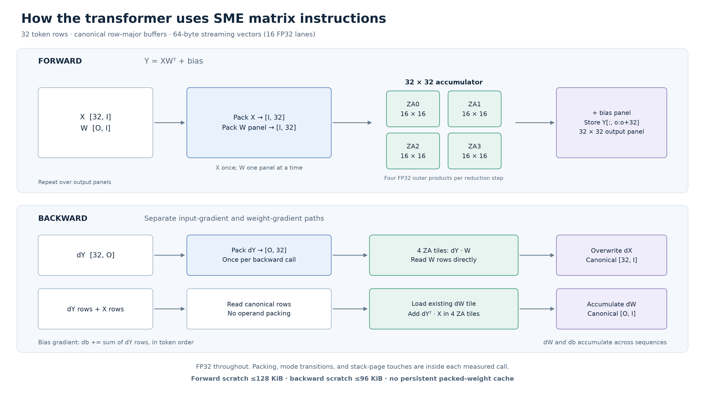
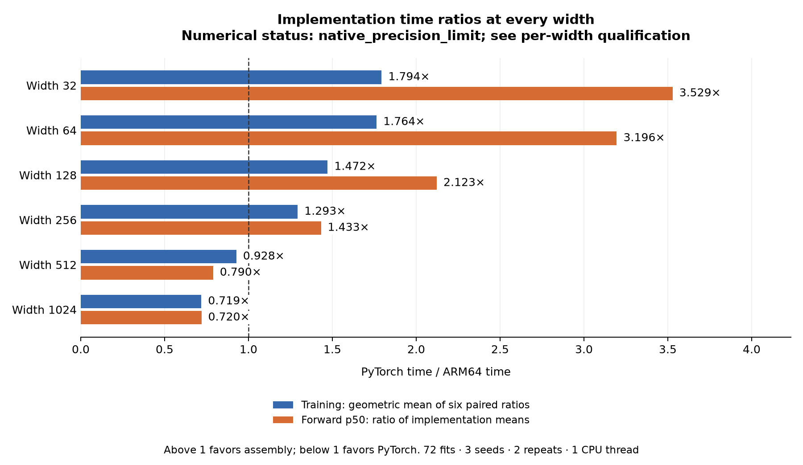

# ARM64 Transformer

**How much can a transformer gain when its computation is designed around the
machine that executes it?** This project implements a small language model's
complete forward pass, backward pass, and Adam optimizer in handwritten ARM64
CPU assembly and custom Metal GPU kernels. Standard PyTorch and MLX provide
comparison implementations.

## The idea: make the hardware shape the computation

Transformer equations leave many engineering decisions open. Which outputs
share an input load? Where do partial sums live? Which threads cooperate? When
do values round to 32 bits? Those choices determine how much useful work a
processor performs and whether the answer remains accurate.

On the CPU, tiles of outputs share packed operands and accumulate in Arm's
**Scalable Matrix Extension (SME)** registers. NEON vector instructions handle
attention, normalization, exponentials, and the remaining arithmetic. The
native numerical path calls no BLAS, Accelerate, PyTorch, or external math
library. Backward and the optimizer receive the same attention as inference.

On the Apple GPU, the useful unit of work becomes a cooperating group of
threads. Our **Metal** implementation assigns matrix tiles, rows, and reductions
to those groups, reuses data in registers and threadgroup memory, and combines
operations to avoid unnecessary launches and global-memory reads. The model
keeps the same equations and FP32 stored state.

LayerNorm gives a concrete example. The reference assigns an entire row to one
GPU thread, which walks its channels serially. The replacement assigns a row to
a cooperating group: adjacent lanes process adjacent channels, then combine
their partial sums in a fixed, compensated reduction. The equations stay the
same while much more work can proceed in parallel.

| Computation | Hardware mapping |
|---|---|
| Dense forward, input gradients, weight gradients | Cooperative FP32 SIMD-group matrix operations; guarded tiles and explicit output ownership |
| LayerNorm and shared gradients | Parallel row/channel reductions with fixed trees and compensated sums |
| Short-context attention | Fused score formation, centering, softmax, and value mixing; fused parts of backward |
| Repeated-token embedding gradients | Stable integer grouping followed by a deterministic floating-point reduction |
| Elementwise work | Selected matrix-output activation/residual fusion and Adam/finite-scan fusion |
| Execution | Persistent pipelines and buffers, resident inputs, separate training and batch-one policies |

A faster primitive is only a candidate. We select schedules by the complete
training step or synchronized forward pass, after checking numerical accuracy.
A wide matrix tile can help a training batch and hurt a single-context request.
The [GPU kernel notes](native/metal/OPTIMIZED-KERNELS.md) describe the layouts,
barriers, precision, and retained reference paths.

## Precision is part of the architecture

Attention can depend on the tiny difference between two large query–key scores.
Subtracting the maximum before softmax prevents overflow, but cannot recover
bits already lost while forming those scores. Normalization and backward
reductions can expose similar cancellation.

The CPU uses selective FP64 intermediates for sensitive wide attention. The GPU
uses **two-float arithmetic**: a pair of FP32 values carries a main value and its
rounding residual through important contractions. Scores retain that information
through centering and softmax; normalization and sensitive QKV paths also use
compensated arithmetic. Parameters, saved activations, probabilities, gradients,
and Adam moments remain FP32. Extra intermediate precision has a measurable cost.

Accuracy, exact repeatability, and predictive quality are tested separately.
Small aggregate loss differences do not waive a failed logit or gradient check.
The [CPU numerical investigation](experiments/numerics-v6/README.md) records
historical failures that remain unresolved.

## The model and matched workload

One causal decoder block, four heads, context 32, feed-forward width 2W with
ReLU, three LayerNorms, and an ASCII-128 vocabulary predict the next character.
Widths range from 32 to 1024. Pinned Tiny Shakespeare partitions contain 65,536
training targets and 8,192 targets each for validation and test.

The formal workload uses batch 16, eight epochs, and 1,024 Adam updates, with
identical initialization bytes and schedules for seeds 42, 43, and 44. Each seed
has two timing repeats. Lowest own-engine validation NLL selects the checkpoint;
the earliest epoch wins ties. This is a reused engineering benchmark with a
fixed training budget, not a fresh generalization assessment or convergence study.

## GPU engineering results

The optimized Metal policies improve every tested width against the retained
Metal reference. These are **training-partition development measurements** of a
complete B16/T32 training step and a synchronized B1/T32 forward pass.

| Width | Training step, reference → selected | Step gain | Forward, reference → selected | Forward gain |
|---:|---:|---:|---:|---:|
| 32 | 1.158 → 0.480 ms | 2.40× | 0.227 → 0.189 ms | 1.22× |
| 64 | 1.375 → 0.588 ms | 2.34× | 0.269 → 0.171 ms | 1.56× |
| 128 | 1.775 → 0.853 ms | 2.08× | 0.362 → 0.193 ms | 1.86× |
| 256 | 3.194 → 1.590 ms | 2.00× | 0.608 → 0.249 ms | 2.49× |
| 512 | 8.251 → 4.321 ms | 1.91× | 1.005 → 0.362 ms | 2.76× |
| 1024 | 25.079 → 13.641 ms | 1.84× | 2.062 → 0.818 ms | 2.51× |

Times are sample medians; gains use the median of five paired block ratios.
The final comparisons use fresh instances with matching owned allocations and
initial state. Training includes backward, Adam, finite checks, and scalar-loss
completion. These timings exclude full-fit validation and checkpoint work.
The selected configurations pass the development stress and full-gradient
checks, plus exact replay across two fresh processes per width. Parameters,
optimizer moments, and checkpoint predictions repeat exactly. Their schedules are retained in the
[versioned policy file](experiments/gpu-v2/policies/selected.json).

At width 1024, cooperative normalization and shared reductions reduce their
isolated GPU stage cost from 3.478 to 0.301 ms during training. The protected QKV
contractions remain a major cost. Its batch-one policy changes only the
normalization reductions, yet improves forward latency by 2.51×. The full report
separates instrumented profiles from the production latencies above.

The formal five-engine CPU/GPU study remains **blocked: 0 of 180 planned fits**.
Both standard PyTorch MPS and compiled MLX fail the required byte-exact training
repeatability checks at every width. The first divergent full-gradient case
examined at each width localizes the initial difference to token embeddings;
subsequent updates propagate it into parameters, optimizer moments, and predictions.
All executed baseline FP64 accuracy comparisons pass, but MLX also fails T3
full-model/training cases at widths 256–1024. Those missing results remain errors.

The baseline algorithms, gate, and tolerances remain unchanged. No replacement
embedding implementation or descriptive formal-campaign waiver was introduced.
The reserved admission stream remains unopened. There are no new qualified
CPU/GPU crossover, Metal/framework speedup, or model-quality results.
The [GPU v2 report](experiments/gpu-v2/README.md) separates development measurements,
failed attempts, baseline limitations, and work that remains unexecuted.

## Retained CPU results

The completed CPU v6 study contains 72 fits. Widths **32–256 satisfy both
implementations' FP64 accuracy requirements**: native training is **1.29–1.79×
faster**, and full-context forward inference is **1.43–3.53× faster** than eager
PyTorch on one CPU compute thread. At width 32, forward latency is 15.1 µs versus
53.2 µs.

Widths 512 and 1024 are not fully numerically qualified and favor PyTorch on time.
The retained audit finds native logit failures at width 1024, and PyTorch failures
at widths 512 and 1024. These historical limitations have not been relabeled as
resolved. See the [full CPU report](experiments/width-sweep-v6/README.md) for
learning curves, memory, paired timings, and prediction-level effects. These
historical CPU numbers are separate from the new GPU development measurements.

## Reproduce and inspect

The [GPU v2 protocol](experiments/PROTOCOL-gpu-v2.md) fixes the workload, candidate
search, numerical gates, and measurement boundaries. The
[formal-study guide](experiments/gpu-v2/FORMAL-STUDY.md) documents the authenticated
runner and full-checkpoint auditor. Its 180-cell plan is committed; an ordinary
flag or a self-reported pass cannot enable formal measurement.

The [release guide](experiments/gpu-v2/RELEASE-TOOLS.md) describes report generation,
complete evidence retention, and split-archive verification. The
[GPU v2 evidence release](https://github.com/logannye/arm64-transformer/releases/tag/transformer-gpu-engineering-v2)
contains raw states, predictions, candidate ledgers, timing samples, failures,
runtime identities, source snapshots, and verification tools. The
[CPU reproduction guide](docs/REPRODUCE.md) and [native ABI](native/ABI.md) cover the
assembly implementation. Historical
[CPU v6](https://github.com/logannye/arm64-transformer/releases/tag/transformer-attention-precision-v6)
and [GPU development v1](https://github.com/logannye/arm64-transformer/releases/tag/transformer-gpu-development-v1)
releases remain unchanged.

The measurements concern short-context, full-context forward computation and a
small training workload. They do not establish long-context, cached decoding,
energy, production-serving, or larger-data performance.
