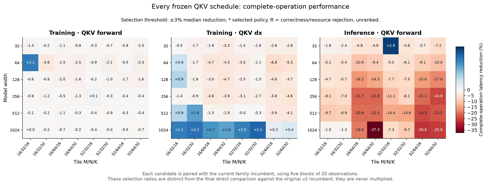

# ARM64 Transformer

**A transformer’s equations do not determine how efficiently a machine executes
it.** This project asks what changes when we design the computation around the
hardware: handwritten ARM64 CPU assembly, custom Metal GPU kernels, and
PyTorch and MLX comparison implementations. Each engine includes forward,
backward and Adam. Numerical accuracy and exact repeatability are explicit gates.

## Let the hardware shape the computation

A matrix multiplication leaves crucial choices open: which outputs share a
load, where partial sums live, which threads cooperate, and when values round.
Those choices can matter as much as the number of operations.

On the CPU, packed matrix tiles feed Arm’s **Scalable Matrix Extension (SME)**
registers. NEON vectors handle attention, normalization, exponentials and the
remaining arithmetic. Backward and optimizer kernels receive the same attention
as inference. The native numerical path calls no BLAS, Accelerate, PyTorch or
external math library.

On the Apple GPU, cooperating threads share matrix tiles and reductions. The
implementation reuses operands in registers and threadgroup memory, gives each
output a defined owner, and fuses suitable operations to reduce launches and
intermediate memory traffic. Parameters and stored numerical state remain FP32.

| Work | Low-level design |
|---|---|
| Dense forward and gradients | Cooperative FP32 SIMD-group matrix operations, guarded tiles and reusable operand loads |
| Normalization | Adjacent channels assigned to adjacent lanes; fixed reduction trees with compensated sums |
| Short-context attention | Fused score formation, centering, softmax and value mixing, plus fused parts of backward |
| Shared embedding gradients | Stable token grouping and deterministic sums instead of unordered floating-point atomics |
| Elementwise operations | Selected activation/residual output fusion and Adam/finite-scan fusion |
| Execution | Persistent pipelines and buffers, resident inputs, separate training and batch-one policies |

LayerNorm illustrates the change: the reference assigns a whole row to one GPU
thread; the replacement distributes its channels across cooperating lanes.
Parallel partial sums then combine in a fixed order. The equations remain the
same, while the work fits the GPU’s execution model.

We choose a kernel by its effect on a complete training step or synchronized
forward pass. A faster matrix primitive can still lose overall through launch
cost, extra storage or too few independent threadgroups. See the
[GPU kernel notes](native/metal/OPTIMIZED-KERNELS.md).

## Precision is also an architectural choice

Attention can depend on a tiny difference between large query–key scores.
Subtracting the maximum before softmax prevents overflow, but cannot recover
bits already lost while forming the scores.

The CPU uses selective FP64 intermediates for sensitive wide attention. The GPU
uses **two-float arithmetic**: a main FP32 value and its rounding residual carry
additional precision through important contractions. Score centering and
softmax preserve that information; normalization and sensitive QKV operations
also use compensated arithmetic. Stored activations, probabilities, gradients
and Adam moments remain FP32.

These protections cost time. Our latest QKV kernels share tiled operands while
each output visits products in exactly the reference order. This preserves
output bytes, but increases live accumulators and barrier coordination. The
[QKV design](native/metal/QKV-KERNELS.md) explains the ownership and guarded tails.
Accuracy, exact replay and predictive quality are checked separately; a good
average loss cannot waive a failed gradient or logit check.

## A fixed, matched workload

The model has one causal decoder block, four heads, context 32, FFN width 2W,
ReLU, three LayerNorms and an ASCII-128 vocabulary. Widths span 32–1024. Pinned
Tiny Shakespeare partitions contain 65,536 training targets and 8,192 targets
each for validation and test.

The formal design fixes batch 16, eight epochs, 1,024 Adam updates, seeds 42–44
and two timing repeats per seed. Each engine selects its lowest-validation-NLL
checkpoint, with earliest-epoch ties. This is a reused engineering benchmark
with a fixed budget, not a fresh generalization or convergence study.

## Results: gains, limits and unsuccessful optimizations

### Custom GPU kernels

The retained GPU v2 development experiment improved individual widths by
**1.84–2.40× for a training step** and **1.22–2.76× for forward inference** against
the original Metal reference. At width 1024, training fell from 25.079 to
13.641 ms; forward fell from 2.062 to 0.818 ms. Training-step measurements include
backward, Adam, finite checks and completion, but exclude full-fit validation
and checkpoint work. [Results and figures](experiments/gpu-v2/README.md).

The latest precision-protected QKV search froze 144 candidates. **Every
candidate passed correctness; none met the 3% complete-operation adoption
threshold.** Training and inference were selected separately, and every width
retains its prior kernel policy.

| Width | Best training candidate | Best batch-one candidate | Decision |
|---:|---:|---:|---|
| 512 | 1.63% lower latency | 8.90% higher latency | Retain incumbent |
| 1024 | 2.41% lower latency | 1.03% higher latency | Retain incumbent |

Final FP64 checks and exact replay pass in two fresh processes per width,
including gradients, six-step parameters/moments and checkpoint predictions.
Extra accumulators and fewer independent groups are plausible tradeoffs;
occupancy and register pressure were not measured. The
[QKV report](experiments/gpu-v3-qkv/README.md) retains every candidate and failure
record. Small final differences around 1× compare unchanged selected policies
and are not a new speedup.

### Framework integration

We repaired deterministic embedding backward inside MPS and MLX, MLX’s
short-query attention-backward dispatch, and its FP32 head-dimension-192
attention schedule. Stable integer grouping defines the reduction order;
correct dispatch preserves the saved state backward needs.

Patched **MLX Release builds** pass both GPU integration suites and full-model
checks in both shader modes. Per mode, 36 fresh-process pairs replay six training
steps exactly, and 18 shapes pass independent FP64 forward and all-gradient
checks. Release describes optimized compiler settings, not a supported package.

A matched operator experiment completed **1,104 workers**. Patched operators
qualify in all **328 comparisons**; 180 have qualified latency ratios. The other
148 retain baseline repeatability or runtime failures, so their ratios are
suppressed. Deterministic reductions can cost latency; there is no pooled
speedup or whole-transformer performance claim.

Patched **PyTorch MPS** passes 79 focused upstream tests, 4,320 embedding
checks, and matched-transformer checks across 18 shapes and 36 workers,
including dual-FP64 accuracy and exact fresh-process replay. Its broad suite
still records **25 failures and two errors across 10,353 tests**. All 27 failing
IDs also recur in isolated fresh processes.

A separately built, audited pristine/patched pair reproduces all 27 failures
in both versions, with matching failure kinds, source-normalized assertion
locations and all 81 recorded-state comparisons. This establishes reproduction
within that matched pair. It does not identify a shared numerical cause or turn
the original broad suite into a pass.

The [integration report](experiments/upstream-integration-v2/README.md) explains
the fixes, numerical margins, operator figures, broad-suite controls and evidence
limits. These development checks do not qualify a supported framework release.

### Retained CPU study

The CPU v6 study contains 72 fits. Widths **32–256 pass both implementations’
FP64 accuracy requirements**: native training is **1.29–1.79× faster**, and
full-context forward inference is **1.43–3.53× faster** than eager PyTorch on one
CPU compute thread. At width 32, forward takes 15.1 µs versus 53.2 µs.

Widths 512 and 1024 favor PyTorch on time and are not fully numerically qualified:
the retained audit finds native failures at width 1024 and PyTorch failures at
both widths. These limitations remain unresolved. The
[CPU report](experiments/width-sweep-v6/README.md) retains learning curves,
quality, memory and prediction-level errors. Historical CPU measurements are
separate from the new GPU development experiments.

## Completing the CPU/GPU comparison independently

The [current study](experiments/gpu-v4-owned/README.md) uses pinned,
**project-maintained full-source PyTorch and MLX builds**. We can repair and
validate those frameworks ourselves, without an upstream submission or release.
The comparison will name the patched baselines explicitly. Accuracy, exact
training repeatability, the matched workload and the full checkpoint audit
remain required.

The first combined-runtime model check passes at all six widths: 36 fresh
processes reproduce initial logits, loss and every gradient within the frozen
FP64 limits, and replay six training updates and checkpoint reloads exactly.
An independent audit verifies all 216 saved array archives. These are short
**B3/T3 development checks**, not timing results or full-workload qualification.
See the [model report](experiments/gpu-v4-owned/model-report-v2/README.md).

We also isolated two broader MPS problems. Strided matrix outputs can overwrite
guards; a contiguous GPU temporary restores correct values and intact guards.
Some Conv3d layouts fail in the selected MPP path while the existing SIMD path
passes. A separate FP16 indexing diagnostic exposes accumulation-order rounding
differences. Matching CPU order and improving FP64 accuracy are distinct goals.
The [diagnostics and repair notes](integration/gpu-owned/MPS-REPAIR-NOTES.md)
retain raw evidence and distinguish source candidates from validated fixes.

**The new study is still at 0 of 180 fits.** The retained broad MPS failures
remain blocking. Rebuilt frameworks must pass integration and full-workload
checks before identity-bound admission, fresh CPU anchors, formal fits and the
checkpoint audit. Reserved owned-study stream `20261108` remains unopened.

The original **standard-release** study is also unchanged at 0 of 180, with
stream `20261104` unopened. Installed MPS 2.14.1 and MLX 0.32.4 fail exact
training replay under the corrected controls; wide MLX attention-backward cases
also fail execution. Our maintained builds do not qualify those standard
packages. The [formal-study guide](experiments/gpu-v2/FORMAL-STUDY.md) and
[configuration corrections](experiments/gpu-compile-control-v1/CORRECTION.md)
retain that separate contract and its failures.

## Reproduce and inspect

Start with the [QKV reproduction guide](experiments/gpu-v3-qkv/REPRODUCE.md),
[framework integration guide](experiments/upstream-integration-v2/REPRODUCTION.md)
and [CPU guide](docs/REPRODUCE.md). Protocols fix fixtures, numerical limits,
selection rules and timing boundaries. Evidence packages retain source,
identities, raw states, timing samples and failures; see the linked guides for
archive reconstruction and verification.

The [framework integration release](https://github.com/logannye/arm64-transformer/releases/tag/transformer-upstream-integration-v2)
publishes 92 verified evidence assets. Its [publication catalog](experiments/upstream-integration-v2/PUBLICATION.md)
records the tested source, download hashes, archive layers and restoration paths.

Historical [CPU v6](https://github.com/logannye/arm64-transformer/releases/tag/transformer-attention-precision-v6),
[GPU v2](https://github.com/logannye/arm64-transformer/releases/tag/transformer-gpu-engineering-v2)
and [QKV v3](https://github.com/logannye/arm64-transformer/releases/tag/transformer-gpu-qkv-v3)
releases remain unchanged. These short-context experiments establish no
long-context, cached-decoding, energy, serving or larger-data performance claim.
