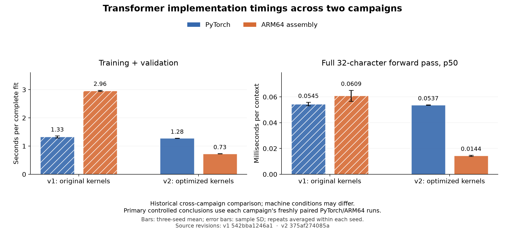
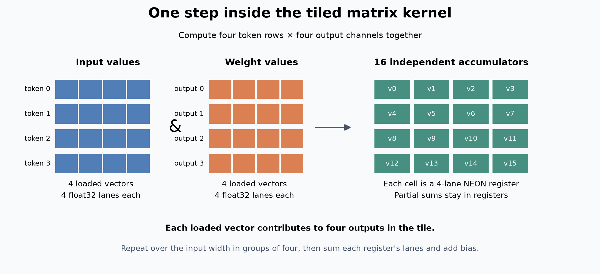
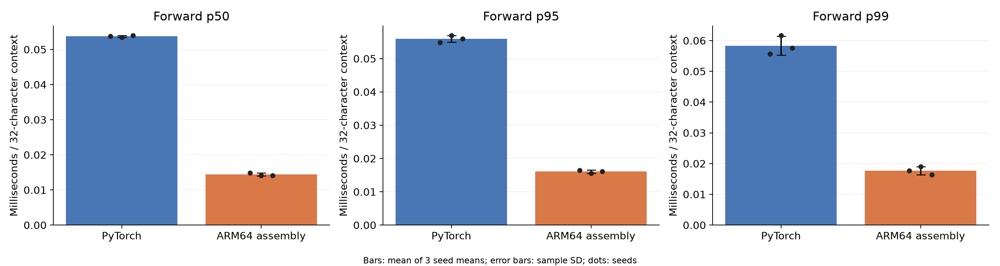
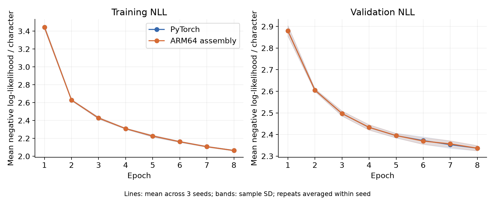

# ARM64 Transformer

[](https://github.com/logannye/arm64-transformer/actions/workflows/validate.yml)

A small language transformer, implemented in ordinary PyTorch and handwritten
Apple ARM64/NEON assembly. On this fixed CPU benchmark, the optimized native
implementation trained **1.751× faster**, with **3.730× faster full-context forward
passes** by mean p50 latency and similar observed prediction quality. Both versions
start from identical weights and learn from identical data and batch schedules.

The original native version took **2.23× as long as PyTorch to train**. V2 changes
how the processor executes the same learning algorithm. The original
[v1 results](experiments/matched-v1/README.md) remain preserved alongside the new
comparison.



This chart compares historical campaigns whose machine conditions may differ.
The v2 speed claims come from its own fresh, paired PyTorch/ARM64 runs.

## The engineering idea

A network's equations specify what must be calculated. They leave many choices
about which calculations run together, how often inputs are loaded, and where
partial results live. **This project reorganizes execution around the hardware
while checking that predictions, gradients, and optimizer updates still implement
the intended learning calculation.**

Writing assembly was the starting point. The gains came from changing the work
done between memory accesses and making more calculations available together.

**Tiled matrix kernels reuse inputs and keep partial sums in registers.** The
original forward kernel completed one output dot product at a time. V2 computes
four token rows and four output channels together. For each four-feature chunk,
eight vector loads feed sixteen `FMLA` instructions. Each instruction multiplies
and accumulates four float32 lanes, so a loaded input vector contributes to four
outputs and a loaded weight vector contributes to four token rows.

Sixteen vector registers hold the tile's partial dot products until the reduction
finishes. This reduces repeated loads and provides independent accumulator chains
that the processor can overlap, instead of making all progress wait on one sum.
Backward uses four-by-sixteen tiles for input and weight gradients. It loads an
existing weight-gradient tile once, accumulates contributions across token rows,
then writes the tile once. Input-gradient tiles likewise stay in registers across
the output-channel reduction. The original code repeatedly loaded and stored
those partial gradients inside the reduction loops.



**Attention uses the model's eight-value heads directly.** A query fits in two
NEON registers and stays there while the kernel visits its permitted keys.
Weighted values accumulate in another pair of vector registers. This replaces
scalar channel loops with four-lane operations while preserving causal masking.
Backward computes each dot product between the output gradient and a value
vector once. It stores these attention derivatives in a 32-float, **128-byte**
stack row, then reuses them for the softmax derivative and Q/K gradients. The
original implementation recomputed those dot products. Only one derivative row
is cached; this adds no quadratic backward buffer.

**Softmax evaluates four exponentials per call.** The original scalar routine
used a degree-12 polynomial for one value. V2 range-reduces four values together,
evaluates a degree-nine polynomial in two pairs of float64 lanes, and rounds back
to float32. Subtracting the row maximum before exponentiation preserves stable
softmax normalization. The ASCII-128 cross-entropy kernel also vectorizes its
maximum, exponential sum, and logit-gradient calculations. The shared `exp4`
helper benefits both attention and loss. Out-of-range or nonfinite inputs fall
back to the original scalar exponential behavior.

**LayerNorm vectorizes both statistics and derivatives.** The first pass computes
the mean and the second sums squared deviations from that mean, four values per
instruction. Keeping the centered two-pass variance avoids the cancellation risk
of subtracting squared means from mean squares. Normalization and backward's
reductions, input gradients, and accumulated scale/bias gradients also use vectors.
Finiteness checks use integer exponent-bit masks on four floats at once, followed
by a scalar remainder. Every original runtime check remains in place.

Specialization has explicit boundaries. Linear tiles require compatible row and
feature dimensions; attention specializes width 32, four heads, and up to 32
tokens. Other supported shapes use the original generic kernels. Partial softmax
vectors load only valid lanes and mask unused lanes. The original numerical
tolerances are unchanged, with additional tests for tails, extreme values,
causality and accumulated gradients. See the [kernel notes](native/kernel_notes.md).

These mechanisms are visible in the code. Their combined performance effect is
measured below; this experiment does not isolate each change in a separate
ablation. Native training still accumulates gradients one sequence at a time.
The tiles share work within a sequence; batch-wide native execution is not yet
implemented.

The [synthetic kernel diagnostic](experiments/matched-v2/kernel-diagnostics.json)
compares the preserved original and optimized native libraries:

| Native operation | Original (µs) | Optimized (µs) | Ratio |
|---|---:|---:|---:|
| QKV linear forward | 8.00 | 2.29 | 3.49× |
| Vocabulary-head linear backward | 19.91 | 5.51 | 3.61× |
| Causal attention forward | 23.63 | 5.52 | 4.28× |
| Causal attention backward | 20.23 | 3.36 | 6.02× |
| First LayerNorm forward | 2.03 | 0.60 | 3.36× |
| Cross-entropy plus logit gradient | 21.48 | 5.20 | 4.13× |

Times are medians of ten balanced-order blocks of 200 calls after warmups. Ratios
use unrounded values. Buffers are preallocated; Python/FFI overhead is included.
Backward reuses saved activations and accumulates gradients. On these synthetic
inputs, complete native forward changed **61.081 → 14.845 µs**, and backward
including loss changed **103.853 → 25.777 µs**. These diagnostics are distinct
from the full matched training study. Their times cannot be added to infer shares
of an internally profiled model execution.

## Model and measured results

The model has **17,952 parameters**: one causal decoder block, four heads, width
32, a width-64 ReLU feed-forward network, learned token/position embeddings,
LayerNorm, residual connections, and an untied output head. It predicts the next
ASCII character from a 32-character context. PyTorch uses built-in
scaled-dot-product attention, autograd, and `torch.optim.Adam`.

Pinned Tiny Shakespeare excerpts supply **65,536 training, 8,192 validation, and
8,192 test target characters** from disjoint contiguous partitions. V2 reuses
v1's fixed benchmark after its test results were inspected. This is an engineering
comparison on a known benchmark, without a fresh untouched test-set claim. Model,
data, optimizer, seeds and stopping rule remain fixed in the
[v2 protocol](experiments/PROTOCOL-v2.md).

The experiment ran twelve complete fits: three seeds, two repeats, and both
implementations, with eight epochs and one CPU compute thread on an Apple M4 Max.

| Measurement | PyTorch | ARM64 assembly |
|---|---:|---:|
| Training + validation | 1.280 ± 0.006 s | 0.731 ± 0.006 s |
| Full-context forward p50 | 0.0537 ± 0.0002 ms | 0.0144 ± 0.0004 ms |
| Peak process RSS through training | 277.35 ± 0.25 MiB | 2.33 ± 0.00 MiB |
| Test negative log-likelihood | 2.4585 ± 0.0292 | 2.4621 ± 0.0211 |
| Test perplexity | 11.691 ± 0.341 | 11.731 ± 0.246 |
| Next-character accuracy | 35.046% ± 0.532 pp | 35.042% ± 0.671 pp |

Values are mean ± sample SD across three seed means, after averaging timing
repeats within each seed. Training speedup is the geometric mean of six paired
time ratios. Forward speedup is the ratio of mean p50 values. Process RSS includes
the framework, runtime and data; both models have the same parameter count.



Forward timing covers a complete 32-character context with 20 warmups and 100
samples per run, excluding softmax, sampling and I/O. There is no KV cache, so
these measurements do not describe cached next-token generation.



Lower negative log-likelihood means more probability assigned to the correct
character; perplexity is its exponential. Both transformers improve on the
training-only unigram predictor's test NLL of **3.3623**. Mean native-minus-PyTorch
NLL was **+0.003609**, while top-one predictions disagreed on **8.610%** of
characters. Floating-point operation grouping can change training trajectories;
similar aggregate quality does not establish statistical equivalence.

## Correctness and retained evidence

The measured binary passed **688 numerical/runtime checks**, including parameter
gradients, Adam updates, finite differences, causality, partial batches, malformed
inputs, and vector boundary cases. The independent post-run audit passed
**3,399 checks** and recomputed all **98,304 retained test prediction rows** from
saved checkpoints. Selected-checkpoint validation loss matched selection history.
Within each implementation, repeat checkpoints, optimizer states, predictions,
and non-timing learning histories matched exactly.

Read the [complete v2 report](experiments/matched-v2/README.md),
[preflight](experiments/matched-v2/preflight.json), and
[audit](experiments/matched-v2/audit.json). The
[v2 release](https://github.com/logannye/arm64-transformer/releases/tag/matched-transformer-cpu-v2)
retains raw inputs, schedules, checkpoints, optimizer states, predictions, timings,
executable and measured source revision `375af274085af1c5b55e2f9be091749a7d863bcd`.
The [v1 release](https://github.com/logannye/arm64-transformer/releases/tag/matched-transformer-cpu-v1)
retains the original slower implementation and its evidence.

## Reproduce

Native execution requires an Apple silicon Mac and Xcode Command Line Tools.
The Python reference and mathematical tests also run on Linux. Use Python 3.12
and prebuilt dependencies; a compatible existing environment can be reused.

```sh
git clone https://github.com/logannye/arm64-transformer.git
cd arm64-transformer
python3.12 -m venv .venv
source .venv/bin/activate
python -m pip install --only-binary=:all: -e '.[dev,report]'
export OMP_NUM_THREADS=1 MKL_NUM_THREADS=1 OPENBLAS_NUM_THREADS=1
export VECLIB_MAXIMUM_THREADS=1 PYTHONHASHSEED=0
python -m transformer.fetch_data --output data/tinyshakespeare.txt
make -C native
python -m pytest -q
python -m transformer.validate --output results/preflight-v2.json \
  --runtime --work-dir results/smoke-v2
python -m transformer.prepare --source data/tinyshakespeare.txt --output results/inputs-v2
python -m transformer.run --inputs results/inputs-v2 --output results/matched-v2 \
  --preflight results/preflight-v2.json --protocol v2
python -m transformer.report --inputs results/inputs-v2 --results results/matched-v2 \
  --output results/report-v2
```

Measured source must be committed and clean, the Mac must use AC power, and
source/binaries must match the passing preflight. Outputs refuse overwrites.
The runner reverses implementation order between repeats and pauses 15 seconds
between sequential fits. CI runs synthetic validation rather than the full study.
[requirements-benchmark.txt](requirements-benchmark.txt) records measured package versions.

## Code map

| Path | Purpose |
|---|---|
| `transformer/reference.py`, `python_train.py` | Standard PyTorch model and runtime |
| `transformer/prepare.py` | Fixed splits, weights, schedules and hashes |
| `native/linear.S` | Tiled linear forward and backward |
| `native/attention.S`, `softmax.S`, `normalization.S` | Specialized vector kernels |
| `native/kernels.S` | Generic fallbacks, ReLU, Adam and scalar math |
| `native/model.S`, `runtime.S` | Complete model, training, files and measurements |
| `transformer/validate.py`, `audit.py` | Numerical gates and independent saved-output audit |
| `transformer/run.py`, `report.py` | Matched execution, provenance, statistics and charts |

All native numerical work and training control are handwritten assembly. macOS/libc
provides files, memory and clocks; no Torch, BLAS, Accelerate or compiled C numerical
implementation is linked. See the [ABI](native/ABI.md) and
[model diagram](docs/architecture.png).

The findings concern this small CPU workload. Larger models, GPUs, graph-compiled
PyTorch, energy use and production serving remain outside the measured scope.
