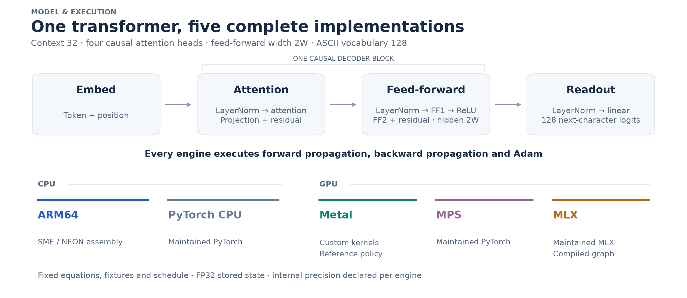
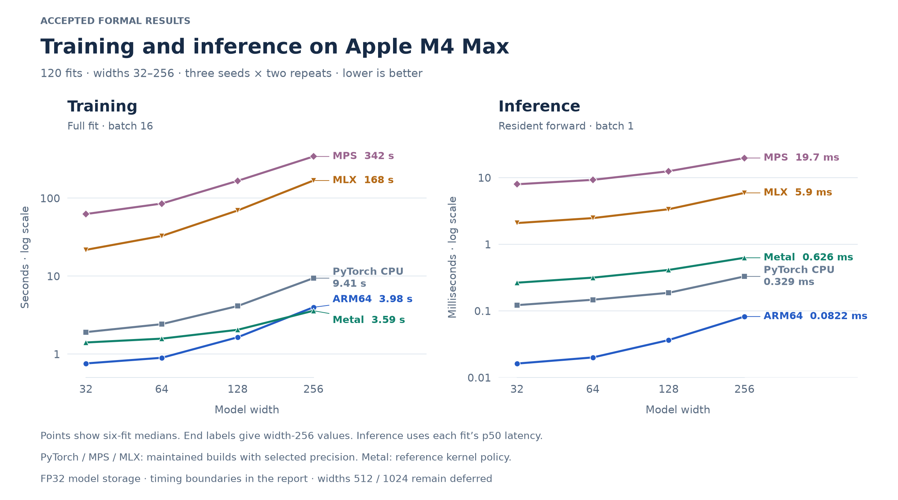
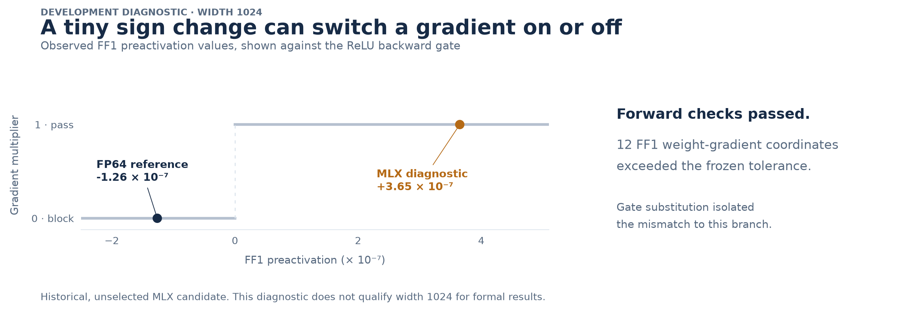

# ARM64 Transformer

**One small transformer, five implementations, and a question: how much does
execution design matter when the learning algorithm stays the same?** This
project builds a character-level language model in handwritten ARM64 CPU
assembly, custom Metal GPU kernels, and Python frameworks. Each implementation
trains the model end to end, including backward propagation and Adam updates.

We investigate speed, numerical accuracy and repeatability together. Memory
layout, parallel work, reduction order and arithmetic precision all affect the
cost of the same equations. The experiment asks which choices improve complete
training and inference, and which apparent optimizations fail under measurement.

## How it works

The model predicts the next ASCII character using one causal decoder block:
four attention heads, context length 32, a ReLU feed-forward layer with twice the
model width, three LayerNorms and a 128-character vocabulary. Every engine uses
the same equations, fixtures and training schedule.

On the CPU, packed matrix tiles feed Arm's **Scalable Matrix Extension (SME)**
registers, while NEON vectors handle attention, normalization and other
arithmetic. Reusing operands and keeping partial sums in registers reduces
memory traffic. The width-32 model uses NEON; larger models use SME where
supported. The native numerical path calls no BLAS, Accelerate or external math
library. See the [matrix dataflow](docs/sme-dataflow.png) for the detailed design.

The GPU investigations explore cooperative tiles, fixed reduction trees,
deterministic embedding gradients and operation fusion. The accepted Metal arm
uses the **reference kernel policy**; optimized-kernel development results are
reported separately below.

PyTorch CPU, PyTorch MPS and MLX use **project-maintained builds with selected
precision operators**. All model state is stored in FP32; intermediate arithmetic
is [declared per engine](experiments/gpu-v5-library-phase1/results/summary.json).
The frameworks also execute compiled native kernels, so this comparison measures
complete implementations rather than isolating Python-language overhead.

## The matched experiment

Pinned Tiny Shakespeare partitions contain 65,536 training targets and 8,192 each
for validation and test. Each fit uses batch 16, eight epochs and 1,024 Adam
updates. Three paired seeds (42–44) and two repeats give six fits per engine and
width. Each fit selects its lowest-validation-loss checkpoint, breaking ties by
the earliest epoch. This is a reused engineering benchmark with a fixed budget.

Qualification and admission precede fitting, and timed fits run serially.
Both the best and last checkpoint from every fit are replayed through all five
engines and checked against independent FP64 calculations, with frozen tolerances.
Same-engine repeatability and predictive quality are assessed separately.

## Accepted results

The first phase **passed all required gates and audits for 120 fits at widths
32, 64, 128 and 256** on an Apple M4 Max with 128 GiB memory, running macOS 26.2.
All **1,200 engine replays, 240 independent FP64 oracles, 240 checkpoint audits
and 60 exact repeat pairs** passed, covering 983,040 audited test-token predictions.

Each point is the median of six fits; both vertical axes are logarithmic.
Training includes forward, backward, Adam, finite checks, loss reads, validation,
checkpoint writes, packing, synchronization and bookkeeping. Inference measures
resident batch-one forward execution and completion, with 20 warmups and
100 samples per fit.
[Full results](experiments/gpu-v5-library-phase1/results/README.md) ·
[Numeric data](experiments/gpu-v5-library-phase1/results/measurements.csv) ·
[Vector figure](experiments/gpu-v5-library-phase1/results/performance.svg).

**The CPU gains survive complete training runs.** ARM64 trained **2.38–2.70×
faster** than the selected PyTorch CPU arm and delivered **3.99–7.52× faster
resident batch-one inference**. The median paired-seed speedups are:

| Width | ARM64 training speedup | ARM64 batch-one speedup |
|---:|---:|---:|
| 32 | 2.53× | 7.52× |
| 64 | 2.70× | 7.28× |
| 128 | 2.48× | 5.16× |
| 256 | 2.38× | 3.99× |

**The fastest engine depends on the workload.** ARM64 had the lowest median
training time at widths 32–128. Metal led at width 256: **3.593 s**, versus
**3.981 s** for ARM64. ARM64 had the lowest batch-one latency at every included
width. The selected MPS and MLX arms were slower than both CPU arms here; this
short-context experiment does not establish a general CPU-over-GPU advantage.

Test loss and accuracy vary across engines. Passing the numerical checks does
not imply identical training trajectories or identical final model quality.
[All 20 engine/width summaries](experiments/gpu-v5-library-phase1/results/README.md)
remain available alongside the timing results.

## What the investigations revealed

### Tiny rounding differences can change gradients

Attention can depend on small differences between large scores. Subtracting the
maximum before softmax cannot recover bits already lost while forming those
scores. ReLU adds another sensitivity: rounding across zero changes whether a
gradient passes through at all.

In one historical MLX development case, an FF1 preactivation was about
**+3.65 × 10⁻⁷**, versus **−1.26 × 10⁻⁷** in FP64. Logit and loss checks passed,
but 12 weight-gradient coordinates failed. A controlled gate substitution
isolated the mismatch to that branch.

Selective FP64 and compensated two-float arithmetic corrected specific failures
while retaining FP32 model storage. Their cost stays inside the timing boundary.
The [precision investigation](experiments/trained-precision-v1/STATUS.md) separates
passing development repairs from formal qualification: neither good average
loss nor passing initialization checks can replace trained-state gradient audits.

### Repeatability is an implementation property

Embedding backward combines many contributions to the same output. Floating-point
atomic updates can accumulate them in different orders. The framework repairs
use stable grouping and defined accumulation order; attention-dispatch fixes
also preserve the state backward needs. Determinism has an explicit computational
cost. The [integration report](experiments/upstream-integration-v2/README.md)
retains targeted successes, broad-suite failures and their controls.

### A plausible optimization still has to win overall

Separate Metal development experiments achieved **1.84–2.40× faster training
steps** and **1.22–2.76× faster forward passes** versus the original Metal
implementation. Parallel reductions, cooperative matrix tiles and selected
fusion improved that workload. These are development measurements, separate
from the reference-policy Metal arm in the accepted full-fit comparison.
[GPU results](experiments/gpu-v2/README.md).

A subsequent [144-candidate QKV search](experiments/gpu-v3-qkv/README.md) passed
correctness for every candidate, yet **none met the frozen 3% complete-operation
improvement threshold**. The incumbent kernels were retained. More operand reuse
did not reliably reduce the cost of the complete operation.

## Scope and remaining work

**Widths 512 and 1024, and their 60 fits, remain deferred. The original 180-fit
study is incomplete.** The [scope amendment](experiments/gpu-v5-library-phase1/AMENDMENT.md)
was approved after development and partial admission, before any formal fits.
Earlier wide-model failures, ordinary MLX diagnostic crashes and standard-release
repeatability failures remain outside this phase's acceptance.

There were no failed formal fits or final numerical audits in the accepted
phase. Two post-run execution failures were recovered with checkpoints and
failure evidence preserved; the [results report](experiments/gpu-v5-library-phase1/results/README.md#failures-retained)
records both. These measurements establish no long-context, cached-decoding,
energy, serving or larger-data performance claim.

## Explore and reproduce

- [Accepted report, scope and evidence identities](experiments/gpu-v5-library-phase1/results/README.md).
  Public summaries link to retained evidence by hash; the full current raw
  campaign archive remains local.
- [CPU implementation and reproduction](docs/REPRODUCE.md),
  [GPU kernel design](native/metal/OPTIMIZED-KERNELS.md) and
  [QKV reproduction](experiments/gpu-v3-qkv/REPRODUCE.md).
- [Historical CPU study](experiments/width-sweep-v6/README.md),
  [framework reproduction](experiments/upstream-integration-v2/REPRODUCTION.md)
  and [public evidence catalog](experiments/upstream-integration-v2/PUBLICATION.md).
- [Figure sources and vector downloads](docs/figures/README.md).
  The visuals read retained summaries without rerunning the experiment.
