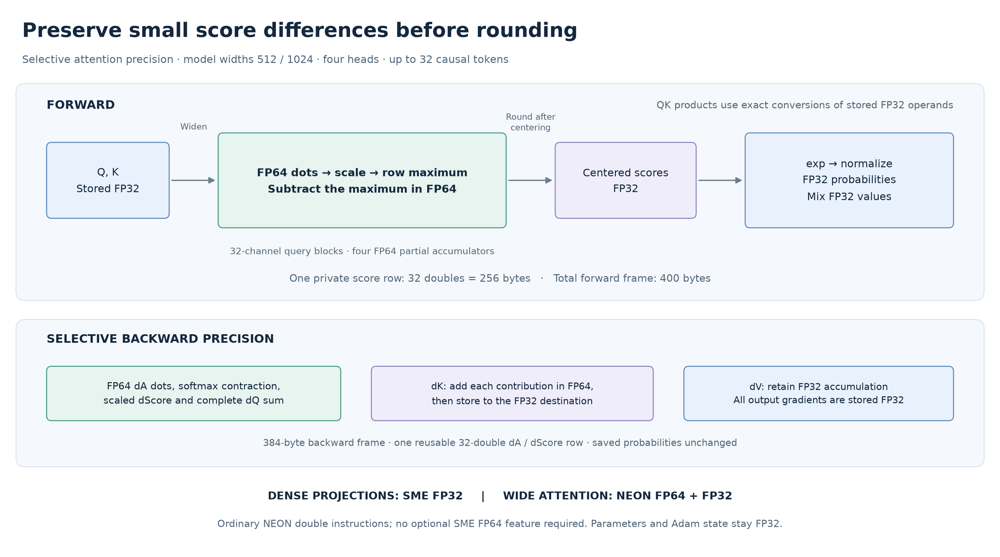
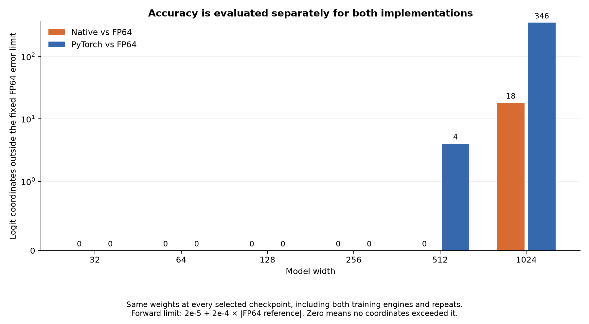

# ARM64 Transformer

A small language model with complete training and forward inference in **PyTorch
and handwritten Apple ARM64 assembly**. The experiment asks how much we can gain
by designing a transformer's computation around the processor's instructions,
registers, memory, and numerical precision.

## The idea: design the computation around the hardware

A mathematical expression leaves important choices open: which values stay in
registers, how many outputs share each memory load, how partial sums are combined,
and where rounding occurs. These choices determine both efficiency and accuracy.
PyTorch already runs optimized native kernels on the same ARM CPU; our work
changes how the computation is arranged.

Dense layers compute tiles of outputs together, reusing inputs and weights while
keeping partial sums in registers. Arm's **Scalable Matrix Extension (SME)**
accumulates outer products in matrix registers. Packing puts operands in the layout
those instructions consume, and backward uses the same hardware for input and
weight gradients.

NEON vector instructions handle causal attention, two-pass normalization, exponentials, and
much of the remaining arithmetic. Loss, gradients, Adam, and the training loop
are also handwritten. The native numerical path calls no BLAS, Accelerate,
PyTorch, or external math library. Four shorter accumulation chains improve
wide dense-layer accuracy at the cost of additional operand loads. The
[kernel notes](native/kernel_notes.md) explain the implementation and tradeoffs.

## Precision is part of the design

Attention exposed a weakness that ordinary random-input tests missed. Two
query–key scores can both be large while their small **difference** determines
how probability is divided between the keys. Subtracting the maximum before
softmax prevents overflow, but cannot recover bits lost while forming the scores.

At widths 512 and 1024, the new kernel widens stored 32-bit floating-point
(FP32) queries and keys **before multiplication**, retaining 64-bit (FP64)
precision through the dot products, scaling, maximum
selection and subtraction, then rounds the centered scores to FP32. Existing
exponentials, probabilities and value mixing follow. Ordinary NEON double
instructions provide this precision; optional SME FP64 support is unnecessary.

Backward needed the same care. A forward-only fix exposed gradient cancellation
under stress. The final implementation also improves attention-weight gradients,
the softmax derivative, and query-gradient accumulation. Key contributions are
added in FP64 before FP32 storage; value gradients retain FP32 accumulation.
Parameters, stored activations, gradients and Adam state remain FP32. Extra
precision has a cost, which we measure in the complete model.

## The matched experiment

Each model has one causal decoder block, four heads, a feed-forward layer twice
its width, learned embeddings, and an ASCII-128 output head. It predicts the next
character from a 32-character context. Both engines receive identical initial
weights, token rows and schedules within each seed and width.

Pinned Tiny Shakespeare excerpts provide 65,536 training targets and 8,192 in each
disjoint validation/test partition. Every fit uses **eight epochs, batch 16, and
1,024 Adam updates**; lowest validation loss selects the checkpoint. Six widths,
three seeds, two timing repeats and both engines produce **72 fits on an Apple
M4 Max, with one CPU compute thread**.

## Results

Widths **32–256 meet both engines' FP64 accuracy requirements**. Native training
is **1.29–1.79× faster**, and full-context forward inference **1.43–3.53× faster**.
The wider models expose precision limits and favor PyTorch on time.

| Width | Parameters | Training ratio | Forward ratio | FP64 accuracy: native / PyTorch |
|---:|---:|---:|---:|---|
| 32 | 17,952 | 1.79× | 3.53× | Pass / Pass |
| 64 | 52,160 | 1.76× | 3.20× | Pass / Pass |
| 128 | 169,728 | 1.47× | 2.12× | Pass / Pass |
| 256 | 601,472 | 1.29× | 1.43× | Pass / Pass |
| 512 | 2,251,392 | 0.93× | 0.79× | Pass / Fail |
| 1024 | 8,696,960 | 0.72× | 0.72× | Fail / Fail |

Ratios are **PyTorch time / native time**, so above one favors native. Training
uses the geometric mean of six paired ratios; forward uses mean per-run median
latencies. Widths 512 and 1024 are **not fully numerically qualified**; their
timings remain descriptive. Repeats are averaged within seed before reporting
variation across three seeds.

At width 32, native forward latency is **15.1 µs versus 53.2 µs**. At width 1024,
native training takes **81.6 versus 58.7 seconds**, and forward takes **1.476
versus 1.062 ms**. Native processes sequences individually during training while
PyTorch batches them. Selective precision adds work; historical timing comparisons
cannot isolate its cost from differences between campaigns.

Native peak resident memory (RSS) through training is lower at every width: **14.6 versus 314.3 MiB** at
width 256, for example. RSS includes runtime and data, not just model allocations.
Larger models also fail to improve this fixed-budget language-model result: mean
test negative log-likelihood (NLL) is about **2.386 at width 128**, versus **2.73–2.74
at width 1024**. This does not establish convergence or an optimal model size.

Training timing includes validation, finite checks and checkpoint/history work.
Forward timing covers a complete batch-one context, including attention softmax;
it excludes output-probability softmax, sampling and I/O. It is not cached token
generation. The [full report](experiments/width-sweep-v6/README.md) includes
latency distributions, learning curves, memory and per-seed results.

## What the numerical audit found

Both engines evaluate every selected checkpoint from both training paths on all
validation/test rows. Independent NumPy FP64 equations evaluate the exact saved
FP32 parameters; PyTorch FP64 cross-checks the first and last sequence of each
partition. Originating predictions and repeated training states must replay
exactly. Accuracy uses the unchanged forward tolerances against FP64:
`abs(error) <= 2e-5 + 2e-4*abs(FP64 reference)`.

All **25,076 admission checks** and **58,462 evidence-integrity checks** passed.
The separate numerical audit retains **147,600 comparisons**, including failures.
After collapsing exact timing repeats, native exceeds the logit limit at **nine
coordinates across eight sequences**, all at width 1024. PyTorch exceeds it at
**two coordinates at width 512 and 173 at width 1024**. These counts include
both checkpoint origins and validation/test data.

Native changes **no highest-probability characters** against FP64 across 589,824
unique checkpoint/token evaluations; PyTorch changes two. All mean-NLL accuracy
checks pass. These small prediction effects do not waive the logit failures:
the overall result remains **`native_precision_limit`**.

The change eliminates the FP64 failures in the 25-case regression replay,
while the new checkpoint audit exposes further work. On all eight native-failing sequence comparisons,
attention passes when given identical Q/K/V inputs. Controlled FP64 replays
trace most remaining error to normalization and QKV arithmetic upstream of
attention. Each primitive can pass its local test while accumulated error still
breaks the model-level requirement. The [numerical investigation](experiments/numerics-v6/README.md)
records these diagnostic experiments, unfavorable results and provenance limits.
No thresholds or kernels were changed after formal measurement began.

## Extending the idea to the Apple GPU

The GPU implementation provides complete handwritten **Metal** forward,
backward and Adam kernels, alongside standard **PyTorch MPS** and compiled
**MLX** baselines. All three retain the same model equations and FP32 stored
state. Metal uses batch-wide matrix tiles, deterministic embedding reductions,
and selective two-float arithmetic where ordinary FP32 accumulation loses
important differences. This provides extra intermediate precision on a GPU
without native FP64 arithmetic.

The custom path passes its development stress inventory at all six widths,
including attention, normalization and QKV gradients. Tiny training-only runs
also pass independent FP64 checks. **This phase closes at the strict repeatability
gate:** standard MPS and compiled MLX fail exact training repeats in the retained
development runs. All **108 planned formal fits remain blocked and unrun**.
The gate and tolerances stay unchanged; there is no GPU speedup claim. The
[development report](experiments/gpu-development-v1/README.md) explains the completed
implementation, retained failures and final outcome. The CPU results above remain
unchanged.

## Reproduce and inspect

See the [frozen protocol](experiments/PROTOCOL-v6.md),
[reproduction guide](docs/REPRODUCE.md), and [native interface](native/ABI.md).
The [verified v6 evidence release](https://github.com/logannye/arm64-transformer/releases/tag/transformer-attention-precision-v6)
contains exact source, binaries, inputs, checkpoints, optimizer states,
predictions, timings and complete audits. The earlier
[failed wide-model outcome](experiments/width-sweep-v5-outcome/README.md) remains
unchanged; this new FP64 contract does not retroactively pass its FP32 comparison.

This is a reused, short-context CPU engineering benchmark against eager PyTorch.
It does not establish fresh test-set generalization, GPU, graph-compiled PyTorch,
long-context, energy, cached-decoding or production-serving performance.
