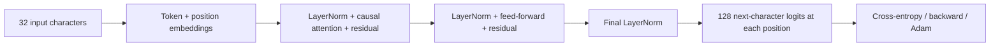
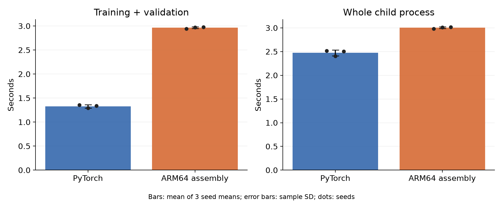

# ARM64 Transformer

[](https://github.com/logannye/arm64-transformer/actions/workflows/validate.yml)

One small language transformer, implemented twice: ordinary PyTorch and
handwritten Apple ARM64/NEON assembly. Both predict the next character from the
same text, start from identical weights, and learn from identical batch schedules.
The experiment measures how implementation changes training time, inference
latency, process memory and held-out prediction quality.

The native executable performs the complete forward pass, backpropagation, Adam
updates, batching, checkpoint selection and evaluation in assembly. It calls
macOS/libc for files, memory and clocks. Python prepares fixed inputs, runs the
comparison, and independently audits saved outputs. No Torch, BLAS, Accelerate,
or compiled C numerical implementation is linked into the native executable.

This follows the earlier
[CNN comparison](https://github.com/logannye/low-latency-neural-decoding/blob/main/CNN_EXPERIMENT.md).
The transformer is a separate experiment with its own source and evidence.

## Model and task

The model has **17,952 parameters**: learned embeddings, one causal attention
block, four heads, width 32, a width-64 ReLU feed-forward network, three LayerNorms,
residual connections and an untied output head. Context is 32 characters and the
vocabulary is fixed ASCII-128. PyTorch uses its built-in scaled-dot-product
attention, standard batched tensors, autograd, and `torch.optim.Adam`.



The pinned Tiny Shakespeare source is divided into disjoint contiguous train,
validation and test partitions before selecting modest excerpts. The experiment
uses **65,536 training, 8,192 validation and 8,192 test target characters**. Context
resets every 32 characters and never crosses a split boundary. The full data,
timing and statistical contract is in [the protocol](experiments/PROTOCOL.md).

## Measured comparison

The completed 12-run experiment found that **ARM64 training took 2.23× as long
as PyTorch**. Full-context forward latency was also slightly higher. The native
process used substantially less resident memory. Both models learned useful
next-character predictions, with similar observed held-out loss across three seeds.

| Measurement | PyTorch | ARM64 assembly |
|---|---:|---:|
| Test negative log-likelihood | 2.4585 ± 0.0292 | 2.4601 ± 0.0189 |
| Test perplexity | 11.691 ± 0.341 | 11.707 ± 0.221 |
| Next-character accuracy | 35.046% ± 0.532 pp | 34.981% ± 0.092 pp |
| Training + validation | 1.328 ± 0.034 s | 2.964 ± 0.018 s |
| Full-context forward p50 | 0.0545 ± 0.0013 ms | 0.0609 ± 0.0043 ms |
| Peak process RSS through training | 276.64 ± 0.44 MiB | 2.33 ± 0.00 MiB |

Values are mean ± sample SD of three seed means, with two timing repeats averaged
within each seed. Measured on one Apple M4 Max, CPU float32, one compute thread.
The primary training ratio is the geometric mean of six paired runs. RSS includes
the framework, runtime and data; it is not the model's memory footprint. Forward
timing covers a complete 32-character context and excludes softmax/sampling/I/O.



All within-implementation repeated numerical outputs matched exactly. Across
implementations, mean test NLL differed by +0.001617 and top-one predictions
disagreed on 8.850% of characters. Similar aggregate quality does not establish
statistical equivalence or bitwise-identical learning trajectories.

The native implementation processes sequences individually and accumulates batch
gradients; PyTorch uses batched operations and optimized scaled-dot-product
attention. That is an implementation difference this experiment measures, not a
profile-based attribution of the performance gap. This version establishes a
verified baseline for future kernel/batching improvements.

Read [the complete results and charts](experiments/matched-v1/README.md),
[all 3,395 post-run audit checks](experiments/matched-v1/audit.json), and
[the 254-check numerical/runtime preflight](experiments/matched-v1/preflight.json).
The audit independently recomputed all 98,304 retained test prediction rows.
The [release](https://github.com/logannye/arm64-transformer/releases/tag/matched-transformer-cpu-v1)
preserves raw data, schedules, checkpoints, optimizer states, predictions, timing
samples, executable and the measured source snapshot.

## Reproduce

Native execution requires an Apple silicon Mac and Xcode Command Line Tools.
The Python reference and mathematical tests also run on Linux. Use Python 3.12
and prebuilt packages; an existing compatible environment can be reused.

```sh
git clone https://github.com/logannye/arm64-transformer.git
cd arm64-transformer
python3.12 -m venv .venv
source .venv/bin/activate
python -m pip install --only-binary=:all: -e '.[dev,report]'
export OMP_NUM_THREADS=1 MKL_NUM_THREADS=1 OPENBLAS_NUM_THREADS=1
export VECLIB_MAXIMUM_THREADS=1 PYTHONHASHSEED=0
python -m transformer.fetch_data --output data/tinyshakespeare.txt
make -C native
python -m pytest -q
python -m transformer.validate --output results/preflight.json \
  --runtime --work-dir results/smoke
python -m transformer.prepare --source data/tinyshakespeare.txt --output results/inputs
python -m transformer.run --inputs results/inputs --output results/matched \
  --preflight results/preflight.json
python -m transformer.report --inputs results/inputs --results results/matched \
  --output results/report
```

The measured source must be committed and clean, the Mac must use AC power, and
the source/binaries must still match the passing preflight. Outputs refuse to
overwrite prior evidence. The runner executes 12 fits sequentially: three seeds,
two timing repeats per implementation, reversed implementation order, eight
epochs and one CPU compute thread. There is a fixed 15-second pause between fits.
CI uses synthetic preflight data and does not run the complete measured study.
Use `requirements-benchmark.txt` for the package versions used by the retained
experiment. The measured numerical source is revision
`542bba1246a1def1388760ec20d2be3a944b359f`; later changes correct hosted workflow
syntax and add reporting/provenance, without changing the measured model/runtime.

## How the implementation is organized

| Path | Purpose |
|---|---|
| `transformer/reference.py` | Normal batched PyTorch model |
| `transformer/prepare.py` | Exact source splits, weights, permutations and hashes |
| `transformer/python_train.py` | Matched PyTorch training/evaluation runtime |
| `native/kernels.S` | Linear, LayerNorm, attention, loss, backward and Adam math |
| `native/model.S` | Complete model and residual/embedding gradient composition |
| `native/runtime.S` | Native loading, batching, epochs, selection and measurements |
| `transformer/validate.py` | Primitive, full-model, causality and executable gates |
| `transformer/audit.py` | Independent saved-prediction and checkpoint audit |
| `transformer/run.py` | Frozen execution order and provenance |
| `transformer/report.py` | All-run audit, comparisons, charts and report |

See [the binary ABI](native/ABI.md) and [numerical kernel notes](native/kernel_notes.md).
Only layout constants are mechanically generated; model and runtime instructions
are handwritten. Native inference here is a full 32-character forward pass, not
cached token-by-token generation. These measurements concern this small CPU
workload and do not predict performance for large models or GPUs.
