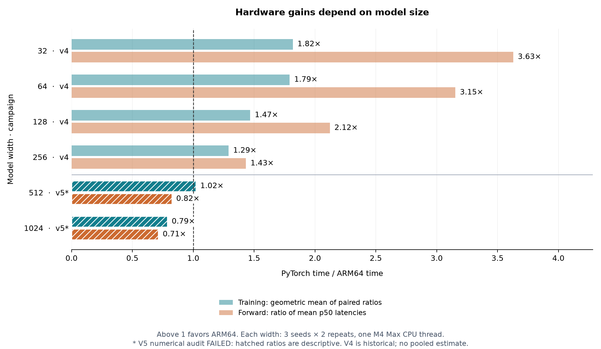

# ARM64 Transformer

A small language model with complete training and forward inference in **PyTorch
and handwritten Apple ARM64 assembly**. Both implementations learn the same
transformer. The experiment asks how much execution improves when its calculations
are organized around the processor's matrix instructions, registers, and memory.

## The idea: make the mathematics fit the machine

PyTorch already calls optimized native kernels. Assembly becomes useful when it
changes how values move and how much work each instruction performs. Profiling
our earlier NEON implementation identified dense matrix calculations as its main
bottleneck, motivating a different organization.

Computing a tile of outputs together lets each loaded operand contribute to many
results while partial sums stay in registers. Arm's **Scalable Matrix Extension
(SME)** provides FP32 outer-product instructions and matrix accumulators for this
work. Our packing routine arranges values in the order those instructions consume.
Forward reuses packed token inputs across weight panels; backward uses matrix
instructions for input and weight gradients.

The wider forward kernels use four shorter accumulation chains, combined at the
end. This improved accuracy in synthetic checks but adds operand loads. Attention
keeps query and gradient blocks in NEON registers; normalization uses vector
reductions; softmax uses stable maximum subtraction and vectorized exponentials.
Loss and Adam are also handwritten. The native numerical path calls no external
math library. [Kernel notes](native/kernel_notes.md) explain the implementation.

The latest results show why this work is workload-specific. The native trainer
still processes sequences individually, while PyTorch batches them. Packing,
operand reuse, and accumulation order remain consequential as matrices grow;
these measurements do not isolate each one's contribution.

## What stays matched

Each model has one causal decoder block, four attention heads, a feed-forward
layer twice its width, learned embeddings, and an ASCII-128 output head. It predicts
the next character from a 32-character context. Both engines receive identical
float32 initial weights, token rows, and batch schedules within each seed/width.

Pinned Tiny Shakespeare excerpts supply 65,536 training targets and 8,192 targets
in each disjoint validation/test partition. Every fit uses **eight epochs, batches
of 16, and 1,024 Adam updates**. Lowest validation loss selects the checkpoint.
This reused engineering dataset and fixed budget do not establish convergence or
an optimal model size.

Training time includes forward/backward, Adam, finite checks, epoch validation,
and checkpoint writes. Setup and final test evaluation are excluded. Forward
latency covers a complete batch-one context, including attention, but excludes
output-probability softmax, sampling, and I/O. It is not cached token generation.
The baseline is eager CPU PyTorch; there are no GPU, compiled-PyTorch, energy, or
production-serving claims.

## What happens as the model grows?

The results reveal a boundary. At widths 32–256, the earlier validated study found
**1.29–1.82× faster training and 1.43–3.63× faster forward execution** in assembly.
The new 512/1024 study loses that advantage as the model grows. It also **fails the
frozen post-training numerical audit**. Those wider measurements are retained as
descriptive development results, not a qualified speedup or equivalence claim.

The latest campaign contains **24 fresh fits**: two widths, three seeds, two timing
repeats, and both implementations on one Apple M4 Max with one CPU compute thread.
The dataset and training budget are unchanged.

| Width | Parameters | Training, PyTorch / ARM64 | Forward p50, PyTorch / ARM64 | Test NLL, PyTorch / ARM64 |
|---:|---:|---:|---:|---:|
| 512 | 2.25 million | 15.94 / 15.62 s | 298 / 362 µs | 2.500 / 2.486 |
| 1024 | 8.70 million | 58.66 / 74.62 s | 1,053 / 1,480 µs | 2.741 / 2.738 |

**Both wider rows failed the post-training audit.** Values describe the recorded
runs. Training is near parity at width 512; at width 1024, ARM64 takes about 27%
longer. Forward execution is about 22% and 40% slower, respectively.

The chart separates historical v4 measurements from the failed v5 campaign.
Training ratios are geometric means of six paired PyTorch/ARM64 times; forward
ratios compare mean per-run median latencies. Values above one favor assembly.

Adding parameters also failed to improve saved-prediction quality under this
budget: test NLL rose from roughly 2.5 to 2.74 in both implementations as width
increased from 512 to 1024. Lower is better. Memory remains a native advantage:
peak process RSS through training was **47 versus 392 MiB** at width 512 and
**173 versus 656 MiB** at width 1024. These include framework, runtime, and data.

## Numerical findings and reproducible evidence

Synthetic admission passed **21,734 blocking checks** across all six widths and
three backend policies; the test suite passed at every width. A prospective
validation revision compared both engines at identical model/optimizer states
and independently replayed each training loop. Original trajectory failures
remained visible, with unchanged tolerances.

The subsequent trained-checkpoint audit nevertheless failed **50 of 6,822 checks**:
2 at width 512 and 48 at width 1024, including repeated observations. These compare
predictions at the **same saved weights**, so they are distinct from training
trajectory drift. We preserved the failures and did not change the acceptance
criterion after measurement.

A [diagnosed width-512 case](experiments/numerics-v5/post-study/README.md) traced the
difference to FP32 attention-score rounding. Assembly was closer to three agreeing
float64 calculations on that case, but the declared PyTorch comparison still
failed. That diagnosis does not establish correctness across all wider checkpoints.

The [full outcome report](experiments/width-sweep-v5-outcome/README.md) retains every
run, variation, memory/quality plots, and original failed audit. See the
[numerical investigation](experiments/numerics-v5/README.md),
[protocol](experiments/PROTOCOL-v5.md), [reproduction guide](docs/REPRODUCE.md), and
[native interface](native/ABI.md). The [v5 release](https://github.com/logannye/arm64-transformer/releases/tag/transformer-wide-v5-outcome)
preserves measured source, binaries, fixtures, checkpoints, predictions, and diagnostics.
Archive integrity and passing CI checks do not turn the failed experiment audit into a pass.

Earlier [v4](experiments/width-sweep-v4/README.md) and
[v3](experiments/width-sweep-v3/README.md) reports preserve the development history,
including comparisons where assembly was slower.
