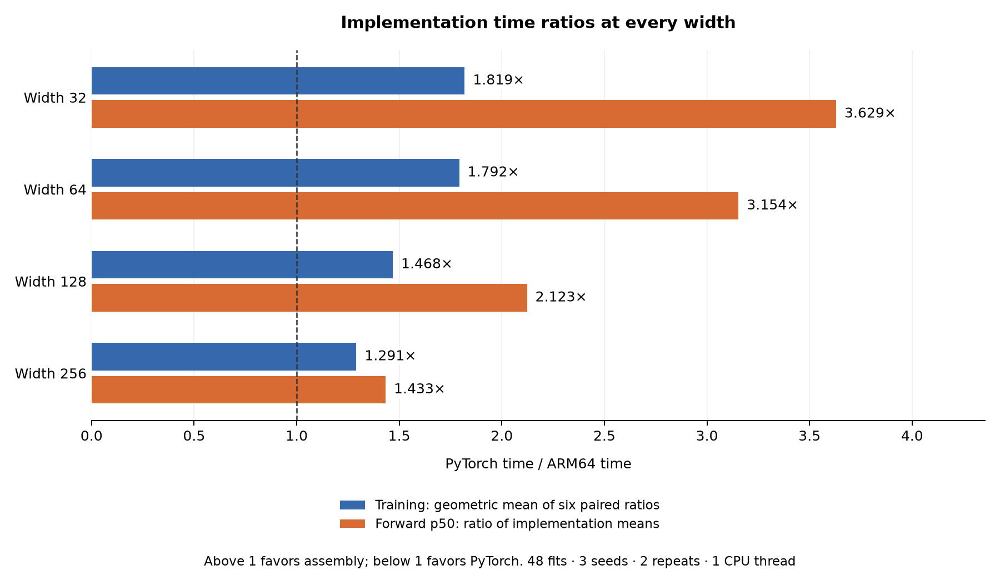
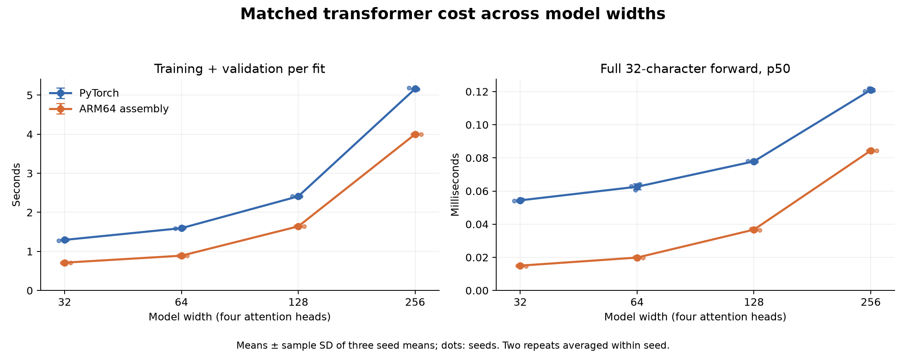
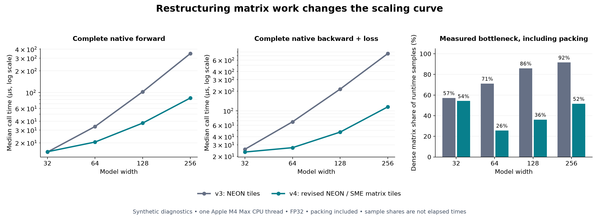
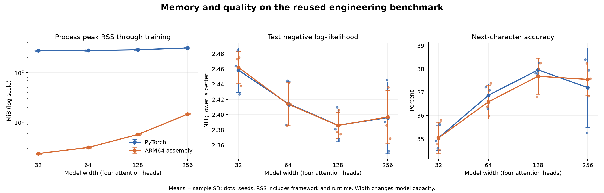

# ARM64 Transformer

[](https://github.com/logannye/arm64-transformer/actions/workflows/validate.yml)

A complete small language-model training stack in ordinary PyTorch and handwritten
Apple ARM64 assembly. The experiment asks how far we can improve execution by
organizing the calculation around the processor's actual matrix instructions,
registers, and memory access patterns, while preserving the model and checking
its predictions, gradients, and optimizer updates.

The latest profile-guided implementation trains faster than eager PyTorch and
has lower full-context forward latency at **all four widths**. At width 256,
the fresh matched comparison is **1.29× faster for training** and **1.43× faster
for forward**, with native peak process RSS through training of **14.56 MiB** versus
**314.72 MiB**.




## The result across four model widths

The latest study compares **32, 64, 128, and 256** hidden features, from **17,952
to 601,472 parameters**. It contains 48 fresh matched fits on one Apple M4 Max:
three seeds, two repeats, two implementations, and four widths. Width 32 uses
revised NEON kernels; widths 64–256 use capability-guarded FP32 SME matrix kernels
for all five dense projections. Other operations remain handwritten NEON/scalar
assembly. Actual kernel counters verify these paths in every native run.

| Width | Parameters | PyTorch training (s) | ARM64 training (s) | PyTorch / ARM64 |
|---:|---:|---:|---:|---:|
| 32 | 17,952 | 1.295 | 0.712 | 1.819× |
| 64 | 52,160 | 1.595 | 0.890 | 1.792× |
| 128 | 169,728 | 2.410 | 1.641 | 1.468× |
| 256 | 601,472 | 5.163 | 4.000 | 1.291× |

Training includes forward/backward, Adam, finite checks, epoch validation,
checkpoint selection/writes, and history bookkeeping. It excludes setup and final
test evaluation. Times are means of three seed means, with repeats averaged
within seed. The primary ratio is the geometric mean of six paired PyTorch/ARM64
times. **Above one favors assembly.** The [full report](experiments/width-sweep-v4/README.md)
retains variation and every observation.

| Width | PyTorch forward p50 (µs) | ARM64 forward p50 (µs) | PyTorch / ARM64 |
|---:|---:|---:|---:|
| 32 | 54.38 | 14.98 | 3.629× |
| 64 | 62.59 | 19.85 | 3.154× |
| 128 | 77.89 | 36.69 | 2.123× |
| 256 | 120.99 | 84.42 | 1.433× |

Forward ratios use the implementation means of per-run p50 latency. Each run
uses 20 warmups and 100 samples of a batch-one forward pass over the complete
32-character context. This excludes token loading, loss, output probability softmax, sampling, and
I/O; causal attention softmax is included. It is not cached next-token generation
or application latency.



## Why these changes worked

The previous [v3 width sweep](experiments/width-sweep-v3/README.md) exposed a
scaling limit: NEON assembly won on the smallest model but lost both training and
forward comparisons at widths 128 and 256. Python was already dispatching its
matrix operations to optimized native code. Removing Python overhead alone could
not compensate for inefficient dense arithmetic.

We profiled the actual native training process on synthetic data. Dense linear
kernels accounted for roughly **71%, 86%, and 92%** of post-loader sampled execution at widths
64, 128, and 256. This made the next target clear: change how those matrices are
computed. The M4 Max exposes Arm's **Scalable Matrix Extension (SME)** with a
64-byte streaming vector length. SME supplies matrix accumulators and outer-product
instructions in the CPU instruction set. The new implementation uses those
instructions directly, with float32 inputs and accumulation.

**Pack once for a panel, then reuse values across a matrix tile.** The old NEON
forward path holds sixteen four-lane dot-product accumulators for a 4-by-4 output
tile. The new path computes a **32-by-32 output tile in four 16-by-16 ZA matrix
accumulators**. At each reduction step, four `FMOPA` instructions accumulate 1,024
scalar multiply-adds. Loaded input and weight values contribute to many outputs,
and partial results stay in ZA until the reduction finishes.

The original tensors remain ordinary row-major arrays. A handwritten transpose
helper loads horizontal ZA slices and stores vertical slices to pack 32 rows into
contiguous reduction-major vectors. Forward packs the 32-token input once and
one 32-output weight panel at a time. Bias addition and row-major output stores
complete the public call. This is a change in data layout during execution;
checkpoint files and optimizer state keep their canonical representation.


**Backward uses the same matrix hardware with a different dataflow.** Input
gradients pack `dY` once and combine it with contiguous weight rows. Weight
gradients directly multiply contiguous `dY` and input vectors as outer products,
loading the existing gradient tile and adding each token's contribution before
writing it back. Input gradients overwrite their destination; parameter and bias
gradients accumulate in the existing order. The native runtime still accumulates
complete per-sequence gradients within each batch.

**Packing and state transitions are paid for inside the measured call.** Each
eligible dense call enters and leaves streaming mode once. Scratch is private
stack memory, bounded by 128 KiB for forward and 96 KiB for backward; stack growth
touches each page. There is no hidden persistent packed-weight cache, excluded
preprocessing phase, heap allocation in the numerical kernel, or deferred repacking
cost after Adam changes the weights.

**Small matrices keep NEON, with a cheaper backward loop.** SME is selected only
for the supported 32-token shapes and hardware. Width 32 keeps the existing NEON
tiles. Its weight-gradient FMLAs now read coefficients directly from vector lanes,
removing separate broadcasts. Its input-gradient loop loads four coefficients at
once and processes four output channels in order, reducing load and loop overhead
without changing the accumulation sequence. Other shapes retain generic tails.

The same synthetic before/after comparison reduced width-256 full native forward
from **348.2 to 84.0 µs (4.15×)** and backward including loss from **756.1 to 114.9 µs
(6.58×)**, including packing and FFI. Width 32 backward improved about 1.10×;
its forward was slightly slower in that diagnostic. These measurements explain
the implementation improvement separately from the matched PyTorch comparison.



The [profiling report](experiments/kernel-profiles-v4/README.md) preserves the
sample denominators, complete timing blocks, library hashes, and attribution
limits. Current dense sample shares are about 26%, 36%, and 52% at widths
64/128/256, including packing. A sample share is not an elapsed-time saving.
The combined changes are measured together; this is not an isolated instruction
ablation or a cache-miss study.

## The vector work around the matrix kernels

The earlier optimizations remain important after dense arithmetic gets faster.

**Attention specializes each head width.** Heads of 8, 16, 32, or 64 values use
2, 4, 8, or 16 NEON vectors. QK dot products, weighted values, and Q/K/V derivatives
use vector arithmetic; wider paths retain query and output-gradient vectors
across key visits and use independent accumulators. Backward computes each
output-gradient/value dot product once and reuses a **128-byte stack row** for
the softmax derivative. Causal masking remains exact, with no quadratic backward
scratch tensor.

**Softmax shares a vector exponential.** Four values are range-reduced together,
evaluated with a degree-nine polynomial in pairs of float64 lanes, then rounded
to float32. Subtracting the row maximum keeps the softmax stable. The ASCII-128
cross-entropy path vectorizes its maximum, exponential sum, and gradient. Tails
load only valid elements; out-of-range or nonfinite inputs retain the original
scalar math behavior.

**LayerNorm vectorizes statistics and derivatives.** A first pass computes the
mean; a second sums squared deviations. This avoids subtracting two nearly equal
mean-square terms. Normalization, derivative reductions, and accumulated scale
and bias gradients use NEON. Finiteness checks inspect four float exponent fields
at once, with scalar remainders. Runtime validation remains enabled.

The engineering idea is to make the equations' dataflow fit the processor. The
model architecture, dataset, precision, and training budget stay fixed within a
matched comparison. The [kernel notes](native/kernel_notes.md) explain every path,
and the [ABI](native/ABI.md) defines its shape and caller requirements.

## Matched model and training rules

Each model is one pre-LayerNorm causal decoder block with four heads, learned
token/position embeddings, residual connections, a ReLU feed-forward network of
width `2 × model_width`, final LayerNorm, and an untied ASCII-128 output head.
It predicts the next character from 32-character contexts. PyTorch uses built-in
scaled-dot-product attention, autograd, and `torch.optim.Adam` in eager mode.

Pinned Tiny Shakespeare excerpts provide **65,536 training, 8,192 validation,
and 8,192 test target characters**, in disjoint contiguous partitions. The data
are a known engineering benchmark used in earlier transformer versions, not a
newly untouched test set. No test quality guided kernel development.

Every fit uses eight epochs, batch size 16, **1,024 Adam updates**, learning rate
0.001, and one CPU compute thread. Within a width and seed, both implementations
receive identical initial weights, token rows, and schedules. The lowest validation
NLL selects the checkpoint before test evaluation. Width and implementation order
reverse on the second repeat, with a 15-second pause between fits and recorded
power/thermal/load conditions. See the frozen [v4 protocol](experiments/PROTOCOL-v4.md).

## Memory and learning quality

| Width | Implementation | Peak RSS through training (MiB) | Test NLL | Accuracy (%) |
|---:|---|---:|---:|---:|
| 32 | PyTorch | 277.52 | 2.4585 | 35.046 |
| 32 | ARM64 | 2.34 | 2.4621 | 35.042 |
| 64 | PyTorch | 278.47 | 2.4145 | 36.869 |
| 64 | ARM64 | 3.11 | 2.4138 | 36.589 |
| 128 | PyTorch | 288.28 | 2.3862 | 37.964 |
| 128 | ARM64 | 5.67 | 2.3859 | 37.691 |
| 256 | PyTorch | 314.72 | 2.3962 | 37.203 |
| 256 | ARM64 | 14.56 | 2.3969 | 37.557 |

Peak process RSS through training includes the framework, runtime, data, and model state; it is
not isolated parameter storage. The compact assembly runtime and per-sequence
workspace keep native process memory much lower throughout this family.



| Width | Mean ARM64 minus PyTorch NLL | Top-one prediction disagreement |
|---:|---:|---:|
| 32 | +0.003609 | 8.610% |
| 64 | -0.000695 | 20.121% |
| 128 | -0.000250 | 23.751% |
| 256 | +0.000723 | 26.453% |

Both implementations beat the training-only unigram baseline's test NLL of
3.3623. Aggregate quality similarity does not establish statistical equivalence:
floating-point grouping changes long training trajectories and individual
predictions. The same small dataset and update budget at every width also do not
establish convergence or an optimal model size. Per-seed NLL, accuracy, perplexity,
bits per character, learning curves, and disagreement remain in the reports.

## Correctness, portability, and evidence

All **12,480 numerical/runtime checks passed** with unchanged tolerances:
4,162 automatic-policy checks and 8,318 supplemental forced-NEON/forced-SME checks.
The exact four executable/library pairs passed gradients for every model parameter,
multiple Adam steps, finite differences, causal interventions, partial batches,
input rejection, vector tails, tile boundaries, nonzero accumulated gradients,
misaligned pointers, changed weights at the same address, and buffer guards.
At the measured revision, the repository test suite also passed **115 tests at
each width** locally.

SME admission checks OS capability before the first SME instruction, then verifies
the required vector length before entering the matrix path. Unsupported hardware or shapes use NEON; explicitly requesting
unavailable SME fails. The normal public ABI requires non-streaming entry and
preserves callee-saved state. Live ZA or a pending TPIDR2 save block routes to NEON
without overwriting caller state. Separate probes checked all 64 seeded ZA slices
and a nonnull TPIDR2 block. Float32 matrix grouping has its own NaN/exception
semantics; the numerical comparison covers the declared finite-input model domain.

The independent post-run audit passed **14,185 checks** and recomputed all **393,216 retained test prediction rows** from saved selected checkpoints. It also recomputed selected validation losses and confirmed bit-identical repeated checkpoints, Adam states, logits, and non-timing histories within each implementation, width, and seed. The measured source revision is `276c6d091a7ebdc5f7831be2169683db4715f748`.

Read the [complete report](experiments/width-sweep-v4/README.md),
[summary](experiments/width-sweep-v4/summary.json), and
[audit records](experiments/width-sweep-v4/audit.json). The
[v4 release](https://github.com/logannye/arm64-transformer/releases/tag/matched-transformer-sme-v4)
contains all fixtures, schedules, weights, Adam states, predictions, latency
samples, four binaries/layouts, exact measured source, and separately labeled
development/profiling evidence. The archive is checked internally and externally
with SHA256. Publication changes are separate from the measured source.

## Reproduce

Native execution requires Apple silicon, macOS, and Xcode Command Line Tools with
SME assembler support. Runtime SME use additionally requires the capabilities
above; the measured host is an M4 Max with 64-byte streaming vectors. The NEON
fallback supports older Apple silicon. Python reference tests also run on Linux.
Use Python 3.12 and prebuilt dependencies, or reuse a compatible environment.

```sh
git clone https://github.com/logannye/arm64-transformer.git
cd arm64-transformer
python3.12 -m venv .venv
source .venv/bin/activate
python -m pip install --only-binary=:all: -e '.[dev,report]'
export OMP_NUM_THREADS=1 MKL_NUM_THREADS=1 OPENBLAS_NUM_THREADS=1
export VECLIB_MAXIMUM_THREADS=1 PYTHONHASHSEED=0
python -m transformer.fetch_data --output data/tinyshakespeare.txt
make -C native widths PYTHON=python
for width in 32 64 128 256; do
  export ARM64_TRANSFORMER_WIDTH=$width
  export ARM64_TRANSFORMER_BACKEND=auto
  python -m pytest -q
  python -m transformer.validate --output results/preflight-v4/width-$width.json \
    --runtime --work-dir results/smoke-v4/width-$width
  ARM64_TRANSFORMER_BACKEND=neon python -m transformer.validate \
    --output results/preflight-v4/width-$width-neon.json \
    --runtime --work-dir results/smoke-v4/width-$width-neon
  supported=$(python -c "import json; print(json.load(open('results/preflight-v4/width-$width.json'))['backend']['sme_supported'])")
  if [ "$supported" = 1 ]; then
    ARM64_TRANSFORMER_BACKEND=sme python -m transformer.validate \
      --output results/preflight-v4/width-$width-sme.json \
      --runtime --work-dir results/smoke-v4/width-$width-sme
  fi
  python -m transformer.prepare --source data/tinyshakespeare.txt \
    --output results/inputs-v4/width-$width
done
unset ARM64_TRANSFORMER_WIDTH
python -m transformer.sweep --protocol v4 --inputs results/inputs-v4 \
  --preflight-dir results/preflight-v4 --output results/width-sweep-v4
python -m transformer.sweep_report --inputs results/inputs-v4 \
  --results results/width-sweep-v4 --output results/report-v4
```

Use fresh output paths. The source must be committed and clean, and the Mac must
use AC power. The runner authenticates source, binary, layout, preflight, and
fixture hashes around every child; only one fit runs at a time. CI covers Linux
reference tests and macOS ARM64 gates at every width, including forced NEON and
SME where supported. [requirements-benchmark.txt](requirements-benchmark.txt)
records the measured package versions. No external numerical library performs
work inside the native executable: macOS/libc supplies files, memory, clocks,
and feature queries.

## Earlier transformer versions

The [v1](experiments/matched-v1/README.md), [v2](experiments/matched-v2/README.md),
and [v3](experiments/width-sweep-v3/README.md) reports preserve the initial slower
implementation, the first vector/tile improvements, and the wider-model crossover.
Their release archives remain available. Historical campaign times can differ
with machine conditions; the primary v4 conclusions use fresh matched PyTorch
and ARM64 runs. The synthetic v3/v4 kernel comparison separately measures the
implementation change in one balanced session.

## Code map

| Path | Purpose |
|---|---|
| `transformer/spec.py` | Width, parameter/workspace layouts, generated constants |
| `transformer/reference.py`, `python_train.py` | Standard PyTorch model and training |
| `native/linear_sme.S` | Packed FP32 matrix forward/backward with ZA tiles |
| `native/backend.S` | Capability/policy dispatch, ABI probe, observed-path counters |
| `native/linear.S` | NEON matrix tiles and lane-based backward kernels |
| `native/attention.S`, `softmax.S`, `normalization.S` | Vector attention, exponential/loss, normalization |
| `native/kernels.S` | Generic tails, ReLU, Adam, scalar math |
| `native/model.S`, `runtime.S` | Full native model and standalone training runtime |
| `transformer/validate.py`, `audit.py`, `backend.py` | Admission, independent checkpoint audit, backend identity |
| `transformer/sweep.py`, `sweep_report.py` | Matched study and audited plots |
| `scripts/benchmark_kernels.py`, `profile_native.py` | Separate synthetic diagnostics |
| `scripts/package_sweep_evidence.py` | Verified release archive |

This is a short-context float32 CPU experiment against eager PyTorch. It does not
establish results for graph-compiled PyTorch, GPUs, long contexts, quantization,
energy consumption, cached decoding, or production serving.
