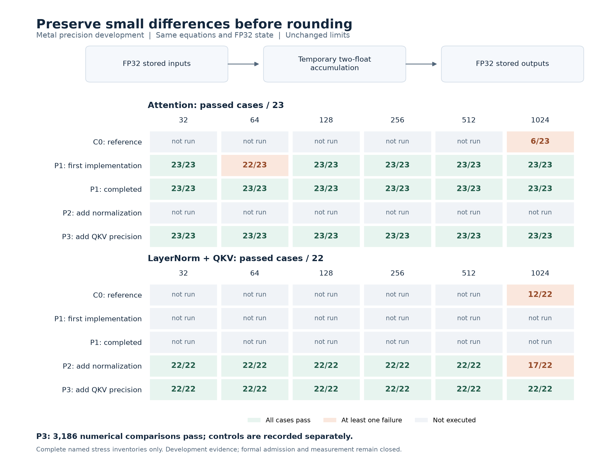

# Preserving small differences on the GPU

**Phase closed at the strict repeatability gate on 2026-10-29.** The user chose
to retain bitwise-repeatable training as a requirement and report the limitation.
The implementations and development validation are complete. All **108 planned
formal fits remain blocked and unrun**; this report makes no GPU timing or
speedup claim. The [closure record](closure.json) lists every planned cell.

A hardware-aware implementation must preserve the differences the model depends
on. Attention subtracts large scores; normalization centers nearly equal values;
its derivative can amplify projection error. Moving FP32 reductions onto the GPU
preserved these failure modes.

Metal now retains rounding residuals in sensitive operations. Temporary FP32
pairs carry the main result and its low part; fused multiply-add recovers product
residuals. Model state keeps its FP32 layout and model arithmetic stays on the
GPU. These software expansions retain FP32 dynamic range and provide no general
FP64-equivalence guarantee.



Cells show complete named stress inventories. “Not run” remains untested;
unchanged kernels do not receive an inferred pass. C0 also passed a smaller
width-32 smoke suite, which is recorded separately.

## What the bounded refinements fixed

The [candidate declaration](../GPU-PRECISION-CANDIDATES-v1.md) specified the
sequence before the compensated variants were evaluated. Every change retained
the model equations, FP32 state, fixtures and tolerances.

| Stage | Evidence and resulting change |
|---|---|
| C0 | At width 1024, 17/23 attention cases and 10/22 LayerNorm/QKV cases failed. |
| P1 | Two-float score accumulation, scaling, centering and backward contractions fixed most attention failures. Width 64 still failed two gradients: the FP32 softmax denominator left probability mass `0.99999970055`. Compensating the denominator and quotient completed P1. |
| P2 | Added compensated normalization means, centered variance, affine calculations and backward contractions. Five width-1024 joint input-gradient failures remained, while normalization passed at identical incoming gradients. |
| P3 | Added compensated QKV projection and its input-gradient contraction. QKV weight/bias gradients and other dense kernels retained their existing arithmetic. All declared development cases passed. |

The implementation uses safe compiler math and precise floating-point functions.
It computes the scalar attention scale once on the host and splits it into two
FP32 constants; no tensor calculation falls back to the CPU. Details are in the
[Metal implementation notes](../../native/metal/README.md).

## What the final denominator covers

P3 passed **3,186 numerical array comparisons** across widths 32, 64, 128, 256,
512 and 1024. This excludes controls and does not count independent observations
or individual coordinates.

| Family | Per width | Across six widths |
|---|---:|---:|
| Attention: 23 cases × 5 comparisons | 115 | 690 |
| LayerNorm/QKV: 22 cases × 17 comparisons | 374 | 2,244 |
| Primitive, initial-model and Adam smoke checks | 42 | 252 |
| **Total** | **531** | **3,186** |

Attention checks compare both mathematical FP64 gradients and the derivative
conditioned on the exact saved rounded probabilities. The upstream suite checks
joint LayerNorm/QKV behavior and identical-operand stage calculations. Forward,
gradient and probability limits remain those in the
[prospective protocol](../PROTOCOL-gpu-v1.md); Adam checks retain the existing
optimizer limits.

Separately recorded controls passed: exact repeats, causal masking, input
immutability, finite values, guards, exact warmup restoration, resident gather,
state/export ownership and malformed-input rejection. Future/prefix interventions
run only when T > 1; the nonfinite fault-injection control ran at width 32 only.
These development checks do not constitute complete formal admission or the
final trained-checkpoint audit.

Later checks remain separate: **36 B16/T32 test functions passed** across all
three engines and six widths, covering full gradients against FP64 and exact
causal/sequence isolation. After diagnostic-workspace and shutdown error-handling
repairs, six Metal smoke suites passed another 252 numerical comparisons.
An extracted-function C++ control verified cleanup when a mocked synchronization
throws; it is not a real GPU fault-injection test. These [post-P3 receipts](post-p3.json)
retain their own source identities and do not change the 3,186 denominator.

Final hardware checks exercised diagnostic tracing and lifecycle success paths
at widths 32 and 1024. Both passed, and tiny Metal training runs using the final
sources reproduced every saved checkpoint, optimizer-moment and logit artifact
from the earlier integration runs exactly. The historical CPU-only trace receipt
and the subsequent hardware receipt are retained separately.

## Separate tiny-training and baseline context

A later integration exercise used **eight training rows, three development
validation rows and three development test rows, all drawn from the original
training partition**. At widths 32 and 1024, each engine ran B3 for two epochs
and six updates, in two fresh processes. Corpus validation/test rows were not
used. All 36 saved-logit/oracle comparisons passed; these are separate from the
3,186 comparisons above. They do not establish full-budget trained-model accuracy.

| Exact repeated training artifacts | Width 32 | Width 1024 |
|---|---|---|
| Custom Metal | Pass | Pass |
| PyTorch MPS | Fail | Fail |
| Compiled MLX | Fail | Fail |

Earlier width-32 isolation found differences only in repeated-token embedding
gradients; pure forward and fixed-gradient Adam reproduced exactly. Those early
files authenticate retained bytes but lack contemporaneous executed-source
hashes. Later integration receipts retain source and artifact identities.
The repeatability failures remain explicit and the
[formal gate stays closed](../PROTOCOL-gpu-v1.md).

This is a limitation of the declared comparison: the standard baselines did not
meet its exact-repeatability requirement. It does not establish that their
training is unusable or numerically inaccurate in general. Passing the retained
FP64 development checks does not waive the separate repeatability failures.
No tolerance was loosened, standard-framework gradient was replaced, or failing
run was excluded to obtain a performance claim. MLX's short-sequence T3 attention
backward failure at head width 256 also remains recorded; the T32 model path
passed its development checks.

The original eight-stage plan was stopped before performance candidate search,
formal admission, full-budget training and checkpoint auditing. This phase
therefore establishes a working, development-validated implementation and a
documented boundary for the comparison. A future benchmark requires a new
declared phase; no descriptive campaign is authorized by this closure.

## Evidence and reproduction

[Summary](summary.json), [numerical receipts](receipts.json),
[integration receipts](integration.json), [baseline context](baseline-context.json),
[post-P3 controls](post-p3.json)
and [provenance](provenance.json) preserve successes, failures, untested cells,
operand identities, source/binary hashes and original receipt hashes. No binary
or large model-state payload is checked into this directory. Receipts identify
the source snapshot actually tested; subsequent wrapper/lifecycle corrections
do not retroactively change those identities.

The verified [development evidence archive](https://github.com/logannye/arm64-transformer/releases/tag/transformer-gpu-development-v1)
preserves the larger source, binary and raw-result payloads. It contains
development evidence only; it contains no formal 108-fit comparison results.
Its source revision and payloads remain unchanged by this later closure decision.

Regenerate the figure from the checked-in data without GPU execution:

```sh
MPLCONFIGDIR=work/matplotlib .venv/bin/python scripts/render_gpu_development.py
```

With the original local evidence available, regenerate the compact extraction:

```sh
.venv/bin/python experiments/gpu-development-v1/collect.py --integration --post-p3 --overwrite
```

The tracked [development drivers](../../native/metal/README.md) rerun these checks.
Original candidate sources, binaries and logs remain under
`work/gpu-v1/metal-development/`.
