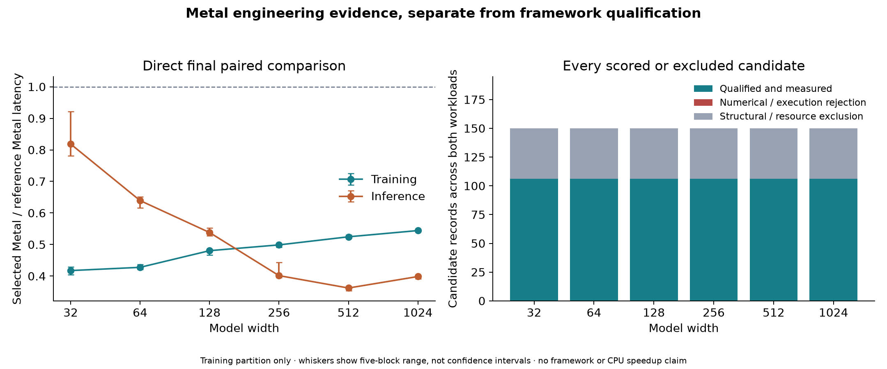
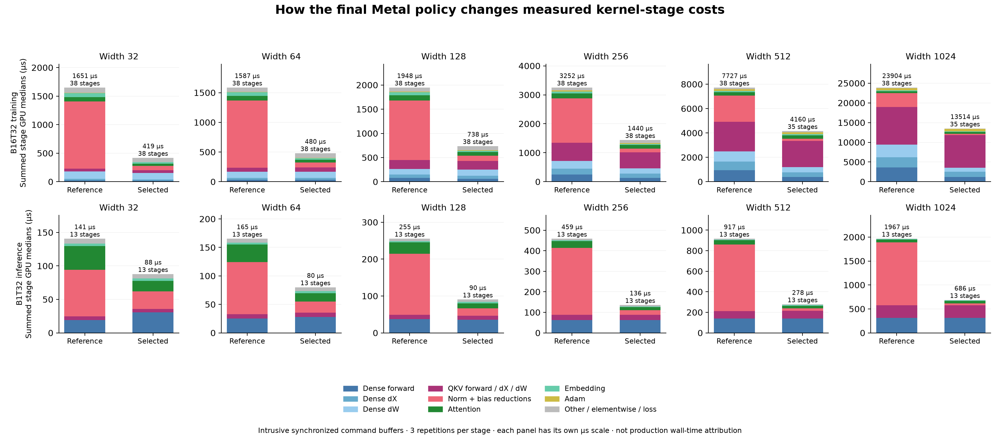
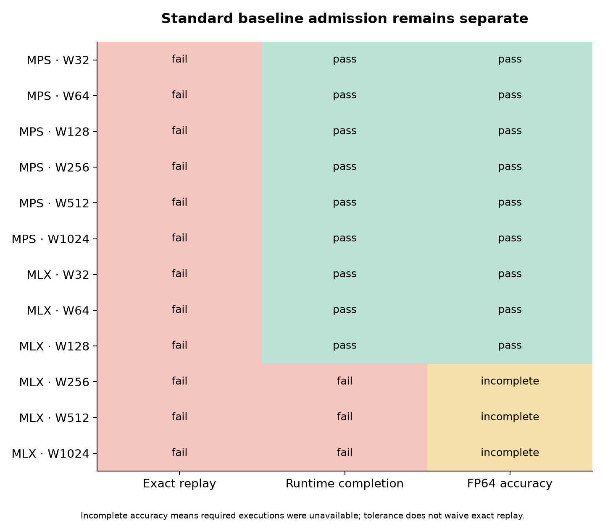

# GPU v2: designing execution around the hardware

The central idea is to make the transformer's execution fit the machine:
which lanes cooperate on a reduction, which matrix tiles stay in local memory,
where intermediate values live, and when operations can share a dispatch.
The mathematical architecture and FP32 model storage stay fixed. The program
that realizes them changes substantially.

This phase implements that idea on the Apple M4 Max GPU using handwritten Metal.
The selected kernels reduce a resident B16/T32 training step by **45.6–58.3%**
and B1/T32 forward latency by **18.1–63.8%** relative to our original Metal
implementation in the development workload. The most consistent improvement
comes from parallel normalization and reduction kernels. Larger training
shapes also benefit from SIMD-group matrix instructions and fusion.

These are direct comparisons between two custom Metal implementations. The
standard MPS and MLX baselines still fail the strict repeatability prerequisite.
The matched five-engine study therefore remains at **0 of 180 formal fits**,
with admission seed **20261104 unopened**. This report establishes development
results for the custom implementation; it does not establish superiority over
PyTorch, MLX, the CPU implementations, or a completed language-model training run.

The model is one causal decoder block with four heads, context length 32,
feed-forward width 2W and ReLU, three LayerNorms, and an ASCII-128 next-character
output. Widths range from 32 to 1024. The unchanged formal task would use the
pinned Tiny Shakespeare partitions, eight epochs and 1,024 Adam updates per fit;
the measurements below isolate development training steps and forward passes.

## What changed in the implementation

**Dense matrix operations use cooperative tiles and SIMD-group matrix
instructions.** Threads load guarded tiles of activations and weights into
threadgroup memory. Each SIMD group owns complete 8×8 output tiles and uses
`simdgroup_multiply_accumulate` for FP32 accumulation. The same structure supports
forward products, input gradients and weight gradients, with separate schedules
for each direction. Boundary checks keep partial rows and non-tile dimensions
within the same implementation. The candidate grid varies output tiles,
reduction tiles and the number of cooperating SIMD groups.

**Normalization distributes reductions across lanes.** The reference reductions
were expensive even when the matrices were small. The replacement uses a fixed
shuffle tree inside each 32-lane SIMD group, then a second fixed reduction across
groups. Two-component FP32 sums preserve low-order terms. The four-value variant
uses aligned `float4` loads and stores along a row. LayerNorm forward, its input
gradient, affine gradients and linear bias gradients use the selected reduction
policy. Bias gradients traverse row-strided data, so their four-value option
means multiple rows per lane rather than a contiguous `float4` load.

**Attention keeps cooperating work close together.** One or two SIMD groups
process a query, and a threadgroup can own one or two queries. Lanes initially
own keys for the score reduction, then own contiguous channels for the weighted
value output. A candidate can reuse the query through registers or threadgroup
memory. Score reduction, causal softmax and value accumulation consume nearby
intermediates while still writing the trace buffers required for auditing.
Backward candidates either use saved intermediates or recompute them. None of
the final selected policies chose recomputation for this T32 workload.

**Softmax and attention retain the precision repair.** Scores keep high and low
FP32 components through scaling and maximum subtraction. Exponentiation happens
after centering. The denominator uses a compensated reduction and the probability
quotient receives a residual correction. Sensitive backward contractions also
use expanded accumulations. The protected QKV forward and input-gradient paths
retain their compensated arithmetic; ordinary dense tiling does not replace
those paths. The GPU uses FP32 operations to carry extra intermediate precision,
while model parameters, stored activations, gradients and Adam moments stay FP32.

**Embedding gradients have deterministic ownership.** The optimized path builds
stable per-token occurrence lists with SIMD prefix operations. One output owner
then sums occurrences in a fixed order. This avoids floating-point atomic
scatter updates. At widths 512 and 1024, the reference deterministic embedding
path remained faster under the selection rule, so it was retained.

**Fusion removes separate passes where it helps.** A dense epilogue can apply
ReLU or a residual addition before its output leaves the owning lane, while
retaining the raw activation needed by backward and trace checks. The fused
Adam variant tests updated parameters, moments and gradients for nonfinite
values during the update. Its only atomic operation combines integer failure
flags. Both fusions were selected for training at widths 512 and 1024.

The implementation is in [optimized.metal](../../native/metal/optimized.metal),
with dispatch and ownership in [backend.mm](../../native/metal/backend.mm).
The [policy schema](../../transformer/gpu_policy.py) keeps training and inference
choices explicit and independently selectable.

## Direct measured results

The corrected `selection-v2` attempt compares the original Metal reference and
the final selected bundle in fresh, allocation-matched contexts. Each policy
has 20 warmups and 100 observations, grouped into five alternating paired blocks
of 20. Initial parameters, moments and step are restored before each block.
Training includes the step, finite scan and scalar loss readback. Forward timing
includes GPU completion with resident input and output; readback and correctness
checks occur outside that timing boundary.

| Width | Training step: reference → selected | Paired speedup | B1 forward: reference → selected | Paired speedup |
|---:|---:|---:|---:|---:|
| 32 | 1.158 → 0.480 ms | 2.40× | 0.227 → 0.189 ms | 1.22× |
| 64 | 1.375 → 0.588 ms | 2.34× | 0.269 → 0.171 ms | 1.56× |
| 128 | 1.775 → 0.853 ms | 2.08× | 0.362 → 0.193 ms | 1.86× |
| 256 | 3.194 → 1.590 ms | 2.00× | 0.608 → 0.249 ms | 2.49× |
| 512 | 8.251 → 4.321 ms | 1.91× | 1.005 → 0.362 ms | 2.76× |
| 1024 | 25.079 → 13.641 ms | 1.84× | 2.062 → 0.818 ms | 2.51× |

Latency entries are medians of the 100 individual observations. Speedups are
the reciprocal of the median of five selected/reference block-median ratios;
they need not equal the ratio of the two displayed overall medians. They are
measured directly against the original reference, not multiplied from the
greedy search's intermediate gains.

The figure's whiskers span the five paired block ratios. They are not confidence
intervals. [Raw latency statistics](results/metal-paired-latency.csv) include
p50/p95 in microseconds and milliseconds, plus B16/T32 next-token targets per
second at the measured training boundary. [The machine-readable report](results/summary.json)
retains the direct comparisons and qualification scope.

The workload uses the first 16 training sequences and initial parameters from
seed 42 of the original Tiny Shakespeare inputs. Candidate qualification also
uses the declared development stress stream, seed 20261103. No original
validation/test partition or reserved admission operands were used for policy
selection. The repeated development batch is not a full epoch, a held-out
assessment, or an autoregressive KV-cache decoding benchmark.

## Which schedules won

The same 75-candidate grid was used at every width: 16 dense schedules for each
of forward, dX and dW; six reduction policies; 16 attention policies; two
embedding policies; and three fusion choices. Compile/resource eligibility was
frozen before timing. Families were visited in descending reference-profile
cost, and a numerically qualified candidate needed at least a 3% median paired
improvement to replace the incumbent. This is a bounded greedy search, not an
exhaustive search over every combination.

All 75 training candidates and 31 relevant inference candidates per width
passed their development qualification before being timed: **636 measured
candidate configurations** across six widths. The remaining 44 inference
entries per width were prospectively excluded because they were backward-only
or duplicates of an already represented forward computation. Each selected
training and inference policy then passed all-family development qualification,
and the combined bundle passed full-model checks.

In the tables below, a dense tile is `M×N×K`; every selected dense tile uses four
SIMD groups. `G/V` means SIMD groups and values per lane for reductions. Attention
is `query rows / groups per query / query staging`. “Reference” means the
original implementation was retained.

| Width | Training dense forward / dX / dW | Reductions G/V | Training attention | Embedding block | Fusion |
|---:|---|---|---|---|---|
| 32 | Reference / reference / reference | 2/1 | 2 / 1 / registers | 64 | None |
| 64 | Reference / reference / reference | 2/1 | 2 / 1 / registers | 128 | None |
| 128 | 16×32×32 / reference / reference | 1/4 | 1 / 2 / registers | 64 | None |
| 256 | 16×32×16 / 16×32×32 / 16×32×32 | 2/1 | 2 / 1 / registers | 64 | None |
| 512 | 32×32×16 / 32×32×16 / 32×32×16 | 4/4 | Reference | Reference | Epilogue + Adam/finite |
| 1024 | 32×32×16 / 32×32×16 / 32×32×16 | 4/1 | Reference | Reference | Epilogue + Adam/finite |

| Width | Inference dense forward | Reductions G/V | Inference attention |
|---:|---|---|---|
| 32 | 16×64×16 | 1/4 | 1 / 1 / threadgroup memory |
| 64 | Reference | 2/1 | 1 / 2 / registers |
| 128 | Reference | 2/4 | 2 / 2 / registers |
| 256 | Reference | 2/1 | 2 / 2 / registers |
| 512 | Reference | 2/4 | 2 / 2 / threadgroup memory |
| 1024 | Reference | 2/4 | Reference |

Every selected attention variant uses saved backward intermediates. Inference
selects neither fusion option; embedding backward is absent. Exact dispatch
choices are preserved in [selected.json](policies/selected.json).

The schedule differences are part of the result. A B16 training matrix has 512
token rows to reuse and parallelize; B1 inference has 32. The larger matrix tiles
became worthwhile for training as width increased, while inference retained the
reference dense kernel at five of six widths. Reduction improvements helped
every width and both workloads. The most elaborate attention option was not
automatically faster: at training widths 512 and 1024, no attention candidate
cleared the 3% threshold, so the reference path stayed selected.

## What the profiles say to optimize next

These are intrusive stage profiles: each stage runs in its own synchronized
command buffer, with three repetitions. The plotted values are sums of stage
medians, not additive pieces of production wall time. They compare complete
reference and selected bundles, so the figure is not an isolated causal ablation
of one optimization. Hardware occupancy, register-pressure and bandwidth
counters were unavailable; timing alone does not establish those quantities.
[Stage costs](results/kernel-stage-costs.csv) and
[grouped costs](results/kernel-category-costs.csv) retain the underlying numbers.

The reduction changes remove a large measured cost. At width 1024, the training
normalization/bias-reduction category falls from **3.478 to 0.301 ms** of
intrusive stage time. For B1 inference, normalization falls from **1.314 to
0.035 ms**. Width 1024 inference selects only the reduction policy, yet its
direct paired latency improves by 2.51×. That is a particularly clear example
of a small family of operations controlling total latency.

Once those costs shrink, the compensated QKV work becomes the main large-width
target. The following shares use the summed selected stage medians; QKV includes
its forward, input-gradient and weight-gradient products, with bias gradients
counted in reductions.

| Width | Selected training stage sum | QKV matrix stages | QKV share |
|---:|---:|---:|---:|
| 128 | 0.738 ms | 0.181 ms | 24.6% |
| 256 | 1.440 ms | 0.560 ms | 38.9% |
| 512 | 4.160 ms | 2.147 ms | 51.6% |
| 1024 | 13.514 ms | 8.263 ms | 61.1% |

At width 1024, QKV forward alone takes 3.645 ms and its input-gradient contraction
takes 4.094 ms in the instrumented training profile. These are the protected
precision paths. The next substantial engineering opportunity is to improve
their tiling, reuse and parallel ownership while preserving the expanded
accumulation and score-centering contract. At B1/width 1024, QKV forward is also
the largest single stage, 0.264 ms or 38.4% of the selected stage sum.

Small widths have a different balance. At widths 32 and 64, cross-entropy is the
largest individual selected training stage, approximately 60–63 microseconds;
the collection of weight-gradient products is also substantial. Attention is
the largest individual B1 stage at widths 32–128. Future work should follow
these measured regimes rather than assume one kernel family controls every
shape.

## Correctness, repeatability, and the closed formal gate

Development numerical qualification preserves the existing limits: forward
absolute/relative tolerances `2e-5 / 2e-4`, gradients `3e-5 / 3e-3`, optimizer
state `3e-6 / 3e-4`, probability/math checks `2e-7 / 2e-6`, and independent
FP64-oracle agreement `1e-10 / 1e-10`.
Attention and normalization stress checks separately inspect expanded
intermediates and same-operand comparisons. Exact restoration, repeated
execution, guards and finite checks are separate controls. Neither acceptable
FP64 error nor a fast timing can waive an exact-repeat failure.

**Selected-Metal fresh-process replay passed its complete declared subset.**
The separate `metal-selected-v1` diagnostic completed **12 workers, 144 cases
and 1,440 executions**, with exact repetition and FP64 accuracy checks passing.
It covers full-model and six-update training controls at all six widths,
B1/B3/B16 and T3/T32, with ten repetitions in each of two fresh processes.
The selected-policy verification receipt matches every worker's actual policy
and binary identity to the published policy and measured binary. This remains
a declared custom-Metal development subset: it has no isolated embedding-probe
stage and is not formal admission.

The finalized standard-baseline attempt, `full-v3`, ran all 24 declared workers.
MPS and MLX failed exact repetition at every width. The first retained divergent
full-gradient comparison at each engine/width localizes its changed coordinates
to token embeddings. That is evidence about those first comparisons, not a claim
that every later training-state difference remains confined to embeddings.
The ordinary framework arithmetic was preserved throughout.

| Width | MPS exact-failed complete cases / completed cases | MLX exact-failed complete cases / completed cases | MLX runtime-error cases |
|---:|---:|---:|---:|
| 32 | 58 / 162 | 58 / 162 | 0 |
| 64 | 53 / 162 | 58 / 162 | 0 |
| 128 | 55 / 162 | 58 / 162 | 0 |
| 256 | 53 / 162 | 46 / 150 | 12 |
| 512 | 51 / 162 | 46 / 150 | 12 |
| 1024 | 58 / 162 | 46 / 150 | 12 |

Counts combine both fresh processes. The 162 executable cases per
engine/width comprise isolated embedding, full-model and training controls.
Impossible unique-token B16/T32 embedding cases are prospectively marked
unsupported because 512 unique positions exceed the 128-token vocabulary.
MPS completed its FP64 checks at every width, and MLX completed them at widths
32–128. MLX's T3 full-model/training errors at widths 256–1024 leave accuracy
coverage incomplete there; those results are not interpreted as successful
numeric checks.

The [baseline investigation](BASELINE-INVESTIGATION.md) explains the isolated
controls and pinned implementation evidence. The [formal study contract](FORMAL-STUDY.md)
describes the 2,088 gate groups, all-origin checkpoint replay, immutable CPU
anchors, evidence authentication and executable commands. The committed
[blocked result](blocked-study.json) retains the full 180-cell denominator and
zero test-token predictions. No learning curves or formal five-engine speedups
were generated.

The historical CPU v6 results retain their own limits. Widths 512 and 1024 were
not fully numerically qualified: the saved audit finds native logit failures at
1024 and PyTorch failures at 512 and 1024. Passing GPU development checks does
not revise those earlier checkpoint audits.

## Provenance and attempts that did not qualify

The measured machine has an Apple M4 Max with 40 GPU cores and 128 GiB of unified
memory, running macOS 26.2 (25C56). The host bridge uses Apple Clang 17.0.0 and
SDK 26.1. Kernels use MSL 3.1 with safe math and precise floating-point functions.
Device probes report 32-lane SIMD groups and 32 KiB of threadgroup memory, and
the candidate probes execute supported FP32 SIMD-group matrix operations.
The recorded device supports Apple9 and Metal4; no newer neural-accelerator
feature was inferred from that version label. The runtime does not export GPU
machine-code bytes, so its provenance binds shader sources, policy, host binary,
OS build, and capability receipts. Hardware serial numbers are excluded.

The measured reference and corrected search use source revision
`39e54abda72f0eabfb839a280f4e017fff2bc4c9`. The selected policy was committed as
`ae13f72`. Search receipts bind input, source, runtime, binary, policy and device
identities and verify them again after execution. AC power was required; known
throttling rejected a timing boundary, while unavailable thermal information
remained explicitly unknown. Compile/setup work and intrusive profiling were
kept outside the reported production observations.

Three superseded attempts are retained with their failures:

- **Baseline `full-v1`** stopped after a collaborator added an optional runtime
  identity field while workers were active. Baseline arithmetic was unchanged,
  but mixed-source execution disqualified the attempt as a complete matrix.
- **Baseline `full-v2`** exposed an MLX T3 runtime error and a harness cleanup
  failure. A poisoned pending graph rethrew during cleanup, and the launcher
  then encountered missing completion metadata. The harness was repaired to
  retain the original error, retire the backend and continue independent cases.
  `full-v3` preserves the underlying MLX errors.
- **Search `selection-v1`** had asymmetric timing allocations: candidates retained
  buffers and uploaded batches from qualification while incumbents were fresh.
  All timings and selections from that attempt are invalidated. `selection-v2`
  reran all six widths with the unchanged 75-candidate grid, fresh timing
  contexts, equal initial state, and matching owned allocation counts and bytes.

The final paired contexts each contain exactly one B16/T32 training batch and
one B1/T32 inference batch. Device-global allocation counters are descriptive,
not substitutes for per-context ownership checks. A separate fresh context
collects final stage profiles after production timing. This repair matters:
memory residency and accumulated diagnostic work can otherwise masquerade as
an arithmetic-kernel improvement.

The retained raw evidence lives under `work/gpu-v2/profiles/reference-v3`,
`work/gpu-v2/search/selection-v2`, and `work/gpu-v2/repeatability/full-v3`, with
the superseded attempts preserved beside them. The release archive includes
those records, `metal-selected-v1`, and their source snapshots. The final
selected-Metal summary SHA-256 is
`cbe5894957970fd9d03986407f6ac54c1547de031a5fb53d4edd4237b788dc2e`.
[Release tools](RELEASE-TOOLS.md)
describe regenerating figures and verifying the split archive. Hash verification
establishes preserved bytes; it does not convert development evidence into
formal admission or independent execution attestation.

Download the complete archive and verification receipts from the
[GPU v2 engineering release](https://github.com/logannye/arm64-transformer/releases/tag/transformer-gpu-engineering-v2).
