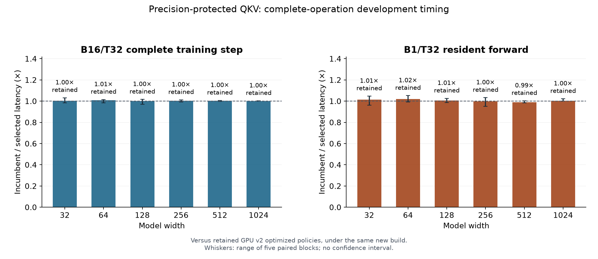
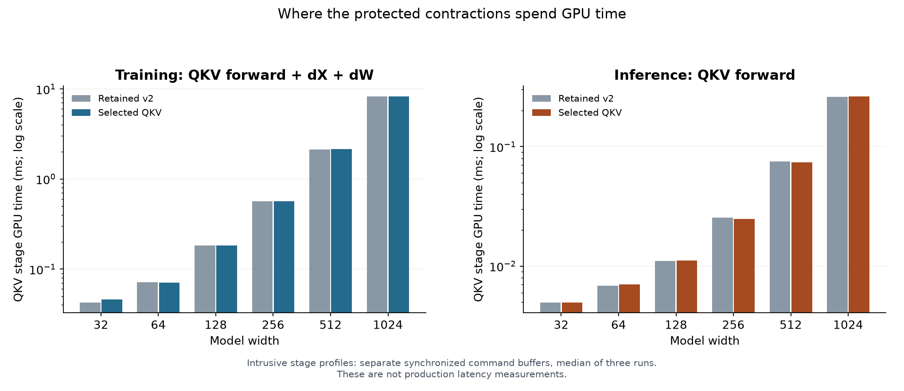

# Precision-protected QKV development results

Cooperative tiling reuses QKV operands while preserving each protected dot product's arithmetic order and final FP32 bytes. This report compares the selected QKV policy with the retained GPU v2 optimized policy under the same new build.

**Status: completed development report.** These are training-partition development measurements. The formal five-engine study remains blocked; zero of its 180 fits have run.

Each mode uses 20 warmups and 100 synchronized observations in five alternating paired blocks, with exact state restoration and allocation-matched fresh backend instances. A candidate must pass numerical checks and reduce median complete-operation latency by at least 3% to replace its incumbent. Final ratios below come from direct selected versus original-incumbent measurements, not products of candidate ratios.

| Width | Training p50, v2 → selected (ms) | Training ratio | Forward p50, v2 → selected (µs) | Forward ratio |
|---:|---:|---:|---:|---:|
| 32 | 0.481 → 0.479 | 1.004× | 177.5 → 175.7 | 1.015× |
| 64 | 0.573 → 0.577 | 1.008× | 172.6 → 170.8 | 1.018× |
| 128 | 0.867 → 0.870 | 1.001× | 195.7 → 195.4 | 1.006× |
| 256 | 1.588 → 1.583 | 1.004× | 235.0 → 235.5 | 0.996× |
| 512 | 4.159 → 4.148 | 1.002× | 350.2 → 353.4 | 0.989× |
| 1024 | 13.650 → 13.626 | 1.001× | 826.7 → 822.0 | 1.003× |

Ratios are incumbent latency divided by selected latency. Repeated measurements of an unchanged policy can differ; a retained label means no candidate met the selection rule. All p50/p95 values and training throughput are in [timing.csv](timing.csv). No widths are pooled into a headline ratio.

The candidate grid makes retained policies visible as bounded negative findings: a faster-looking microkernel or a sub-3% complete-operation improvement cannot replace the incumbent. Every declared schedule and rejected outcome remains in [candidate-search.csv](candidate-search.csv). Each candidate comparison uses the current family incumbent; it is separate from the final direct original-incumbent comparison above.

Stage profiles use separate synchronized command buffers and are diagnostic only. They must not be added to or substituted for complete-operation latency. [Stage data](stage-profiles.csv) retain every measured stage. Hardware counters were unavailable, so occupancy, memory bandwidth and register pressure are not inferred.

The reporter checks all candidate outcomes and frozen-ledger hashes, recomputes timing ratios and policy selections, and requires full-model, 53 original stress-family, 16 direct-QKV, independent-FP64, guard, and byte-equivalence evidence. Fresh-process selected-Metal replay passed across all six widths: two processes, 12 cases per process and ten executions per case.

Standard PyTorch MPS and MLX are still outside the unchanged exact-repeatability gate. The official stable-source inspection in results.json is source evidence, not a new framework runtime qualification. Local upstream patches cannot substitute for standard released baselines. A new bound freeze, passing admission, fresh CPU/GPU fits and full checkpoint audits remain necessary for the complete matched study.

[Machine-readable results and evidence SHA256 inventory](results.json)
