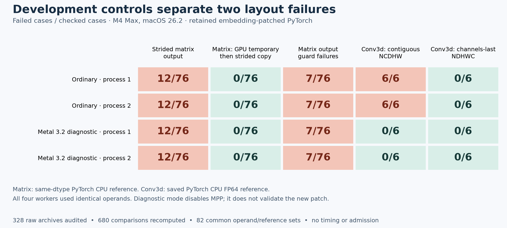

# An independent route to the CPU/GPU study

This phase compares our hardware-specific transformer implementations with
**project-maintained PyTorch and MLX builds**. Keeping the repairs in pinned
full-source frameworks lets us continue without submitting patches upstream or
waiting for a framework release. Every eventual result must identify those
patched baselines explicitly.

The [prospective protocol](../PROTOCOL-gpu-v4-owned.md) preserves the six widths,
original data and initialization, eight-epoch budget, three seeds, two repeats,
180 planned fits, exact training repeatability and FP64 accuracy requirements.
PyTorch CPU and MPS must use the same selected distribution. The full checkpoint
audit and per-width reporting requirements remain in place.

**Status: preparation, not admission. Zero owned-study formal fits have run.**
The original standard-release study also remains at zero of 180, with its
reserved stream `20261104` unopened. The new contract reserves `20261108` and
does not open it during planning or preflight.

## What is already available

The [integration release](https://github.com/logannye/arm64-transformer/releases/tag/transformer-upstream-integration-v2)
contains authenticated full-source framework binaries, patches, regression
evidence and reproduction instructions. Patched MLX passes the declared Release
integration checks in both shader modes. Patched MPS passes targeted embedding
and matched-transformer checks. The custom Metal implementation and its selected
production policies already have separate development evidence.

These results are starting evidence for an isolated owned runtime. Combining or
relocating components creates a new execution identity and requires new checks;
old receipts cannot be reused as admission passes.

## What the independent development checks found

The [model-v2 development check](model-report-v2/README.md) now passes for
maintained PyTorch CPU, PyTorch MPS and compiled MLX at all six widths. Its 36
workers cover two fresh processes per path/width, ten initial evaluations and
two six-update trajectories on fixed **B3/T3 repeated-token inputs**. Initial
logits, loss and all gradients pass the frozen FP64 comparisons; all 18
fresh-process pairs and checkpoint reloads pass exact replay. An independent
saved-array audit verifies all 216 raw archives and the complete evidence
inventory. This small development check does not measure timing or
post-training FP64 accuracy and does not qualify the B16/T32 formal study.
The earlier model-v1 metadata failure remains preserved.

The isolated runtime now passes its narrow import, native-origin and dyadic GPU
execution probe in two fresh PyTorch processes and two fresh MLX processes.
PyTorch CPU and MPS load the same maintained distribution. This is a runtime
smoke check, not transformer qualification or formal admission.

All attempts remain available: [v1](layout-report-v1/receipts/joint-runtime-v1/summary.json)
failed because PyTorch could not use NumPy;
[v2](layout-report-v1/receipts/joint-runtime-v2/summary.json) failed a postflight
file-identity check;
[v3](layout-report-v1/receipts/joint-runtime-v3/summary.json) passed its four
workers but rejected process-specific MLX graph node names.
[v4](layout-report-v1/receipts/joint-runtime-v4/summary.json) passes after
binding the compatible NumPy overlay and comparing the single compiled node's
structure independently of its process-specific name. Raw graphs remain saved;
tensor output hashes and all other probe fields still compare exactly. The
failed receipts and the helpers that produced them are preserved byte for byte.

The next diagnostics explain why some remaining broad MPS failures need
dispatch repairs, rather than relaxed numerical tolerances:



In each ordinary process, 12 of 76 strided matrix cases fail against the
same-dtype PyTorch CPU reference, and seven cases overwrite guard elements.
Computing into a contiguous GPU temporary and then copying into the same
strided output passes all 76 cases with intact guards. These controls support
repairing the existing noncontiguous-output dispatch guard on macOS 26.2.

For the six Conv3d dtype/bias combinations, the channels-last output agrees
with the saved CPU FP64 reference, while every contiguous NCDHW output fails.
Running fresh processes with the diagnostic Metal 3.2 setting, which disables
MPP selection in this source, makes both layouts pass all six cases. Matrix
failures remain unchanged. This points to the MPP convolution path on the
tested OS, without establishing its internal compiler/runtime cause.

An independent CPU-only audit verified all **328 raw-array archive hashes**,
recomputed **680 comparisons**, checked output guards and recorded layout/dtype
metadata, and established exact equality of all **82 operand/reference sets**
across the four processes. Matrix comparisons use a same-dtype CPU reference;
the convolution audit reuses saved PyTorch CPU FP64 values rather than executing
an independent convolution equation. These are development diagnostics, with
their own declared tolerances, not substituted admission checks.

See the [array audit](layout-report-v1/array-audit.json),
[case CSV](layout-report-v1/layout-cases.csv),
[count CSV](layout-report-v1/layout-counts.csv),
[byte-preserving receipt catalog](layout-report-v1/receipt-catalog.json),
[report provenance](layout-report-v1/provenance.json), and
[source diagnosis and candidate patch](../../integration/gpu-owned/MPS-REPAIR-NOTES.md).
The candidate changes two matrix dispatch guards and selects the existing
SIMD convolution path for multi-depth kernels on macOS 26.2. It remains
unqualified until its rebuilt framework passes device checks. It does not
repair the separate half-precision combinations-gradient failure, and none of
these diagnostics removes the broad-suite gate.

The separate [half-precision indexing diagnostic](half-report-v1/README.md)
retains 40 cases in each of two fresh processes. An independent standard-library
audit verifies all 80 raw archives and finds exact equality of every saved array
between processes. The column-major cancellation cases fail CPU/MPS tolerance
120 times per process, while FP32 controls agree with FP64. Both FP16 engines
have accumulation-rounding error: reproducing CPU's order would improve
compatibility, but would not necessarily improve mathematical accuracy. The
report shows both against the exact derivative. No half-precision patch is
selected, and the original failing cotangent was not retained; the new examples
do not clear that broad-suite failure.

## What still blocks formal execution

The broad patched MPS suite retains **25 failures and two errors**. They also
reproduce in a pristine matched build, but remain blocking integration failures
for this new route. This contract does not remove tests or reclassify those
failures to permit measurement. We can investigate and repair them ourselves.

An independently executable study still needs full-workload baseline and CPU
checks beyond the completed B3/T3 development probe, dedicated admission
identities, the complete passing
admission inventory, and finally all 180 fits and checkpoint audits. Existing
planning or preflight output is not an executable manifest or a passing admission
receipt. The old standard-study runner must reject this new protocol.

## Planning and preflight

The additive `transformer.gpu_owned_study` command can produce the complete plan
and inspect the retained evidence. It imports no framework, creates no admission
operands and has no formal-run command. Run from the repository with the existing
Python environment and use fresh output paths:

```sh
.venv/bin/python -m transformer.gpu_owned_study plan \
  --output work/gpu-v4-owned/plan.json
.venv/bin/python -m transformer.gpu_owned_study preflight \
  --repository "$PWD" \
  --evidence-root /ABSOLUTE/VERIFIED/EVIDENCE/ROOT \
  --output work/gpu-v4-owned/preflight.json
```

The evidence root is the common reconstructed `work/` and `outputs/` parent
described in the [integration reproduction guide](../upstream-integration-v2/REPRODUCTION.md).
Preflight authenticates the selected patch identities and retained failed broad
suite; it reports blockers without turning them into passes. An optional
hash-bound joint-runtime development probe remains a smoke check. A dedicated
owned-study freeze, admission, execution and audit integration still has to be
implemented and validated before formal measurement can begin.

The preserved historical CPU numerical failures remain unresolved. A successful
owned-build study could establish a matched comparison against these maintained
frameworks; it would not establish performance against standard released packages.

## Reproducing the development report

The report generator imports NumPy and Matplotlib, never a GPU framework. It
requires the retained raw diagnostic arrays under the original workspace
relative paths and verifies their hashes before producing figures or copying
receipts. Original receipt paths remain literal; the catalog maps them to their
repository copies. Raw NPZ arrays are kept out of the Git receipt directory.

```sh
.venv/bin/python -m unittest discover -s integration/gpu-owned \
  -p test_audit_layout_diagnostic.py -v
.venv/bin/python integration/gpu-owned/report_layout_diagnostic.py \
  --workspace /ABSOLUTE/RECONSTRUCTED/WORKSPACE \
  --output /ABSOLUTE/FRESH/REPORT/DIRECTORY
```

The fifteen CPU-only negative controls cover changed/missing/symlinked archives,
wrong hashes and sizes, path traversal, missing/extra/duplicate members, wrong
shapes/dtypes, inexact BF16 conversions, one-ULP input changes, nonfinite values,
replaced summaries and stride inventory rules. Reproducing a report does not
rerun GPU execution or qualify a framework binary.
