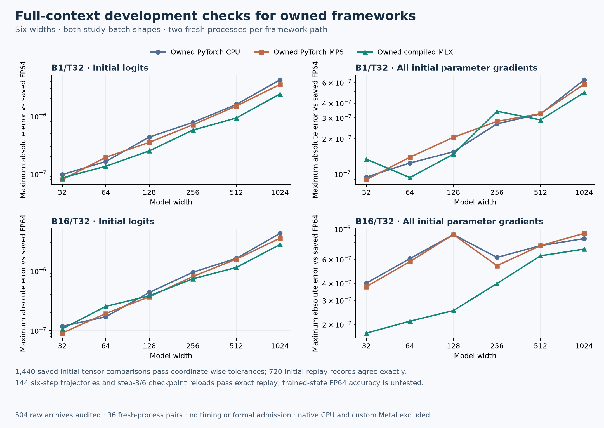

# Full-context owned-framework development evidence

The existing project-maintained PyTorch CPU/MPS build and compiled MLX build pass this synthetic development check at B1/T32 and B16/T32 across widths 32–1024. These are the study’s inference and training tensor shapes, exercised for six updates.

The independent saved-array audit checked 504 NPZ files from 72 workers and 36 fresh-process pairs. All 1,440 saved initial tensor comparisons passed the frozen coordinate-wise FP64 tolerances. Each worker recorded ten identical initial replays, restored its original state after two warmup updates, and repeated a six-step training trajectory exactly. Raw states and predictions at steps 3 and 6 bind checkpoint replay.

| Shape | Engine | Max logit error | Max parameter-gradient error |
|---|---|---:|---:|
| B1/T32 | Owned PyTorch CPU | 4.24e-06 | 6.3e-07 |
| B1/T32 | Owned PyTorch MPS | 3.52e-06 | 5.79e-07 |
| B1/T32 | Owned compiled MLX | 2.42e-06 | 4.91e-07 |
| B16/T32 | Owned PyTorch CPU | 4.24e-06 | 9.09e-07 |
| B16/T32 | Owned PyTorch MPS | 3.52e-06 | 9.27e-07 |
| B16/T32 | Owned compiled MLX | 2.76e-06 | 7.12e-07 |

Table maxima span the six widths; this is numerical error, not a speed comparison. [The complete CSV](accuracy.csv) retains each width, engine and shape.

This audit rechecks saved initial PyTorch/NumPy FP64 outputs and the retained checkpoint bytes; it does not rerun model equations or runtime authentication. Intermediate trajectory steps and other initial replays have authenticated execution-time hash records rather than separately retained raw arrays.

No timing, corpus fit, trained-state FP64 audit, native CPU or custom Metal comparison is included. Broader framework qualification and the complete stress/repeatability inventory remain required. Formal fits remain 0/180 and admission remains unopened. The original failed attempt remains in the [earlier evidence report](../model-report-v2/README.md); no failure is waived or overwritten.

[Receipt catalog](receipt-catalog.json), [report provenance](provenance.json), and [archive instructions](../../../integration/gpu-owned/FULL-SHAPE-PUBLICATION.md) bind the original workspace paths, copied receipts, raw evidence and producing tools.
