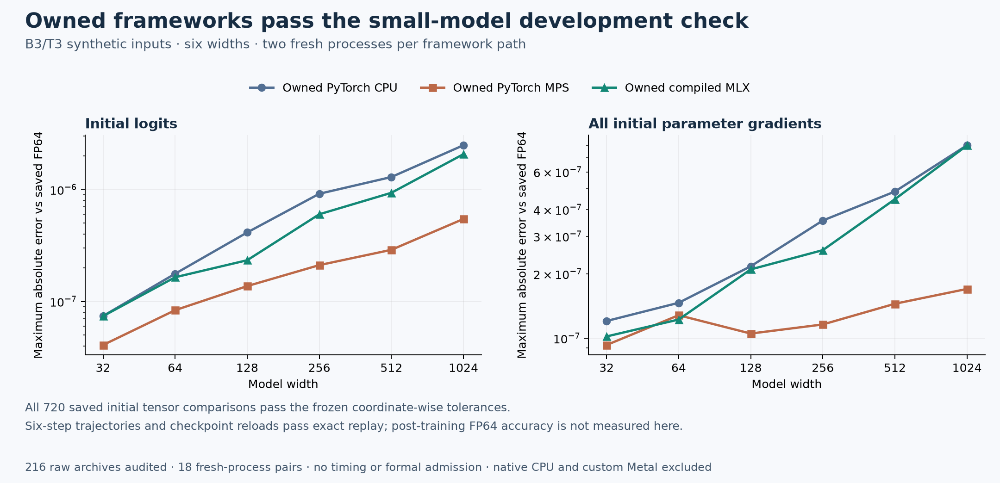

# The maintained frameworks pass the small-model development check

The isolated, project-maintained PyTorch CPU, PyTorch MPS and compiled MLX
paths pass the declared **B3/T3 synthetic transformer check at widths 32,
64, 128, 256, 512 and 1024**. This establishes a useful development milestone:
the repaired frameworks can execute the same tiny repeated-token task with
accurate initial outputs/gradients and exact short training replay.

It is not the planned 180-fit experiment. No formal fits or timing measurements
were taken, and neither admission stream was opened. Native CPU and custom
Metal were not part of this check. The retained broad MPS integration failures
still block study admission.



The check contains 36 workers: six widths, three framework paths and two fresh
processes. Each worker performs ten identical initial forward/backward
evaluations, warmup restoration, two identical six-update training trajectories,
and checkpoint serialization/reload at updates three and six. All 18
fresh-process pairs pass. The same initial parameter, token and target bytes
are used by all three paths at a given width.

| Path | Largest initial logit error | Largest initial parameter-gradient error |
|---|---:|---:|
| Maintained PyTorch CPU | 2.483e-6 | 7.997e-7 |
| Maintained PyTorch MPS | 5.450e-7 | 1.701e-7 |
| Maintained compiled MLX | 2.066e-6 | 7.975e-7 |

These maxima cover all six widths and both processes. Every initial logit,
loss and parameter-gradient coordinate passes its frozen absolute-plus-relative
tolerance. They describe initial-state accuracy on this fixture; they do not
establish post-training accuracy or a general accuracy ranking. The
[per-width/engine CSV](accuracy.csv) also retains loss errors and the worst
gradient tensor.

An independent NumPy-only audit verified **216 raw NPZ archives**, recomputed
the saved initial comparisons against the retained PyTorch FP64 arrays, and
checked those FP64 arrays against the separately saved NumPy FP64 arrays. It
validated all checkpoint-state bytes and replay records, complete parent/worker
inventories, exact fresh-process training hashes, checkpoint prediction hashes,
and common operands. It did not execute the transformer equations again.

Only the first initial evaluation, first-trajectory checkpoint states at
updates three/six and final logits are saved as raw arrays. Other initial
replays, intermediate steps and warmup restoration retain authenticated
execution-time hashes. Update-three predictions are hash records; raw
predictions are retained for update six. Post-training FP64 comparisons, the
full B16/T32 and B1/T32 workload, the complete admission inventory, broad
framework integration and the formal checkpoint audit remain outstanding.
Historical CPU precision failures are not relabeled by this development result.

The earlier [failed model-v1 attempt](receipts/model-compatibility-v1/summary.json)
remains failed. It stopped when the full-source MLX runtime lacked the wheel
metadata expected by the capability reporter. The
[preserved helper snapshot](receipts/failed-model-probe-v1/snapshot.json)
records that boundary. Model-v2 describes the authenticated owned runtime
through a provenance bridge while retaining the production model, optimizer
and backend operations. It does not replace standard baselines or qualify the
unfinished layout/half-precision repair candidates.

The [execution summary](receipts/model-compatibility-v2/summary.json),
[manifest](receipts/model-manifest-v2.json),
[independent audit](receipts/model-array-audit-v1.json),
[receipt catalog](receipt-catalog.json) and
[report provenance](provenance.json) retain exact evidence and source identities.
The catalog maps original workspace-relative paths to byte-identical copies;
paths inside the receipts remain unchanged. All 36 worker receipts are included.
Raw arrays are packaged separately by engine using the
[model archive plan](../../../integration/gpu-owned/model-evidence-plan-v1.json)
and its [publication guide](../../../integration/gpu-owned/MODEL-EVIDENCE-PUBLICATION.md).

To reproduce the compact report after reconstructing the retained workspace:

```sh
.venv/bin/python integration/gpu-owned/report_model_probe.py \
  --workspace /ABSOLUTE/RECONSTRUCTED/WORKSPACE \
  --output /ABSOLUTE/FRESH/MODEL-REPORT/DIRECTORY
```

This command reads the already passing, hash-bound audit and receipts. It does
not execute a framework or rerun the numerical experiment.
