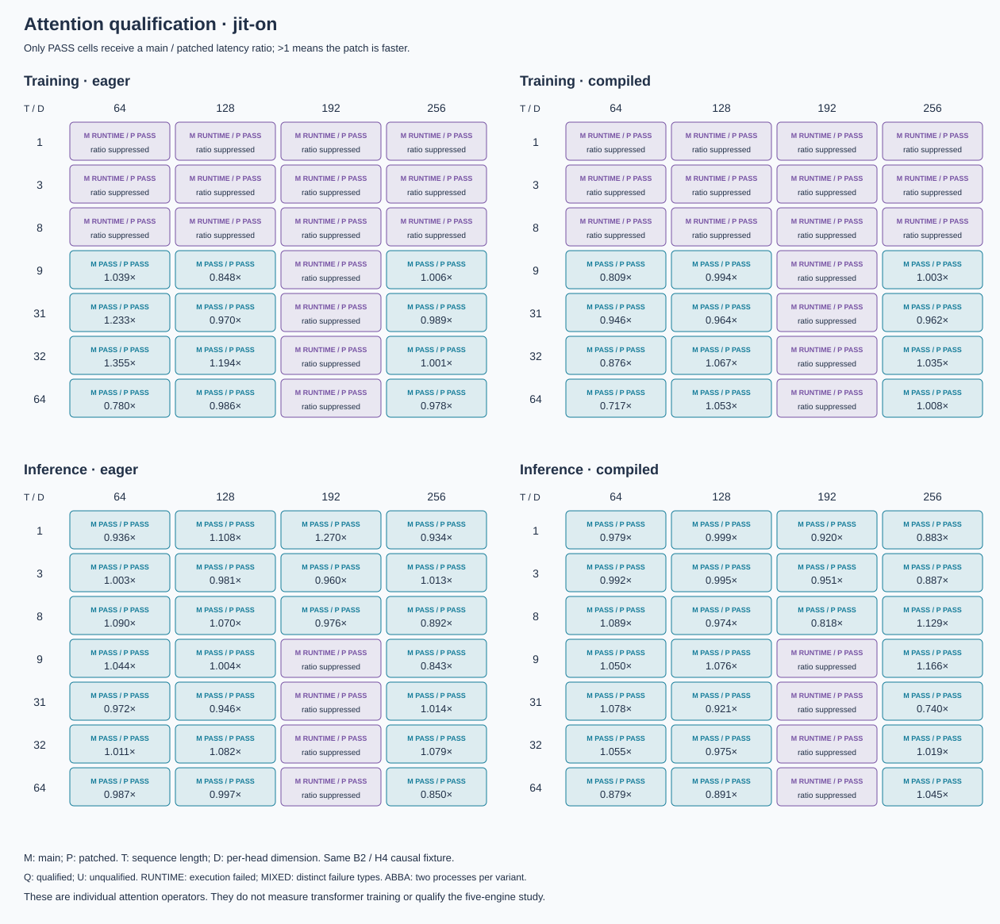
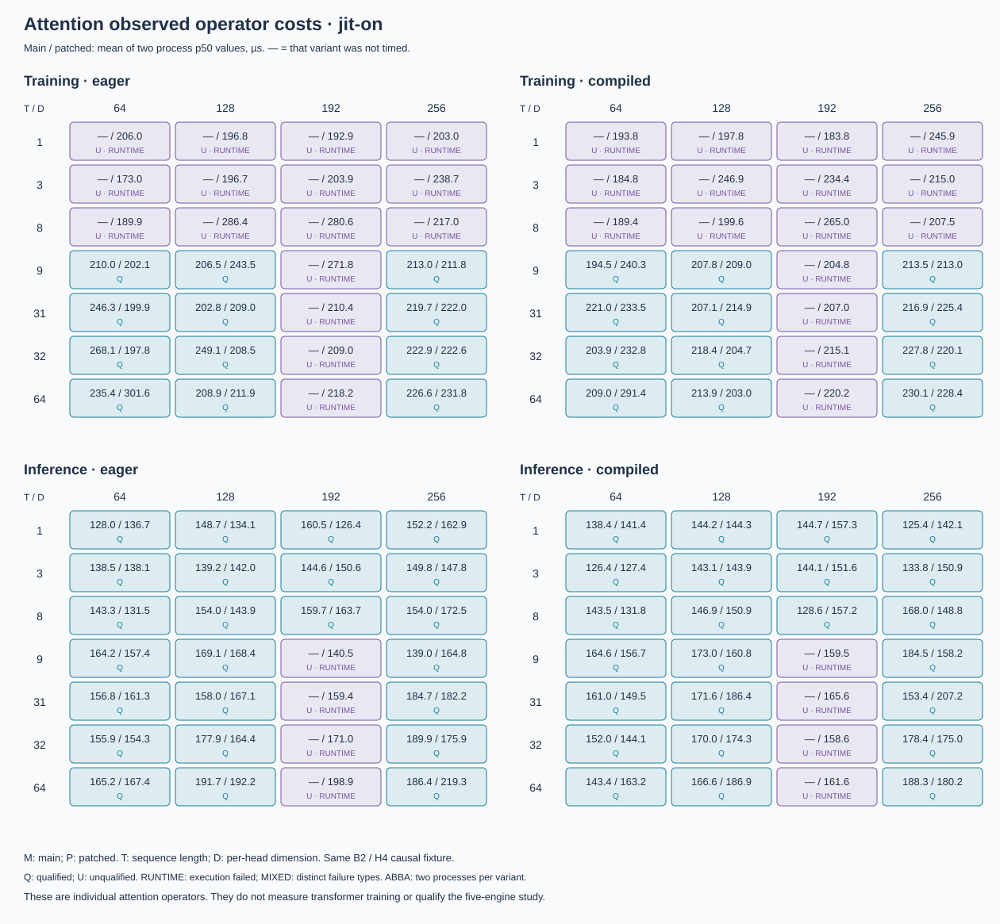
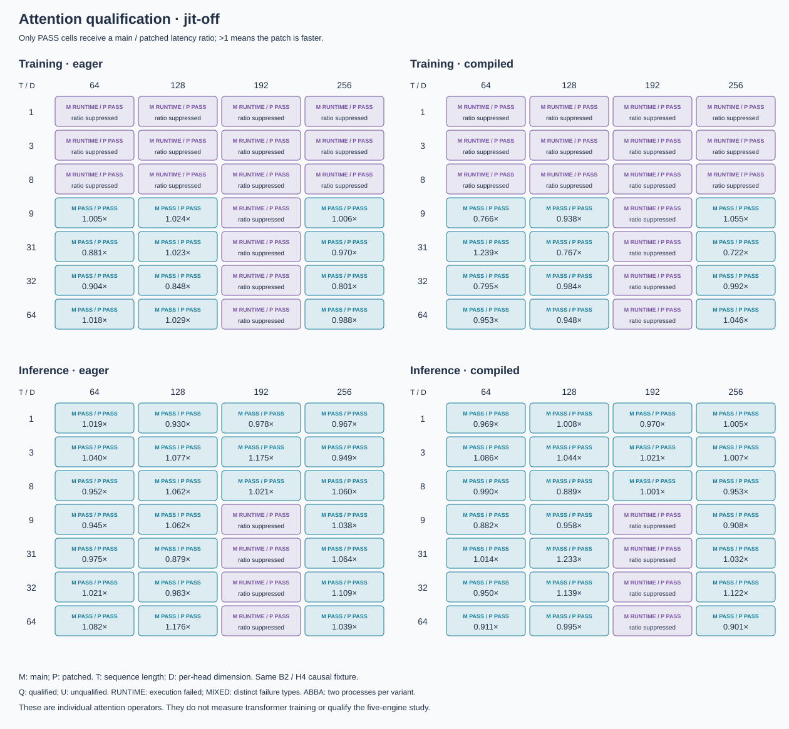
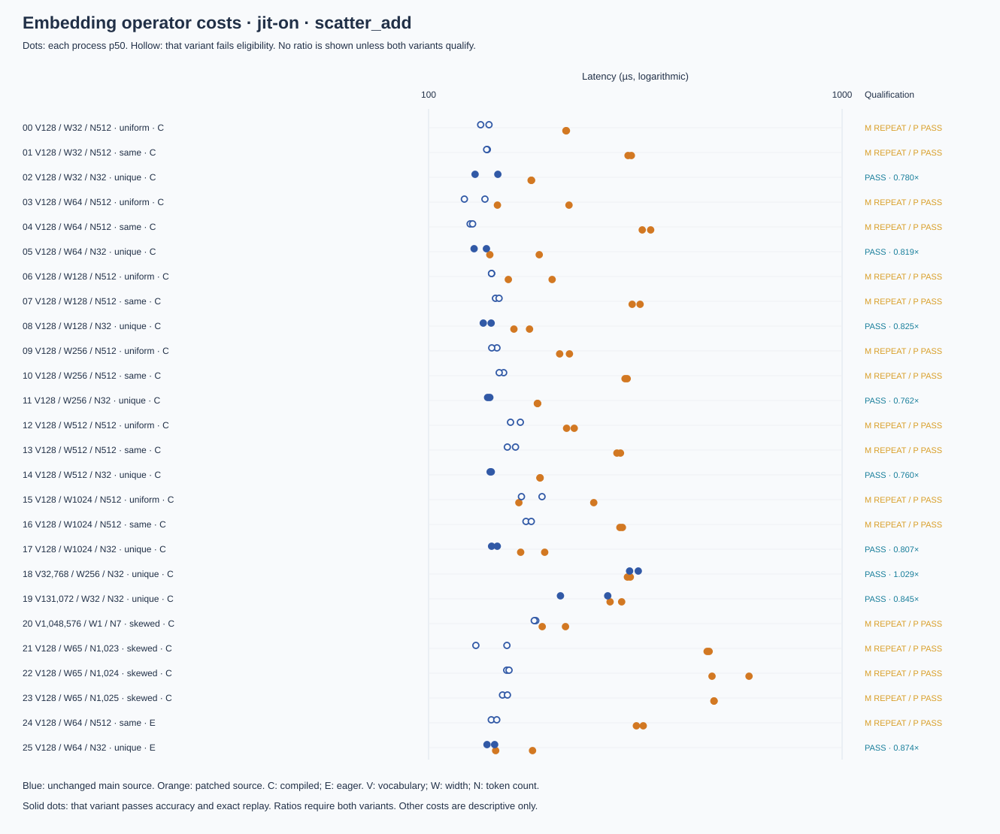
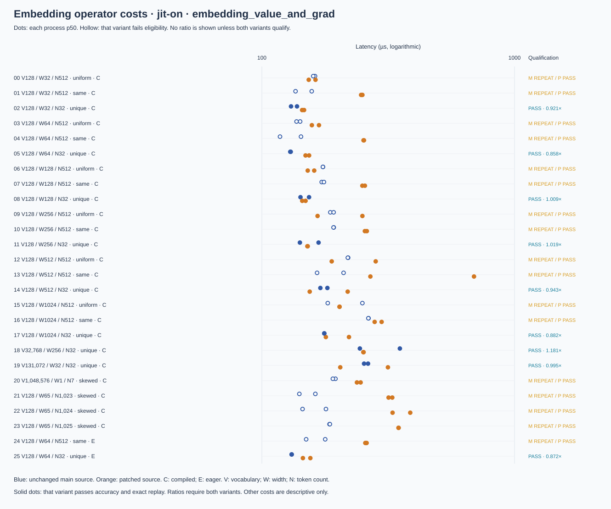
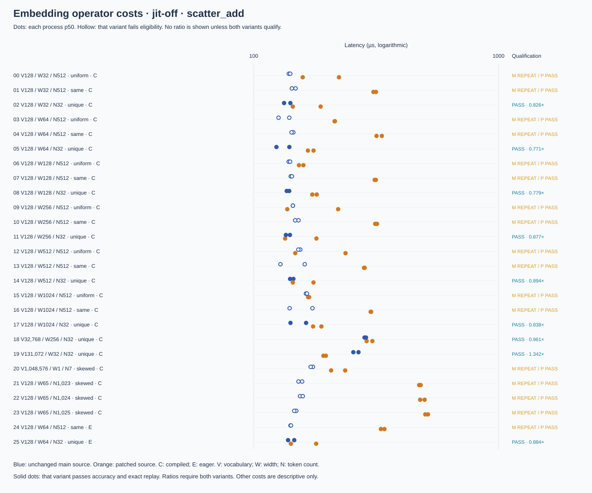
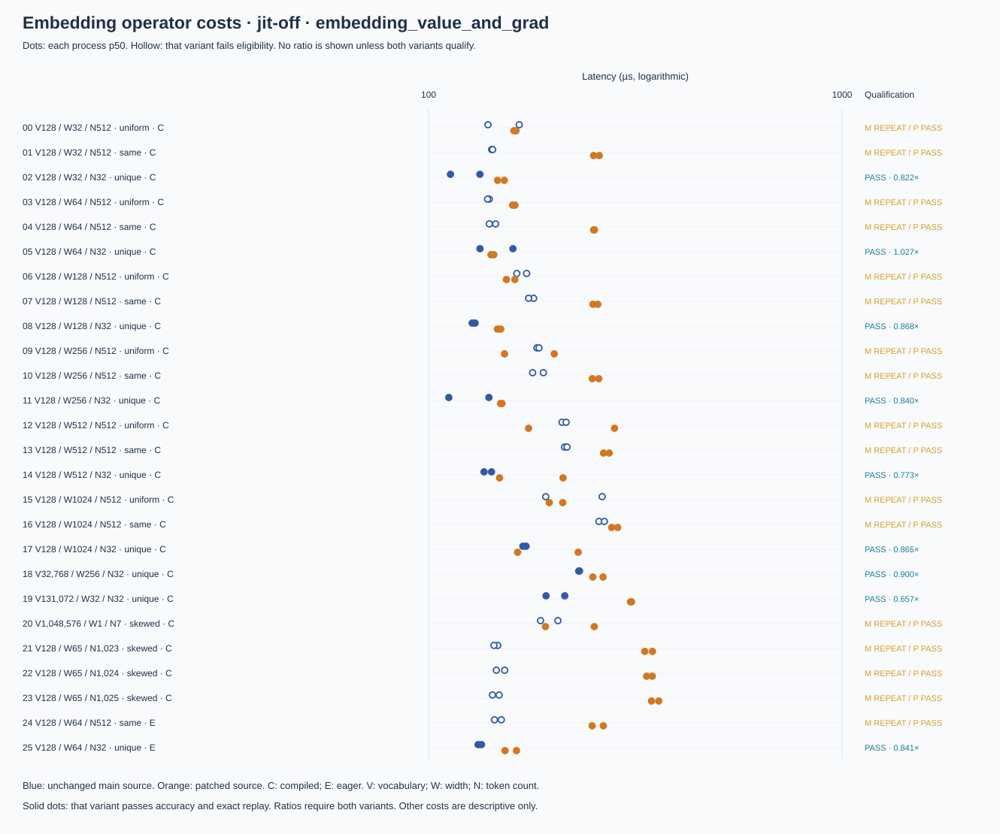

# Matched Release MLX operator experiment

Matched Release MLX operator costs; no model-training or formal-study performance.

This experiment compares the unchanged MLX source with the embedding and attention patches on the same M4 Max, fixtures, Release compiler settings, and dependencies. Both Metal shader modes are shown separately. It measures synchronized calls to individual operators; it does not measure model training, compare CPU with GPU, or admit a standard framework into the 180-fit study.

## Evidence and qualification

All 1,104 worker receipts and 328 operation comparisons were revalidated against the frozen manifest. The 328 comparisons occupy 276 ABBA groups: 26 embedding cases each have two operations, and 112 attention cases each have one operation, in both shader modes. Raw array file identities, full-source runtimes, dependency identities, source bytes, and prior Release model/suite gates were checked again. No equations were rerun by this report. Worker-log hashes are first recorded at report time; qualification relies on the original hash-bound structured receipts and arrays.

| Shader mode | Family / operation | Main eligible | Patched eligible | Qualified ratios | Unqualified comparisons | Total |
|---|---|---:|---:|---:|---:|---:|
| jit-on | scatter_add | 9 | 26 | 9 | 17 | 26 |
| jit-on | embedding_value_and_grad | 9 | 26 | 9 | 17 | 26 |
| jit-on | attention_training | 24 | 56 | 24 | 32 | 56 |
| jit-on | attention_inference | 48 | 56 | 48 | 8 | 56 |
| jit-off | scatter_add | 9 | 26 | 9 | 17 | 26 |
| jit-off | embedding_value_and_grad | 9 | 26 | 9 | 17 | 26 |
| jit-off | attention_training | 24 | 56 | 24 | 32 | 56 |
| jit-off | attention_inference | 48 | 56 | 48 | 8 | 56 |

A ratio is the mean of the two main-process median latencies divided by the mean of the two patched-process medians. A value above one means the patch is faster for that specific qualified operator and shape. Every unqualified comparison has a null ratio. Its measured latencies, failures, and unexecuted operations remain visible. No pooled speedup is calculated.

Each timed operation uses 20 warmups and 100 synchronized observations per process. Ten exact replays, a final replay, two changing-input controls, independent FP64 checks, and exact output equality between the two processes of each variant are required. A failed early runtime or accuracy check may prevent timing; it is retained as an unqualified result. Cold invocation is reported separately. CSV p95 uses linear interpolation at (N−1)×0.95 within a process.

## Attention

### jit-on

### jit-off

## Embedding

## Complete data and limits

[All 328 operation comparisons](data/operator-comparisons.csv) retain qualification, descriptive costs, and suppressed ratios. The [compact summary](summary.json) and [provenance](PROVENANCE.json) identify the full archived campaign, raw timing observations, numerical arrays, audited runtimes and reproduction tools. The original report and its complete CSV/JSON outputs remain in the evidence package; this Git subset omits those larger files.

The main runtime is an unchanged source build at the pinned commit, not a supported stable-package baseline. Both variants are optimized Release builds with actual graph-compilation evidence where requested. These individual-operator measurements establish no complete-model or CPU/GPU speedup. Private patched-runtime checks do not qualify the installed standard baselines or admit the formal 180-fit study. See the [integration report](README.md) for full-model correctness evidence and remaining gates.
