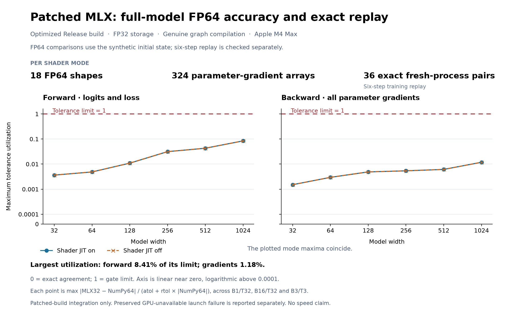
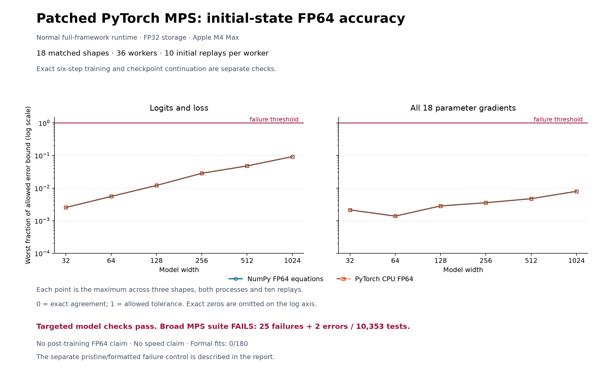

# Framework integration: deterministic reductions and complete GPU execution

A GPU implementation must define both who owns an output and how its arithmetic
is ordered. Many threads can contribute to an embedding row. Floating-point
atomic additions protect the memory update, but their scheduling can change the
sum’s final bits. Attention dispatch has a different contract: forward must save
what backward needs, and the chosen tile must fit the hardware’s memory limits.

This phase repairs those contracts inside the frameworks, validates complete
models, and measures individual operators. Patched full-source MLX passes the
declared optimized-build integration checks in both shader modes. Patched
PyTorch passes targeted embedding and model checks; its broad MPS suite remains
failed. **The five-engine study remains blocked: 0 of 180 formal fits.** Private
patched builds do not replace the required supported standard-framework baselines.

## The implementation changes

**MLX embedding gradients.** Embedding backward lowers to a scatter sum. The
[patch](../../integration/mlx-release-bench/inputs/embedding-fix.patch) orders
complete-slice updates by a 64-bit key containing destination row and original
logical position. Existing merge argsort groups the updates. One thread owns
each destination element and adds contributions in their original order, without
floating-point atomics. Row-group dispatch uses the smaller of update count and
vocabulary size, avoiding work for every untouched vocabulary row.

The public embedding operator and autodiff graph remain intact. This
specialization handles the declared complete-slice case, including negative
indices and strided inputs; other scatter forms retain their existing paths.
Sorting, temporary storage and serial accumulation within a heavily repeated row
have costs. Determinism is an explicit behavior, not an automatic speed gain.

**MLX attention.** The [dispatch repair](../../integration/mlx-release-bench/inputs/attention-fix.patch)
selects full attention whenever backward requires saved log-sum-exp, including
query lengths of eight or fewer. Ordinary short-query inference keeps its vector
path. A separate FP32 head-dimension-192 schedule uses two SIMD groups across the
head dimension and register-resident queries. It avoids the former 40,448-byte
threadgroup-memory requirement on a device limited to 32,768 bytes. Both
runtime-generated and precompiled Metal shader builds are validated.

**PyTorch MPS.** The [candidate patch](../../validation/upstream-pytorch-format-v2/changes.patch)
selects a stable-sort, single-writer embedding-backward path when deterministic
algorithms are requested. Contributions retain their logical input order, with
parallel work across rows and features, existing frequency scaling and padding
behavior, and 32/64-bit offset paths. It preserves ordinary dispatch elsewhere.

**Project integration.** Two presence-based environment controls,
`MLX_DISABLE_COMPILE` and `PYTORCH_MPS_PREFER_METAL`, must be absent to request
actual compiled MLX and ordinary MPS dispatch. Setting either to `"0"` still
activates it. After enabling actual compilation, the MLX gradient wrapper also
needed `model.state` captured as both implicit inputs and outputs:
`nn.value_and_grad` mutates it during tracing. These repairs preserve model
equations, fixtures, optimizer and tolerances. The
[configuration correction](../gpu-compile-control-v1/CORRECTION.md) preserves the
older diagnostics’ narrower scope.

## Complete-model validation of patched MLX

Four matched builds at source revision
`a21f892a6e8e83afb117cef1d1ceae3e82f48c32` provide unchanged and patched variants
in each shader-JIT mode. All use optimized **Release** settings, including
`-O3 -DNDEBUG -g0`. Release denotes compiler configuration, not a supported
stable package. Graph compilation is independently demonstrated in both modes.
Before operator timing, each patched mode passed:

| Check, per shader mode | Completed coverage |
|---|---|
| Full GPU C++ suite | 305 cases, 4,792 assertions; zero failures |
| Full GPU Python suite | 1,046 passed, seven existing skips, 17,701 passing subtests |
| Exact six-step model replay | 72 workers across 36 shapes; all 36 fresh-process pairs exact |
| Saved step-3 checkpoint continuation | 72 exact roundtrips; 216 continued updates |
| Independent FP64 forward/backward | 18 shapes at W32–1024; all 324 parameter-gradient arrays |
| Repeated FP64-harness execution | Ten executions per shape; 180 total |

FP64 fixtures cover B1/T32, B16/T32 and B3/T3 at every width. Explicit NumPy FP64
equations and PyTorch CPU FP64 autograd cross-check one another at absolute/relative
tolerance `1e-10 / 1e-10`. MLX retains forward limits `2e-5 / 2e-4` and gradient
limits `3e-5 / 3e-3`. Exact repeatability is a separate byte-equality check.

The largest forward error uses **8.41% of its allowed bound**; the largest
gradient error uses **1.18%**. These are worst per-element tolerance fractions,
not average errors. The curves describe the synthetic **initial state**.
Exact training and checkpoint replay are separate checks; this figure does not
establish post-training FP64 accuracy. The [per-width data](data/release-numerical-margins.csv)
retain both shader modes.

The seven Python-suite skips are unchanged upstream eligibility decisions for
unavailable hardware, Python version or deliberately disabled exhaustive testing.
Older Debug/hybrid builds and graph-disabled diagnostics are not substituted for
these Release checks. Historical failures and metadata repairs remain archived.

## Patched PyTorch: targeted passes, broad-suite failures

The selected formatted full-framework build
[40989036595](https://github.com/logannye/arm64-transformer/actions/runs/40989036595)
passes compilation, normal import, transported import, archive-roundtrip import,
and complete artifact/runtime transport authentication. These checks use normal
native origins, with no process-local embedding override. They are development
diagnostics, not performance benchmarks or formal fits.

| Check | Recorded result |
|---|---|
| Focused upstream embedding tests | **79 passed**, zero skips, including the 64-bit-offset case |
| Embedding-gradient matrix | **216 cases × ten executions × two processes = 4,320 evaluations**; exact within/across-process checks pass |
| Legacy decoder regression | Six widths, two processes, six updates, step-3 checkpoint and three-update continuation; pass |
| Matched transformer | **18 shapes, 36 workers, 18 exact fresh-process pairs**; ten initial replays, two FP64 references and all 18 parameter gradients per shape; pass |
| Full `test_mps.py` module | **25 failures and two errors across 10,353 tests**; 744 skips, 382 expected failures, zero unexpected successes |

Across both FP64 references, the worst forward error uses **9.24%** of its allowed
bound and the worst gradient error uses **0.80%**. Each point includes three
shapes, two processes and ten initial replays; the
[per-width data](data/pytorch-initial-state.csv) preserve both references. This
chart measures initial synthetic accuracy, not post-training FP64 accuracy,
runtime or predictive quality. The broad-suite failures remain separate.

The matched model uses the project’s ASCII-128 vocabulary, FFN width 2W and three
LayerNorms at W32–1024, with B1/T32, B16/T32 and B3/T3. It compares MPS with
explicit NumPy FP64 equations and PyTorch CPU FP64 autograd under the unchanged
limits. It also checks two exact six-step trajectories, warmup restoration,
step-3 serialization/reload and exact continued updates 4–6. The legacy decoder
has a different vocabulary and FFN width and remains separately labeled.

The saved-evidence audit passes integrity and qualifies the four targeted test
families. It authenticates 1,199 NPY objects and two NPZ containers containing
864 members without rerunning numerical equations. **Overall development
qualification remains false because the broad suite failed.** The audit’s
coverage flag is false after the failed exit; it does not mean tests were
missing: all 10,353 planned IDs ran.

### What the failure controls establish

All **27 failing IDs recur in 27 separate fresh processes**, preserving their
failure/error classifications and upstream assertion locations. The metadata
state audit finds the same recorded framework state in all 81 snapshots, with
no within-process state changes. Earlier tests in the broad suite are therefore
not necessary to trigger these failures. That observation alone does not identify
their cause or establish that the patch is unrelated.

The failures comprise one FP16 combinations-gradient error, one FP32
transposed-3D-convolution-gradient error, 12 channels-last 3D-convolution forward
failures, one channels-last transposed-3D-convolution-gradient failure, six
strided-output BMM failures, one strided-output GEMV failure and five
strided-output MM failures. These counts are observations, not revised thresholds.

A separate [same-host paired build](https://github.com/logannye/arm64-transformer/actions/runs/41008996057)
produced pristine and formatted frameworks using one environment and build tree,
retaining pristine artifacts before applying the patch. Both variants pass normal
and transported imports and retain the same 13 hosted lint findings. The pair
uses runner image `20261021.0445.8` and OpenMP 23.1.4; the selected model build used
`20261013.0424.1` and OpenMP 23.1.3. Thus comparisons within this pair are matched,
while the pair remains distinct from the selected model runtime.

The fresh control completes **all 54 processes: all 27 tests fail in each
variant**. The independent closed-output audit passes. All 27 comparisons have
matching failure kinds and comparable, matching source-bound assertion locations;
all 81 recorded-state comparisons match. Raw traceback line coordinates differ
in every pair. The source-bound comparison resolves those coordinates through
the nine authenticated unchanged method ASTs and within-statement positions.
It does not treat different raw line numbers as different failures.

The audit verifies 110 execution-time authentication events and their journals,
plus two separate audit-time checks. Neither earlier incomplete attempt supplies
a worker to this result. The final summary is `019f4250657fef70ce082b1bb458f6c71e771a65784a98667bfc251c21d65eec`;
the independent audit is `0c650134d2c4cd8ac5aacd27d1fc530fdad63237da6371d1d47785faa24be578`.

These failures reproduce in both variants under matching recorded controls.
Matching kinds and source-bound assertion locations do not prove a shared
numerical cause. The original failed suite remains failed. This retrospective control
neither replaces the model-validation runtime nor admits a supported release.

The selected build’s hosted workflow remains failed at lint. A separately
authenticated pristine/original/formatted comparison, run `40999805087`, finds
13 shared pristine/formatted diagnostics and no formatted-only findings. It
permits the separate development diagnostic gate; it does not turn the workflow
green or waive the broad-suite failures.

## Matched MLX operator results

The fixed inventory contains 26 embedding cases, each with scatter-add and
embedding-value/gradient operations, and 112 attention cases. Both shader modes
run main/patched/patched/main order: **1,104 workers, 276 groups and 328 operation
comparisons**. Every timed operation uses 20 warmups and 100 synchronized
observations per process. Ten exact replays, a final replay, two changing-input
controls and FP64 checks precede qualification; both fresh processes of each
variant must agree exactly.

| Outcome across both shader modes | Comparisons |
|---|---:|
| Both variants qualify; ratio available | 180 |
| Main fails exact repeatability; ratio suppressed | 68 |
| Main encounters a runtime failure; ratio suppressed | 80 |
| Patched variant qualifies | **328 / 328** |

All 6,960 retained initial/control accuracy comparisons pass. An operation that
fails execution has no measured accuracy result for the computation that did not
complete. Restored execution and exact replay over the declared cases are the
strongest results. Deterministic embedding reductions can increase latency,
especially with heavily repeated tokens. Qualified timing comparisons show both
improvements and regressions by shape; no pooled speedup is reported.

The [operator report](OPERATORS.md) presents all eight figures;
[all 328 comparisons](data/operator-comparisons.csv) retain costs and null ratios.
A ratio is mean main-process p50 divided by mean patched-process p50. An untimed
baseline appears as a dash while patched latency stays visible. Unqualified
costs are descriptive, never a one-sided speedup. Two processes per variant give
limited timing evidence. This experiment does not measure complete transformer
training or establish CPU/GPU crossover behavior.

## Why the formal study remains blocked

Installed PyTorch MPS 2.14.1 completes its 12 corrected-control workers and passes
recorded accuracy checks, but fails exact repeatability at every width. The
retained first divergent B16/T32 gradients differ only in the token-embedding
tensor; that localization does not establish every later training difference.
Installed MLX 0.32.4 also fails exact replay in all 12 workers. Widths 32–128
complete; widths 256–1024 retain 36 attention-backward runtime errors. Completed
accuracy checks pass, and the former project state-capture errors are gone.

The original requirements remain: suitable supported standard releases, fresh
baseline and CPU checks, frozen source/runtime/policy identities, complete
admission, then all 180 matched fits and the full checkpoint audit. Admission
stream `20261104` remains unopened. Historical wide-CPU precision failures remain
unresolved. No upstream acceptance, supported-release admission, whole-model GPU
speedup or new predictive-quality result is claimed.

## Retention, reconstruction and qualification boundaries

[summary.json](summary.json) holds compact counts and qualifications;
[PROVENANCE.json](PROVENANCE.json) binds the original reports, audits, source notes
and copied assets. The [reproduction guide](REPRODUCTION.md) distinguishes archive
reconstruction from a new source/runtime-qualified execution. The Git subset
omits large raw arrays, native bundles and exhaustive receipts. Evidence packages
preserve their original `work/` and `outputs/` layout, including failed attempts.
The [published catalog and remote verification records](PUBLICATION.md)
authenticate the complete 92-asset release and its archive layers.

Retention differs by experiment:

- Each patched MLX mode checked 72 checkpoint roundtrips, retained one checkpoint
  archive and declared the other 71 transient after verification.
- Matched MPS retains all initial inputs/parameters, both FP64 references and all
  ten initial logits/loss/gradient evaluations through deduplicated raw storage.
  Raw step-3 states/predictions are retained for B16/T32 in the first process at
  each width. Other transition values retain fingerprints and were compared as
  complete arrays in memory; serialization containers are transient.
- Baseline snapshots retain initial and first-divergent outputs, not every
  execution. The older run has 72 initial moment/counter arrays without original
  value bindings; corrected MLX has 36. Current containers were checked, but
  those values cannot be retrospectively authenticated.

These are not the formal campaign’s full retained checkpoint audit.

The operator manifest is
`79f8fc4b53d3918226ad37e96287e22cff4d2fd1e57ecb961f9771b22da202d8`;
its final summary is
`eac7b33dd0fc9e852bbf72feaf7ce12cd7f01e302ddff01e6c4247d75b12cbb8`.
Report regeneration authenticated the original inputs after a presentation repair;
numerical tables, qualification equations and campaign bytes remain unchanged.

### Preserved failures and infrastructure repairs

The archive retains the original failure before any corrected attempt. None of
the following repairs changes numerical tolerances, saves a failed cell as a
passing one, or opens formal admission.

| Retained event | Separate repair or control |
|---|---|
| MLX graph-disabled, hybrid/Debug and GPU-unavailable diagnostics | Independently authenticated full-source Release runs with actual compilation proof |
| Contradictory full-suite summary fields | Metadata-only correction from unchanged logs and complete test inventories |
| CPU-only interoperability-suite failure | Separate upstream test-eligibility repair; no CPU performance claim |
| PyTorch early import-provenance, lint-tooling and pristine-host-image failures | Versioned repairs, original logs, and explicit matched controls |
| First isolated replay rejected access-time changes | Narrow stable-identity correction; all 27 tests rerun |
| Paired attempts stopped after 53 and 44 completed workers | Both remain incomplete; all 54 cells require a fresh run |
| Source/runtime ctime-only changes invalidated prior stat bindings | Full original-byte revalidation and explicit new evidence, preserving old failed checks |

The complete source postflight rehashed the tracked source against its authenticated
Git and raw/canonical-byte identities. Its successful new receipt permits only
ctime differences from the original receipt; every other field remains exact.
For the fresh paired replay, a ctime change invalidates the file’s cached hash
proof and triggers a stable full-file comparison with the original archive hash.
Other stat fields and topology remain strict. Every accepted invalidation has
retained pre/post authentication events and adjacent hash journals. Missing,
changed or unstable evidence blocks qualification. These checks authenticate
bytes and execution evidence; they do not requalify historical numerical results.
