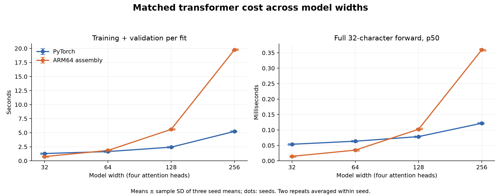
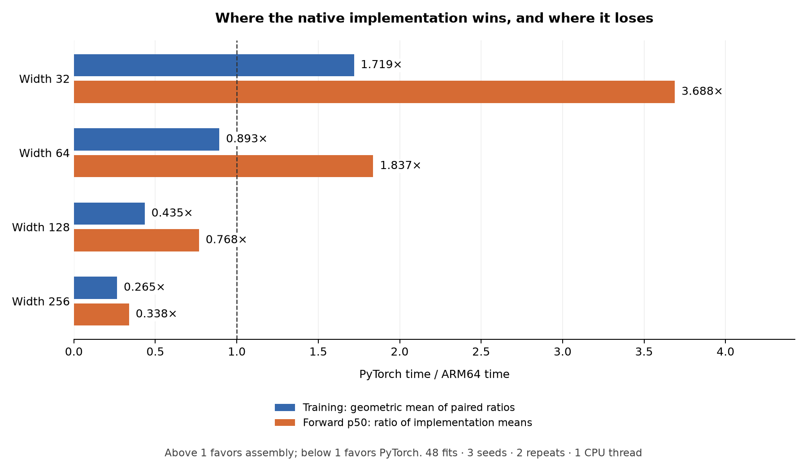
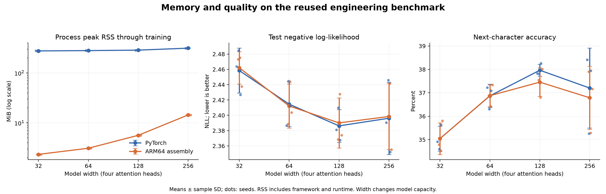

# Transformer width sweep, v3

The complete sweep contains **48 fits** at widths 32, 64, 128 and 256:
three seeds, two timing repeats and both implementations at each width.
Each comparison uses the same initial weights, token rows and schedules within
its width/seed pair. Source revision: `e11243f454d7b42bfb044883089e2df23c5a59e0`.

This is the reused engineering benchmark from v1/v2, not a fresh untouched test
set. Widths and training rules were fixed before timing. Wider models change
capacity and computational cost; this report does not select a width from test quality.

## Training and forward timing

| Width | Parameters | PyTorch training (s) | ARM64 training (s) | Paired training ratio |
|---:|---:|---:|---:|---:|
| 32 | 17,952 | 1.296 ± 0.006 | 0.754 ± 0.002 | 1.719× |
| 64 | 52,160 | 1.649 ± 0.025 | 1.846 ± 0.015 | 0.893× |
| 128 | 169,728 | 2.432 ± 0.017 | 5.596 ± 0.005 | 0.435× |
| 256 | 601,472 | 5.232 ± 0.035 | 19.758 ± 0.094 | 0.265× |

The primary ratio at each width is the geometric mean of six paired
PyTorch/ARM64 training-time ratios. Above one favors assembly; below one favors
PyTorch. There is no pooled-width primary ratio or excluded unfavorable width.
Training includes validation, finite checks, checkpoint selection/writes and
history bookkeeping. Each fit performs 1,024 updates over eight epochs.

| Width | PyTorch forward p50 (ms) | ARM64 forward p50 (ms) | Ratio of mean p50s |
|---:|---:|---:|---:|
| 32 | 0.0537 ± 0.0002 | 0.0145 ± 0.0005 | 3.688× |
| 64 | 0.0635 ± 0.0005 | 0.0346 ± 0.0009 | 1.837× |
| 128 | 0.0784 ± 0.0003 | 0.1021 ± 0.0018 | 0.768× |
| 256 | 0.1217 ± 0.0009 | 0.3597 ± 0.0016 | 0.338× |

Forward latency is one full 32-character context, batch one, after 20 warmups,
with 100 samples per fit. It excludes token loading, loss, softmax, sampling and
I/O. It is not cached next-token generation. The forward ratio uses the two
implementation means, a different statistic from the primary training ratio.

This publication layout separates the value labels for readability. It uses the
unchanged audited statistics; the [original figure](speedup.png) and
[rendering provenance](figure-publication.json) are retained.

Entries and error bars are mean ± sample SD of three seed means, with the two
repeats averaged within each seed. Repeats are not independent quality seeds.
OS scheduling, temperatures and clock frequencies were not experimentally fixed.

## Throughput, memory and prediction quality

| Width | Implementation | Target ktoken/s | Peak RSS (MiB) | Test NLL | Accuracy (%) |
|---:|---|---:|---:|---:|---:|
| 32 | PyTorch | 404.7 ± 1.8 | 277.09 ± 0.64 | 2.4585 ± 0.0292 | 35.046 ± 0.532 |
| 32 | ARM64 assembly | 695.8 ± 1.4 | 2.34 ± 0.00 | 2.4621 ± 0.0211 | 35.042 ± 0.671 |
| 64 | PyTorch | 318.2 ± 4.7 | 280.93 ± 0.60 | 2.4145 ± 0.0291 | 36.869 ± 0.494 |
| 64 | ARM64 assembly | 284.0 ± 2.3 | 3.11 ± 0.00 | 2.4122 ± 0.0288 | 36.877 ± 0.464 |
| 128 | PyTorch | 215.6 ± 1.5 | 287.15 ± 3.04 | 2.3862 ± 0.0214 | 37.964 ± 0.254 |
| 128 | ARM64 assembly | 93.7 ± 0.1 | 5.64 ± 0.00 | 2.3901 ± 0.0327 | 37.455 ± 0.610 |
| 256 | PyTorch | 100.2 ± 0.7 | 314.36 ± 0.43 | 2.3962 ± 0.0472 | 37.203 ± 1.705 |
| 256 | ARM64 assembly | 26.5 ± 0.1 | 14.45 ± 0.00 | 2.3984 ± 0.0431 | 36.788 ± 1.347 |

Throughput divides **524,288 training target characters per fit**
by the training-plus-validation timer, then averages repetitions within seed.
Validation tokens are excluded from the numerator while validation time remains
in the denominator. RSS includes the framework, runtime and data; it does not
isolate model memory. NLL and accuracy are descriptive observations, not evidence
of statistical equivalence between implementations.

Uniform and training-only unigram baselines, all per-seed quality differences,
prediction disagreements, checkpoints and individual runs are retained in the
per-width reports. The shared data audit verifies identical corpus identity,
partitions and train/validation/test rows across widths, identical schedules for
each seed, and distinct width-specific initial parameter files. No model-quality
tuning used this test set during the sweep.

## Evidence and limits

The post-run audit contains **14,113 checks**:
517 sweep consistency checks plus all per-width
post-run records. The separate numerical/runtime preflights contain
**3,692 checks** in total. All
**393,216 retained test prediction rows** were
independently recomputed from selected checkpoints; selected validation losses
were also checked against checkpoint-selection histories. Within-implementation
repeat equality is required before quality aggregation.

- [Width 32: full report](width-32/README.md), [audit](width-32/audit.json) (3,399 checks), [preflight](width-32/preflight.json) (923 checks).
- [Width 64: full report](width-64/README.md), [audit](width-64/audit.json) (3,399 checks), [preflight](width-64/preflight.json) (923 checks).
- [Width 128: full report](width-128/README.md), [audit](width-128/audit.json) (3,399 checks), [preflight](width-128/preflight.json) (923 checks).
- [Width 256: full report](width-256/README.md), [audit](width-256/audit.json) (3,399 checks), [preflight](width-256/preflight.json) (923 checks).

See [summary.json](summary.json) for all observations, statistics and hashes,
[audit.json](audit.json) for every post-run check, and
[report-processes.json](report-processes.json) for the separate width-selected
audit subprocesses. Full raw evidence remains in the original result/input
directories. Reporting never overwrites an existing destination.

The first repeat visited ascending widths and the second descending widths;
implementation order reversed within each seed pair. Fits ran sequentially on
AC power with one CPU compute thread and 15-second pauses. Every measured entry
matches its per-width manifest exactly, with unchanged source, binary and inputs.

The scope is this short-context float32 model family on one CPU machine against
eager PyTorch. Native training still accumulates per-sequence gradients. These
results establish neither fresh test-set generalization nor GPU, long-context,
graph-compiled PyTorch, energy, cached decoding or production-serving performance.
Historical v1/v2 comparisons remain separate campaigns with different conditions.
