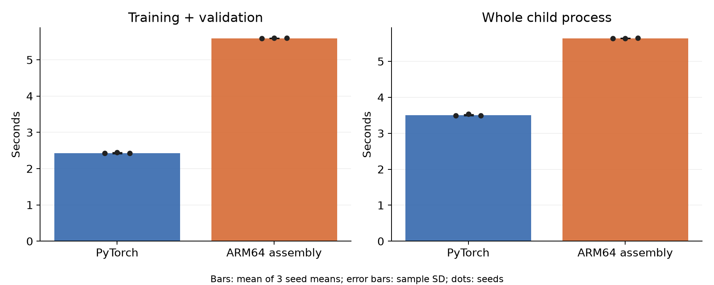
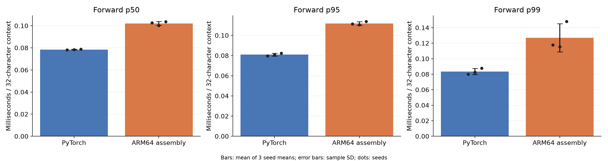
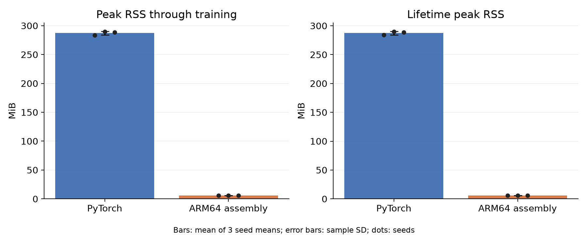
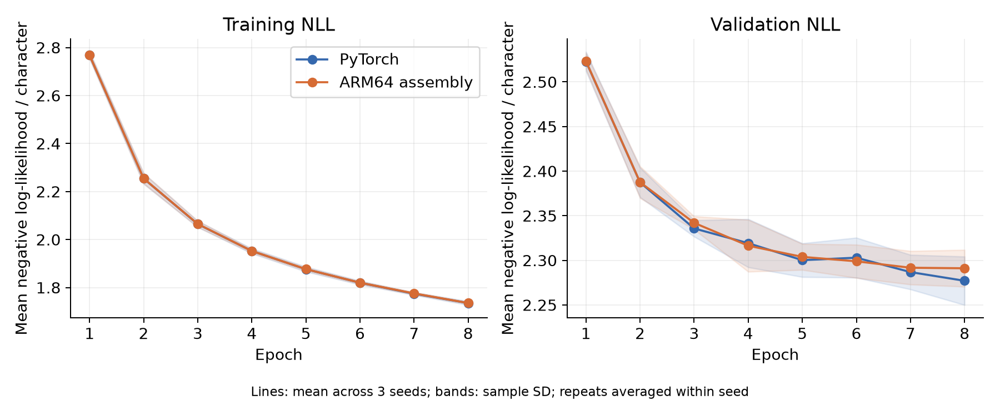

# Matched transformer CPU comparison, v3, width 128

This optimization study reuses v1's fixed train/validation/test fixtures. It is an engineering regression benchmark, not a fresh untouched test set. Kernel development used synthetic correctness and timing inputs; the model, optimizer, seeds and stopping rule were unchanged.

ARM64 training took **2.301× as long** as PyTorch, using the geometric mean of six paired training-time ratios.
This is the same 169,728-parameter causal transformer implemented with ordinary
batched PyTorch (built-in scaled-dot-product attention and autograd) and handwritten
Apple ARM64/NEON assembly. The experiment contains **12 complete fits**: three
initialization seeds, two timing repeats, and both implementations.

Measured source revision: `e11243f454d7b42bfb044883089e2df23c5a59e0`. Hardware: Apple M4 Max.
Platform: `macOS-26.2-arm64-arm-64bit`. PyTorch: `2.14.1`.

| Measurement | PyTorch | ARM64 assembly |
|---|---:|---:|
| Test NLL (lower is better) | 2.3862 ± 0.0214 | 2.3901 ± 0.0327 |
| Test bits / character | 3.4425 ± 0.0309 | 3.4481 ± 0.0471 |
| Test perplexity | 10.874 ± 0.234 | 10.918 ± 0.360 |
| Next-character accuracy (%) | 37.964 ± 0.254 | 37.455 ± 0.610 |
| Training + validation (s) | 2.432 ± 0.017 | 5.596 ± 0.005 |
| Training CPU time (s) | 2.425 ± 0.018 | 5.592 ± 0.007 |
| Whole child process (s) | 3.508 ± 0.020 | 5.643 ± 0.006 |
| Forward p50, full context (ms) | 0.0784 ± 0.0003 | 0.1021 ± 0.0018 |
| Forward p95, full context (ms) | 0.0809 ± 0.0013 | 0.1119 ± 0.0017 |
| Forward p99, full context (ms) | 0.0835 ± 0.0040 | 0.1271 ± 0.0182 |
| Peak RSS through training (MiB) | 287.15 ± 3.04 | 5.64 ± 0.00 |

Entries are mean ± sample SD of three seed means. Timing repeats are averaged
within seed; they are not six independent quality seeds. The primary ratio is
Python/ARM64 training time, **0.434547**, where values above one favor assembly.
All within-implementation repeat checkpoints, optimizer states, held-out logits,
and non-timing learning histories matched exactly.

## Prediction quality and baselines

The mean assembly-minus-PyTorch test NLL difference was
**+0.003875**, and the accuracy difference was
**-0.508626 percentage points**.
Mean paired next-character prediction disagreement was **28.918%**.
These are descriptive observations, not a statistical equivalence claim.

A uniform ASCII-128 predictor has NLL **4.8520** and perplexity
**128.000**. An add-one-smoothed unigram predictor fitted only
to the 65,536 training target characters has held-out NLL **3.3623**,
perplexity **28.856**, and accuracy **15.344%**.
Its training counts are retained in [summary.json](summary.json).

The source corpus is Tiny Shakespeare. Contiguous 80/10/10 partitions were made
before selecting the first 65,537/8,193/8,193 bytes for this bounded experiment.
There are 2,048 training and 256 validation/test sequences, each predicting 32
characters. Eight epochs and batch 16 give 1,024 optimizer updates per run.
Validation NLL selects the checkpoint; test data are used only after selection.

## Timing and memory scope

Training includes forward/backward, Adam, finite checks, epoch validation,
checkpoint selection/writes and history bookkeeping. Setup, final evaluation,
last-state export and inference timing are outside this timer. Whole-process
time is independently measured by the parent from child launch through exit.

Latency is a **batch-one forward pass over a complete 32-character context**,
with 20 warmups and 100 measured samples per run. It excludes token loading,
softmax, sampling, loss, and I/O. It is not cached single-token generation or
end-to-end application latency. The p99 values describe these 100-sample
microbenchmarks and do not establish rare-event deployment guarantees.

Memory is process lifetime peak RSS through each boundary, including runtime,
framework and loaded data. It is not model-only memory; subtracting these peaks
does not isolate individual allocations.

## Every measured run

| Seed | Repeat | Implementation | Train (s) | Test NLL | Accuracy (%) | Best epoch |
|---:|---:|---|---:|---:|---:|---:|
| 42 | 1 | PyTorch | 2.408 | 2.38115 | 37.830 | 8 |
| 42 | 1 | ARM64 assembly | 5.447 | 2.36855 | 37.549 | 7 |
| 43 | 1 | ARM64 assembly | 5.561 | 2.42765 | 36.804 | 5 |
| 43 | 1 | PyTorch | 2.450 | 2.40968 | 37.805 | 7 |
| 44 | 1 | PyTorch | 2.395 | 2.36773 | 38.257 | 8 |
| 44 | 1 | ARM64 assembly | 5.554 | 2.37399 | 38.013 | 8 |
| 42 | 2 | ARM64 assembly | 5.734 | 2.36855 | 37.549 | 7 |
| 42 | 2 | PyTorch | 2.436 | 2.38115 | 37.830 | 8 |
| 43 | 2 | PyTorch | 2.453 | 2.40968 | 37.805 | 7 |
| 43 | 2 | ARM64 assembly | 5.633 | 2.42765 | 36.804 | 5 |
| 44 | 2 | ARM64 assembly | 5.649 | 2.37399 | 38.013 | 8 |
| 44 | 2 | PyTorch | 2.447 | 2.36773 | 38.257 | 8 |

## Controls and retained evidence

Both implementations used the same float32 initial parameters, token rows,
per-epoch schedules, Adam settings, one-thread CPU budget and stopping rule.
Run order was reversed between repeats, one child ran at a time, and fixed
15-second pauses separated children. Power, thermal and load snapshots are
retained in the raw runner manifest. Operating-system scheduling, temperature
and clock frequencies were not experimentally fixed.

The independent post-run audit passed **3399 checks**.
All **98,304 held-out prediction rows**
were recomputed from their selected checkpoints with a separate functional
PyTorch reference. Selected-checkpoint validation loss was independently
recomputed and matched the selection history. NumPy float64 calculations
produced the reported quality metrics. See [audit.json](audit.json) for every
check and [summary.json](summary.json) for per-run metrics and hashes.

The result applies to this small, short-context CPU workload on one machine.
It does not establish a general language-speed advantage, large-language-model
quality, GPU performance, energy use, cached decoding speed, or production
serving behavior. Eager PyTorch is the baseline; graph-compiled PyTorch is not
evaluated. Float32 operation grouping differs, so long training trajectories
need not be bitwise identical between implementations.

The compact report contains metrics, checks, hashes, and figures. Full inputs,
schedules, raw logits, checkpoints, optimizer states, latency samples, the source
snapshot and executable belong to the accompanying raw evidence bundle.
