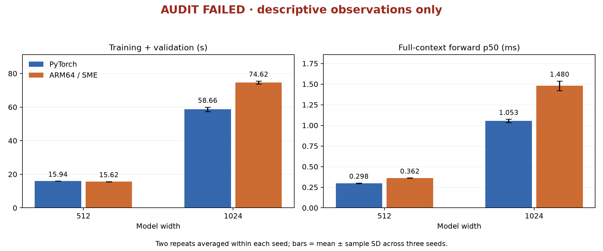
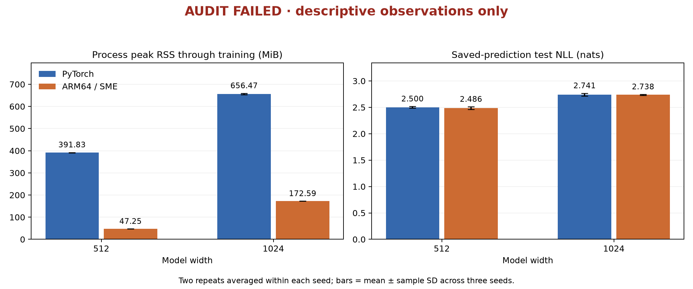

# Wider transformer study: audit failed

**The completed 24-fit campaign failed its frozen post-run checkpoint audit. No validated speed
or numerical-equivalence claim is made.** This reporting-only document was created after the
failed audits to disclose all outcomes. It does not replace either original report, relax a
threshold, reclassify a failed check, or retrain a model after inspecting test results.

Measured source: `c12874c2fe6af3fd1612046950aa56d756f4d0a0`. Widths 512 and 1024 contain 2,251,392 and 8,696,960
parameters. The known engineering benchmark reused the same data partitions, 32-character
contexts, seeds 42/43/44, eight epochs, batch size 16, 1,024 updates, and 524,288 training
target characters per fit. There were two repeats of each implementation per seed and width, in
the prespecified balanced order with 15-second pauses. Each process used one CPU compute thread.

## Numerical result and retained failures

The original per-width post-run audits contain **6,822 checks**,
of which **50 failed**: 2 at width 512 and
48 at width 1024. Each failed check compares a saved native checkpoint's prediction
for one 32-character sequence with an independent functional PyTorch forward pass at the **same
weights**. The original forward tolerance remains `atol=2e-5, rtol=2e-4`. These are post-run
numerical failures, distinct from divergence between independently trained models. Repeated runs
reproduce the same failures; the count includes both repeats.

Before measurement, all **21,734 blocking regression
checks** passed across six widths and auto, forced NEON, and forced SME policies. The
prospective wide-model contract also retained **438 original
free-running diagnostic comparisons**, including **18
failures**, explicitly excluded from passing gate counts. Passing those synthetic admission
checks did not guarantee the later trained-checkpoint audit would pass.

Original records are copied byte-for-byte under [original-reports/](original-reports/); all
six-width regression gates remain under [regression-preflights/](regression-preflights/).
[audit.json](audit.json) retains all post-run failure records and separates evidence-integrity
verification from numerical success. [summary.json](summary.json) retains all 24 run metrics and
artifact hashes. Neither file claims that the numerical audit passed.

## Descriptive timing and memory observations

| Width | Implementation | Train + val, s | Forward p50, ms | Training RSS, MiB |
|---|---|---:|---:|---:|
| 512 | PyTorch | 15.941 ± 0.020 | 0.2979 ± 0.0029 | 391.83 ± 0.78 |
| 512 | ARM64 / SME | 15.622 ± 0.062 | 0.3620 ± 0.0009 | 47.25 ± 0.00 |
| 1024 | PyTorch | 58.659 ± 1.313 | 1.0534 ± 0.0209 | 656.47 ± 3.03 |
| 1024 | ARM64 / SME | 74.623 ± 0.907 | 1.4796 ± 0.0582 | 172.59 ± 0.00 |

Values are means ± sample SD of three seed means, after averaging two repeats within each seed.
Training time includes training and periodic validation. Forward timing is batch-one inference
over the complete 32-character context: 20 warmups and 100 timed samples per run, including
attention softmax but excluding output-probability softmax, loss, sampling, and I/O. It is not
cached single-token generation. RSS is the whole process lifetime peak through training,
including framework/runtime and data, not parameter-only memory.

Ratios below are **PyTorch seconds / ARM64 seconds**, retained as descriptive arithmetic only.
Values below one mean the recorded ARM64 times were longer.

- Width 512: geometric mean of six paired training ratios **1.0205**; ratio of mean forward p50 values **0.8230**.
- Width 1024: geometric mean of six paired training ratios **0.7859**; ratio of mean forward p50 values **0.7119**.

## Descriptive saved-prediction quality

| Width | Implementation | Test NLL, nats | Next-character accuracy, % |
|---|---|---:|---:|
| 512 | PyTorch | 2.500281 ± 0.016730 | 35.384 ± 0.351 |
| 512 | ARM64 / SME | 2.485623 ± 0.025250 | 34.558 ± 0.775 |
| 1024 | PyTorch | 2.741213 ± 0.025497 | 26.005 ± 0.517 |
| 1024 | ARM64 / SME | 2.737774 ± 0.008506 | 26.367 ± 0.606 |

These metrics are float64 calculations directly from the
196,608 retained prediction rows and fixed labels. They
describe the emitted predictions; independent FP32 reference checkpoint replay exceeded tolerance.
This is reused engineering evaluation, not a fresh scientific assessment or a
capacity-optimization experiment. Differences between final models are descriptive, not evidence
of equivalent learning trajectories.

The JSON summary also retains perplexity, bits per character, paired prediction disagreement,
the uniform baseline, and a Laplace-smoothed unigram baseline fitted only to training targets.

## Evidence scope

The reporting script authenticates the measured Git source, all input and binary/layout/gate
hashes, all raw output hashes, exact run identities/order/budgets, matching
within-implementation repeats, and actual backend counters. Every native run records 94,040 SME
forward and 81,920 SME backward dense calls, with zero NEON dense calls. Counts identify
dispatched kernels, not elapsed-time attribution.

The original failed study and all raw artifacts remain preserved. This document introduces no
new model execution or performance measurement. Evidence integrity passing means the failed
outcome is faithfully reproduced; it does not certify numerical correctness. The outcome applies
to this machine, short-context CPU workload, fixed token budget, and eager PyTorch baseline. It
makes no claim about general transformer efficiency, GPU performance, energy, cached decoding,
or production serving.
