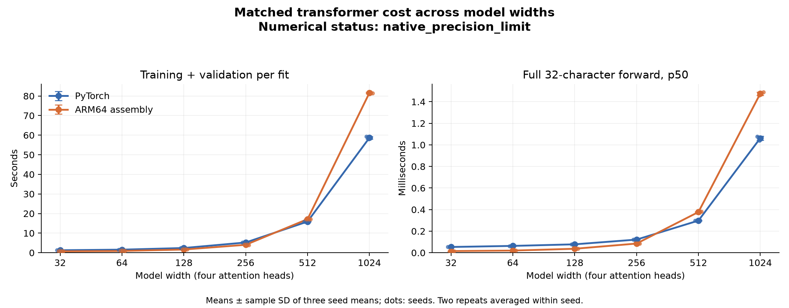
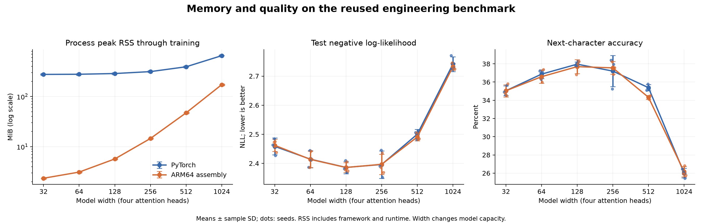

# Transformer width sweep, v6

**Publication view:** this directory contains compact metrics and audit indices. Full correctness checks, numerical failure records, admission gates, and raw evidence are retained in the [release archive](https://github.com/logannye/arm64-transformer/releases/tag/transformer-attention-precision-v6). Each JSON index records the SHA-256 and archive path of its complete source. Numerical outcomes and qualification statements below are unchanged.

The complete sweep contains **72 fits**
at widths 32, 64, 128, 256, 512, 1024:
three seeds, two timing repeats and both implementations at each width.
Each comparison uses the same initial weights, token rows and schedules within
its width/seed pair. Source revision: `2c5191047068c16b12e3312652b118d48a5f3744`.

This is the reused engineering benchmark from v1–v5, not a fresh untouched test
set. Widths and training rules were fixed before timing. Wider models change
capacity and computational cost; this report does not select a width from test quality.

## Numerical qualification

Overall status: **`native_precision_limit`**. Evidence integrity, each implementation's accuracy against independent FP64, and mutual FP32 compatibility are separate results. Full numerical qualification requires integrity and both FP64 accuracy checks. Timings remain descriptive where either implementation misses that requirement; no failed comparison is silently promoted to a pass.

| Width | Native FP64 accuracy | PyTorch FP64 accuracy | FP32 compatibility | Status |
|---:|---|---|---|---|
| 32 | True | True | True | `completed` |
| 64 | True | True | True | `completed` |
| 128 | True | True | True | `completed` |
| 256 | True | True | True | `completed` |
| 512 | True | False | False | `baseline_precision_limit` |
| 1024 | False | False | False | `native_precision_limit` |

The unchanged forward limit is `2e-5 + 2e-4*abs(reference)`. Both engines are evaluated at every selected checkpoint from both training paths. Originating predictions must replay exactly with their original batch semantics. All numerical failures are retained separately in each archived audit's `numerical_checks`.

All measured native processes requested automatic dispatch. The table records actual dense calls per fit, including validation, final test and inference samples; it does not imply every transformer operation used SME. Hardware capability, vector length and exact counters are authenticated against each width's numerical gate.

| Width | SME forward / backward | NEON forward / backward |
|---:|---:|---:|
| 32 | 0 / 0 | 94,040 / 81,920 |
| 64 | 94,040 / 81,920 | 0 / 0 |
| 128 | 94,040 / 81,920 | 0 / 0 |
| 256 | 94,040 / 81,920 | 0 / 0 |
| 512 | 94,040 / 81,920 | 0 / 0 |
| 1024 | 94,040 / 81,920 | 0 / 0 |

## Training and forward timing

| Width | Parameters | PyTorch training (s) | ARM64 training (s) | Paired training ratio |
|---:|---:|---:|---:|---:|
| 32 | 17,952 | 1.272 ± 0.005 | 0.709 ± 0.004 | 1.794× |
| 64 | 52,160 | 1.565 ± 0.005 | 0.887 ± 0.004 | 1.764× |
| 128 | 169,728 | 2.406 ± 0.002 | 1.635 ± 0.005 | 1.472× |
| 256 | 601,472 | 5.224 ± 0.048 | 4.038 ± 0.035 | 1.293× |
| 512 | 2,251,392 | 15.897 ± 0.037 | 17.136 ± 0.052 | 0.928× |
| 1024 | 8,696,960 | 58.663 ± 0.649 | 81.586 ± 0.420 | 0.719× |

The primary ratio at each width is the geometric mean of six paired
PyTorch/ARM64 training-time ratios. Above one favors assembly; below one favors
PyTorch. There is no pooled-width primary ratio or excluded unfavorable width.
Training includes validation, finite checks, checkpoint selection/writes and
history bookkeeping. Each fit performs 1,024 updates over eight epochs.

| Width | PyTorch forward p50 (ms) | ARM64 forward p50 (ms) | Ratio of mean p50s |
|---:|---:|---:|---:|
| 32 | 0.0532 ± 0.0003 | 0.0151 ± 0.0005 | 3.529× |
| 64 | 0.0633 ± 0.0004 | 0.0198 ± 0.0001 | 3.196× |
| 128 | 0.0780 ± 0.0001 | 0.0367 ± 0.0007 | 2.123× |
| 256 | 0.1218 ± 0.0007 | 0.0850 ± 0.0010 | 1.433× |
| 512 | 0.2979 ± 0.0038 | 0.3773 ± 0.0061 | 0.790× |
| 1024 | 1.0621 ± 0.0184 | 1.4757 ± 0.0153 | 0.720× |

Forward latency is one full 32-character context, batch one, after 20 warmups,
with 100 samples per fit. It excludes token loading, loss, output-probability softmax, sampling and
I/O. It is not cached next-token generation. The forward ratio uses the two
implementation means, a different statistic from the primary training ratio.

Entries and error bars are mean ± sample SD of three seed means, with the two
repeats averaged within each seed. Repeats are not independent quality seeds.
OS scheduling, temperatures and clock frequencies were not experimentally fixed.

## Throughput, memory and prediction quality

| Width | Implementation | Target ktoken/s | Training peak RSS (MiB) | Test NLL | Accuracy (%) |
|---:|---|---:|---:|---:|---:|
| 32 | PyTorch | 412.4 ± 1.5 | 276.35 ± 0.93 | 2.4585 ± 0.0292 | 35.046 ± 0.532 |
| 32 | ARM64 assembly | 739.8 ± 3.9 | 2.34 ± 0.00 | 2.4621 ± 0.0211 | 35.042 ± 0.671 |
| 64 | PyTorch | 335.0 ± 1.1 | 278.35 ± 1.16 | 2.4145 ± 0.0291 | 36.869 ± 0.494 |
| 64 | ARM64 assembly | 590.9 ± 2.8 | 3.11 ± 0.00 | 2.4138 ± 0.0282 | 36.589 ± 0.723 |
| 128 | PyTorch | 217.9 ± 0.2 | 287.63 ± 0.33 | 2.3862 ± 0.0214 | 37.964 ± 0.254 |
| 128 | ARM64 assembly | 320.7 ± 1.1 | 5.69 ± 0.00 | 2.3859 ± 0.0171 | 37.691 ± 0.778 |
| 256 | PyTorch | 100.4 ± 0.9 | 314.31 ± 0.11 | 2.3962 ± 0.0472 | 37.203 ± 1.705 |
| 256 | ARM64 assembly | 129.8 ± 1.1 | 14.56 ± 0.00 | 2.3969 ± 0.0348 | 37.557 ± 0.702 |
| 512 | PyTorch | 33.0 ± 0.1 | 392.22 ± 0.38 | 2.5003 ± 0.0167 | 35.384 ± 0.351 |
| 512 | ARM64 assembly | 30.6 ± 0.1 | 47.25 ± 0.00 | 2.4907 ± 0.0129 | 34.326 ± 0.212 |
| 1024 | PyTorch | 8.9 ± 0.1 | 653.87 ± 2.33 | 2.7412 ± 0.0255 | 26.005 ± 0.517 |
| 1024 | ARM64 assembly | 6.4 ± 0.0 | 172.59 ± 0.00 | 2.7323 ± 0.0118 | 26.160 ± 0.576 |

Throughput divides **524,288 training target characters per fit**
by the training-plus-validation timer, then averages repetitions within seed.
Validation tokens are excluded from the numerator while validation time remains
in the denominator. RSS includes the framework, runtime and data; it does not
isolate model memory. NLL and accuracy are descriptive observations, not evidence
of statistical equivalence between implementations.

Uniform and training-only unigram baselines, all per-seed quality differences,
prediction disagreements, checkpoints and individual runs are retained in the
per-width reports. The shared data audit verifies identical corpus identity,
partitions and train/validation/test rows across widths, identical schedules for
each seed, and distinct width-specific initial parameter files. No model-quality
tuning used this test set during the sweep.

## Evidence and limits

Widths 32–256 retain the strict trajectory contract; widths 512/1024 retain the explicit common-state/optimizer-replay contract and its original trajectory diagnostics. The additional prospective FP64 attention stress contract covers large competing scores, gradients, causal interventions, and independent oracles. All six widths were measured anew. All 25,076 automatic/forced regression checks and their diagnostics are indexed under `regression-preflights/`. Stored model state remains FP32; wide native attention uses selective FP64 accumulation in forward and backward. The separate numerical audit retains 147,600 comparisons, including every failed FP64 and FP32-compatibility check.

The evidence-integrity audit contains **58,462 checks**:
832 sweep consistency checks plus all per-width
post-run records. The primary automatic-policy numerical/runtime preflights contain
**8,362 checks** in total. Forced-policy gates add
**16,714 checks**. All
**589,824 retained test prediction rows** were
independently recomputed from selected checkpoints; selected validation losses
were also checked against checkpoint-selection histories. Within-implementation
repeat equality is required before quality aggregation.

- [Width 32: detailed report](width-32/README.md), [audit](width-32/audit.json) (9,605 checks), [preflight](width-32/preflight.json) (1,099 checks).
- [Width 64: detailed report](width-64/README.md), [audit](width-64/audit.json) (9,605 checks), [preflight](width-64/preflight.json) (1,101 checks).
- [Width 128: detailed report](width-128/README.md), [audit](width-128/audit.json) (9,605 checks), [preflight](width-128/preflight.json) (1,101 checks).
- [Width 256: detailed report](width-256/README.md), [audit](width-256/audit.json) (9,605 checks), [preflight](width-256/preflight.json) (1,101 checks).
- [Width 512: detailed report](width-512/README.md), [audit](width-512/audit.json) (9,605 checks), [preflight](width-512/preflight.json) (1,980 checks).
- [Width 1024: detailed report](width-1024/README.md), [audit](width-1024/audit.json) (9,605 checks), [preflight](width-1024/preflight.json) (1,980 checks).

See [summary.json](summary.json) for all observations, statistics and hashes,
[audit.json](audit.json) for the index of complete post-run evidence, and
[report-processes.json](report-processes.json) for the separate width-selected
audit subprocesses. Full raw evidence remains in the original result/input
directories. Reporting never overwrites an existing destination.

The first repeat visited ascending widths and the second descending widths;
implementation order reversed within each seed pair. Fits ran sequentially on
AC power with one CPU compute thread and 15-second pauses. Every measured entry
matches its per-width manifest exactly, with unchanged source, binary and inputs.

The scope is this short-context float32 model family on one CPU machine against
eager PyTorch. Native training still accumulates per-sequence gradients. These
results establish neither fresh test-set generalization nor GPU, long-context,
graph-compiled PyTorch, energy, cached decoding or production-serving performance.
Historical v1–v5 comparisons remain separate campaigns with different conditions.
