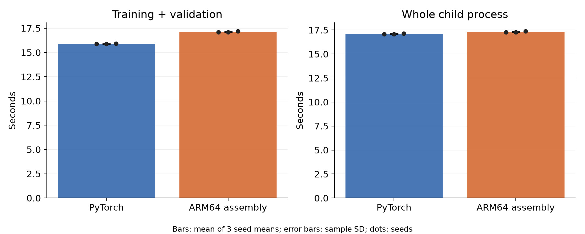
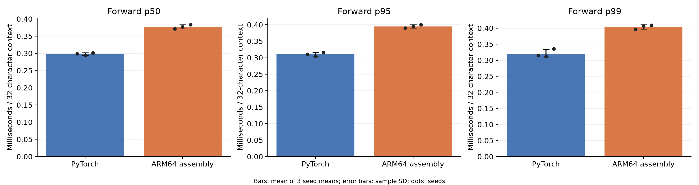
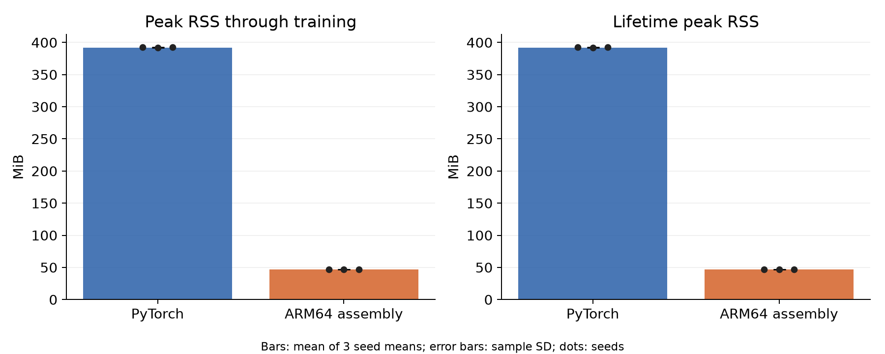
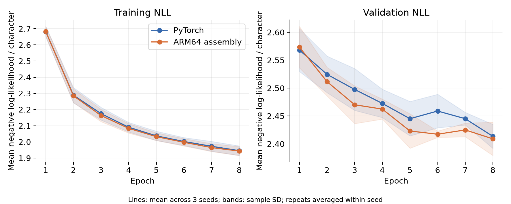

# Higher-precision attention study, v6, width 512

**Publication view:** this directory contains compact metrics and audit indices. Full correctness checks, numerical failure records, admission gates, and raw evidence are retained in the [release archive](https://github.com/logannye/arm64-transformer/releases/tag/transformer-attention-precision-v6). Each JSON index records the SHA-256 and archive path of its complete source. Numerical outcomes and qualification statements below are unchanged.

The implementation preserves the transformer and training budget while making
attention score precision an explicit hardware-design choice. Both engines are
replayed at every selected checkpoint, regardless of which engine trained it.
Independent NumPy FP64 equations evaluate the exact saved FP32 weights.

## Numerical result

Status: **`baseline_precision_limit`**. The evidence is intact, but this width did not meet the full matched FP64 accuracy requirement. Timings and quality are retained descriptively; no numerically qualified speedup is claimed.

The post-run contract is `v6-fp64-centered-attention-v1`. Each native and production
PyTorch prediction is compared with FP64 using the unchanged forward limit
`abs(error) <= 2e-5 + 2e-4*abs(FP64)`. PyTorch FP32 compatibility is separately
reported, with its actual passing or failing records preserved.

| Numerical comparison | Checks | Failed checks | Failed coordinates |
|---|---:|---:|---:|
| Native versus independent FP64 | 6,156 | 0 | 0 |
| Production PyTorch versus independent FP64 | 6,156 | 4 | 4 |
| Native versus production/functional PyTorch FP32 | 12,288 | 12 | 12 |

Counts cover every test and validation sequence at all 12 selected checkpoints,
including repeated fits, plus per-engine validation-NLL comparisons. Coordinates
are individual logits or NLL scalars. They are not independent statistical samples.
The first and last sequence of each split also cross-check NumPy FP64 against
independent functional PyTorch FP64 at fixed absolute/relative limits of `1e-10`.

The originating engine reproduced saved test logits bit-exact, using its original
evaluation grouping (batch 16 for PyTorch; individual sequences for native).
Its validation loss reproduced the selected history entry exactly. Within-engine
repeat weights, moments, saved logits and non-timing histories also matched exactly.
Evidence-integrity checks passed: **9,605**.

## Matched measurements

| Measurement | PyTorch | ARM64 assembly |
|---|---:|---:|
| Training + validation (s) | 15.897 ± 0.037 | 17.136 ± 0.052 |
| Full-context forward p50 (ms) | 0.2979 ± 0.0038 | 0.3773 ± 0.0061 |
| Peak RSS through training (MiB) | 392.22 ± 0.38 | 47.25 ± 0.00 |
| Test NLL | 2.50028 ± 0.01673 | 2.49065 ± 0.01288 |
| Test accuracy (%) | 35.384 ± 0.351 | 34.326 ± 0.212 |

Entries are mean ± sample SD across three seed means, after averaging two repeats
within each seed. The geometric mean of six paired PyTorch/native training-time
ratios is **0.927697**; values above one favor native. This descriptive statistic
does not override the qualification status above.

## Fixed workload and scope

One causal decoder block, width 512, 2,251,392 parameters,
four heads, context 32, feed-forward width twice the model width, ASCII-128 output,
FP32 parameters and optimizer state. The pinned Tiny Shakespeare benchmark uses
65,536 training and 8,192 validation/test targets. Seeds 42/43/44, eight epochs,
batch 16 and 1,024 Adam updates are unchanged. Minimum epoch validation NLL selects
the checkpoint; test predictions are evaluated afterward.

This is a reused engineering benchmark. Exposed v5 failures inform development
and remain failed in their original reports. V6 admission adds prospectively
declared synthetic stress tests and independent FP64 checks. It does not claim a
fresh untouched corpus assessment or equivalence of independent training paths.

Training timing includes forward/backward, Adam, finite checks, validation and
checkpoint/history work. Setup, final test and inference samples are excluded.
Forward timing is batch one over a full 32-character context, including attention
softmax, with 20 warmups and 100 samples per fit; it excludes output probability
softmax, sampling and I/O. RSS includes the framework/runtime and loaded data.
One compute thread, serial children, alternating/reversed order and 15-second
pauses remain fixed. Operating-system clocks and scheduling are not controlled.

## Every measured fit

| Seed | Repeat | Implementation | Train (s) | Test NLL | Best epoch |
|---:|---:|---|---:|---:|---:|
| 42 | 1 | PyTorch | 15.7668 | 2.506151 | 8 |
| 42 | 1 | ARM64 assembly | 16.9589 | 2.505447 | 6 |
| 43 | 1 | ARM64 assembly | 17.0488 | 2.481982 | 5 |
| 43 | 1 | PyTorch | 15.8076 | 2.481407 | 6 |
| 44 | 1 | PyTorch | 15.9648 | 2.513284 | 8 |
| 44 | 1 | ARM64 assembly | 17.1722 | 2.484527 | 8 |
| 42 | 2 | ARM64 assembly | 17.2435 | 2.505447 | 6 |
| 42 | 2 | PyTorch | 15.9835 | 2.506151 | 8 |
| 43 | 2 | PyTorch | 15.9437 | 2.481407 | 6 |
| 43 | 2 | ARM64 assembly | 17.1705 | 2.481982 | 5 |
| 44 | 2 | ARM64 assembly | 17.2197 | 2.484527 | 8 |
| 44 | 2 | PyTorch | 15.9131 | 2.513284 | 8 |

Measured revision: `2c5191047068c16b12e3312652b118d48a5f3744`. Hardware: Apple M4 Max.
Platform: `macOS-26.2-arm64-arm-64bit`. PyTorch: `2.14.1`.
Preflight contract: `v5-common-state-replay-v1`. Auto/forced backend gates
contain 5,938 blocking checks.
All 98,304 saved test prediction rows and
their per-run metrics and numerical counts appear in [summary.json](summary.json).
[audit.json](audit.json) indexes the complete numerical evidence in the release archive. Raw checkpoints, fixtures, source, binaries and timings
are authenticated in the accompanying evidence bundle.
